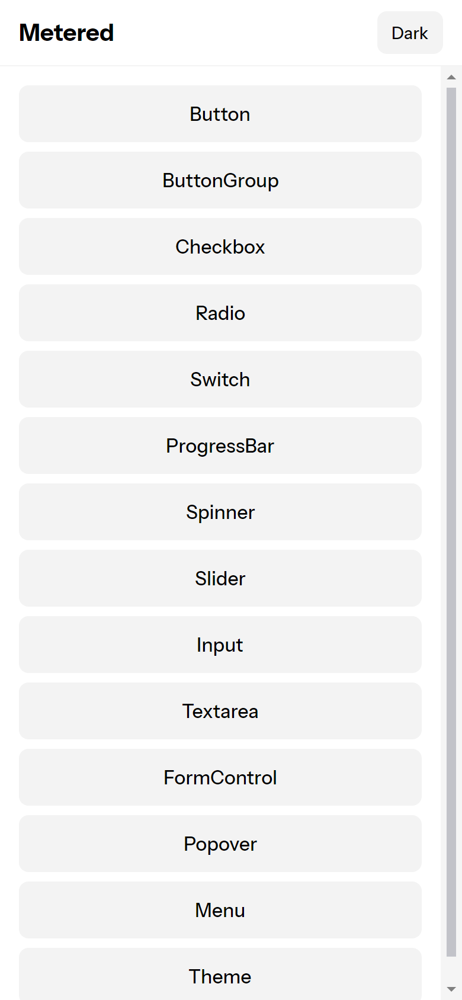
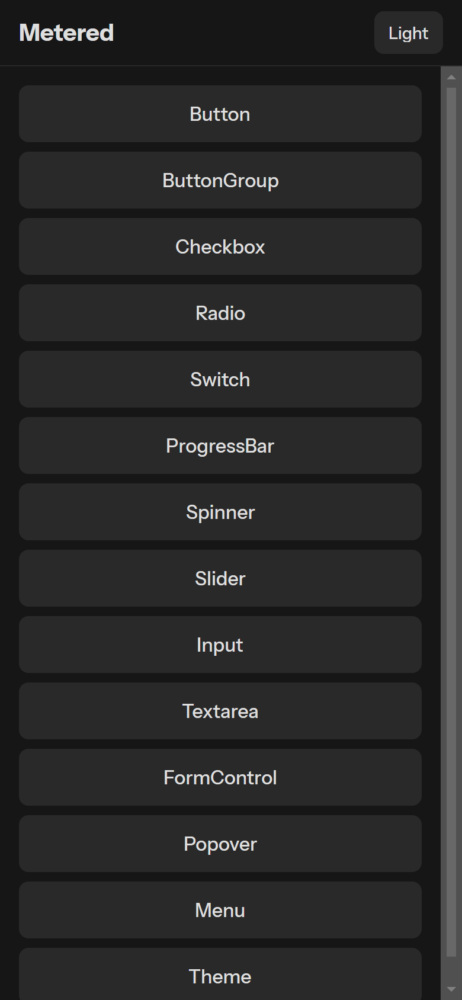
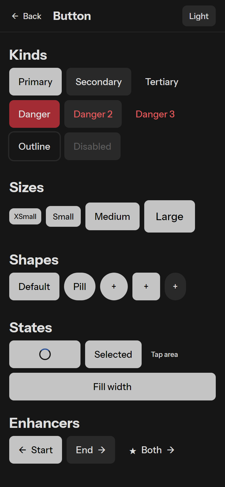
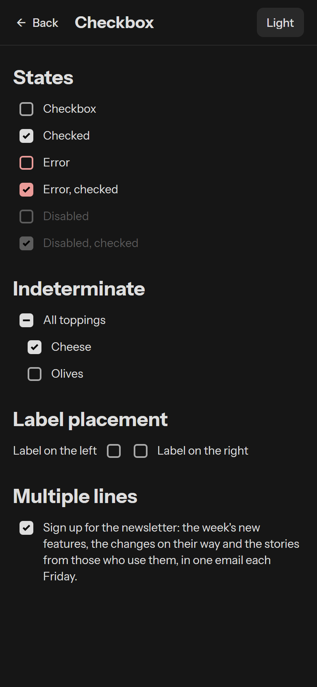
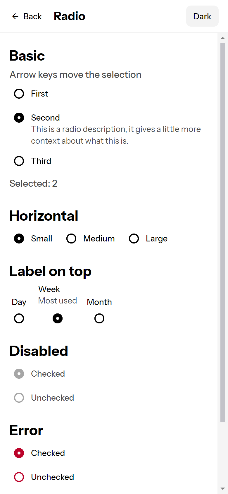
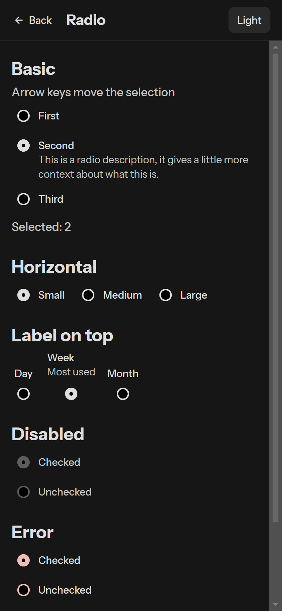
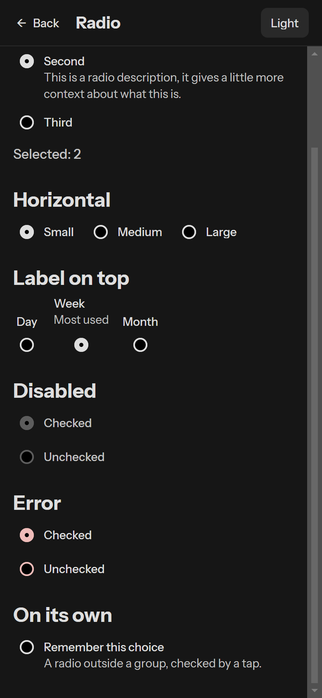
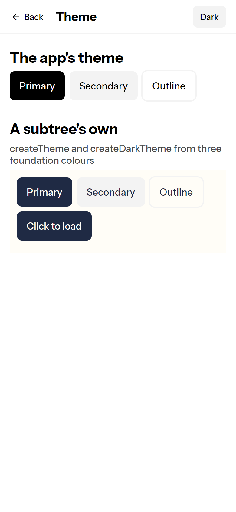
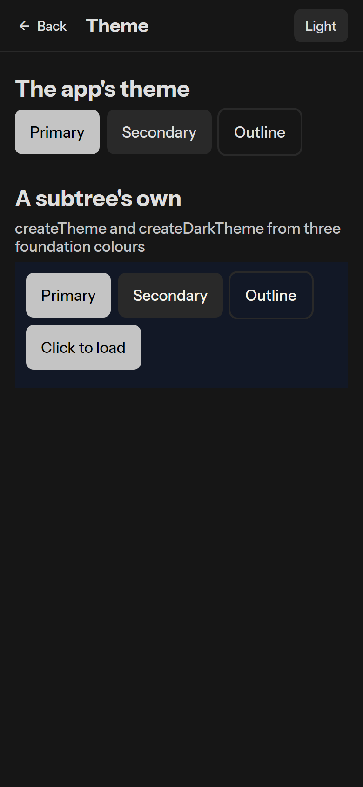

# Preview

What Metered looks like today: the sample ([`samples/Metered.Sample`](samples/Metered.Sample/SampleShell.axaml)) in
its desktop window at a phone's 390 × 844, its list and each page, light and dark, one screen per picture. The bar
across the top is the sample's own: Back, the page's title, and the Light/Dark switch, made of Metered's Buttons.
Base Web's families are drawn in Instrument Sans and Figtree, the OFL substitutes for Uber Move
([ADR 0003](docs/decisions/0003-font.md)). Each control's comparison with Base Web, what matches, what differs and
why, is in [`docs/controls/`](docs/controls/).

The pictures are drawn headless, with Skia, by
[`PreviewGallery`](tests/Metered.Tests/Sample/PreviewGallery.cs), from the sample's own window, so they are the
theme's own pixels and can be drawn again on any OS:

```sh
METERED_PREVIEW=/absolute/folder dotnet test tests/Metered.Tests --filter FullyQualifiedName~PreviewGallery
```

Unset, it does nothing; set, it must name an absolute folder that is new or empty. Its pictures replace
`docs/preview/`.

## The list

A Button for each page in the catalogue, one per control.

<p>


</p>

## Button

The seven kinds and disabled, the four sizes, the shapes, the selected state, the tap area (an XSmall button that
takes taps in a 48 px band), the fill width, and the start and end enhancers.

<p>


</p>

## ButtonGroup

A radio group, a checkbox group of small pills with what was clicked under it, and a group that wraps.

<p>


</p>

## Checkbox

Base Web's checkbox-v2: its states (checked, error, disabled), a parent indeterminate while only some of its children
are checked, the label on the left and on the right, and a label of several lines.

<p>


</p>

## Radio

Base Web's radio-v2: a group with a description and its selection under it, a horizontal group, the label on top
(the marks in a line under labels of different heights), disabled, in error, and a radio on its own.

<p>


</p>
<p>


</p>

## Switch

Base Web's switch, as its documentation's examples: basic with its state under it, a label over several lines,
disabled off and on, the label left and right, the two sizes, and the checkmark.

<p>


</p>
<p>


</p>

## Theme

Buttons under the app's theme, then the same in a subtree given its own by `ThemeProvider`, built by
`BaseTheme.CreateTheme` and `CreateDarkTheme` from three foundation colours ([`docs/theming.md`](docs/theming.md)).

<p>


</p>

## Not shown

The pages at rest only. Hover, press and the keyboard's focus ring are in the Button's frames
([`docs/controls/Button/`](docs/controls/Button/)); the loading spinner turns, and the background's 200 ms
transition moves, which still pictures can't show. The shell's Debug line under the title (what a page cost to open,
[`docs/performance/README.md`](docs/performance/README.md)) is turned off for the pictures, as its times change on
every run. The scroll bar is Avalonia's Simple theme, which the sample puts under Metered's for the controls Metered
doesn't theme yet.
