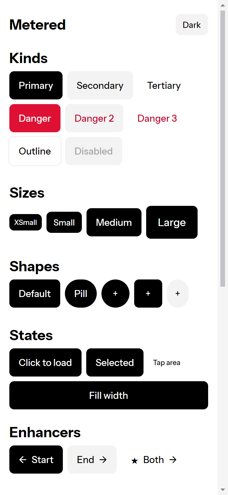
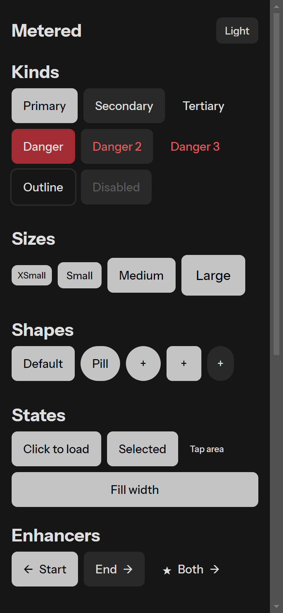
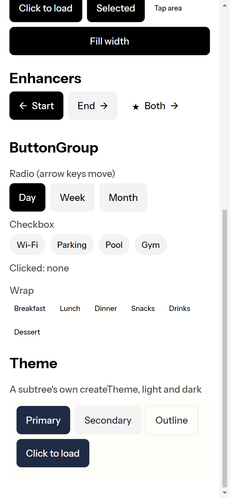
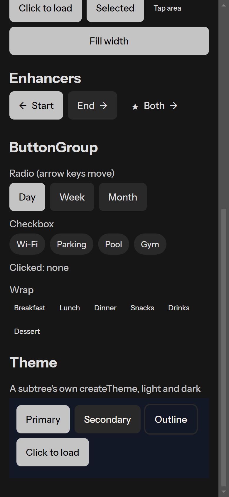

# Preview

What Metered looks like today: the desktop sample's one page
([`samples/Metered.Sample.Desktop`](samples/Metered.Sample.Desktop/MainWindow.axaml)) at its phone-sized 390 × 844,
light and dark, one screen per picture. Base Web's families are drawn in Instrument Sans and Figtree, the OFL
substitutes for Uber Move ([ADR 0003](docs/decisions/0003-font.md)). Each control's comparison with Base Web, what
matches, what differs and why, is in [`docs/controls/`](docs/controls/).

The pictures are drawn headless, with Skia, by
[`PreviewGallery`](tests/Metered.Tests/Sample/PreviewGallery.cs), from the sample's own window, so they are the
theme's own pixels and can be drawn again on any OS:

```sh
METERED_PREVIEW=/absolute/folder dotnet test tests/Metered.Tests --filter FullyQualifiedName~PreviewGallery
```

Unset, it does nothing; set, it must name an absolute folder that is new or empty. Copy its pictures over
`docs/preview/`.

## Button

The seven kinds and disabled, the four sizes, the shapes, the selected state, the tap area (an XSmall button that
takes taps in a 48 px band), the fill width, and the start and end enhancers. Dark is the sample's own switch, top right.

<p>


</p>

## ButtonGroup and a subtree's theme

The second screen ends the page, so its top repeats the end of the first. ButtonGroup as a radio group, as a
checkbox group of small pills, and wrapping. Under them, a subtree given its own
theme by `ThemeProvider`, built by `BaseTheme.CreateTheme` and `CreateDarkTheme` from three foundation colours
([`docs/theming.md`](docs/theming.md)).

<p>


</p>

## Not shown

The page at rest only. Hover, press and the keyboard's focus ring are in the Button's frames
([`docs/controls/Button/`](docs/controls/Button/)); the loading spinner turns, and the background's 200 ms
transition moves, which still pictures can't show. The scroll bar is Avalonia's Simple theme, which the sample
puts under Metered's for the controls Metered doesn't theme yet.
