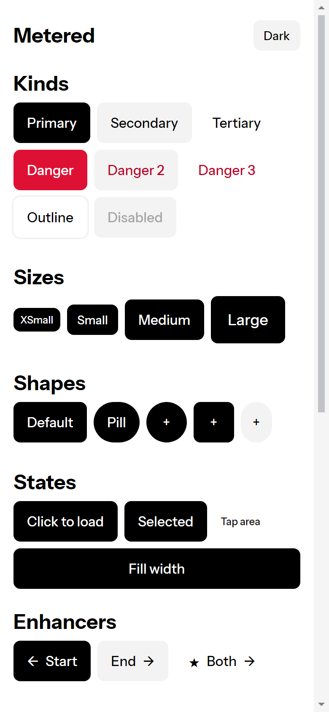
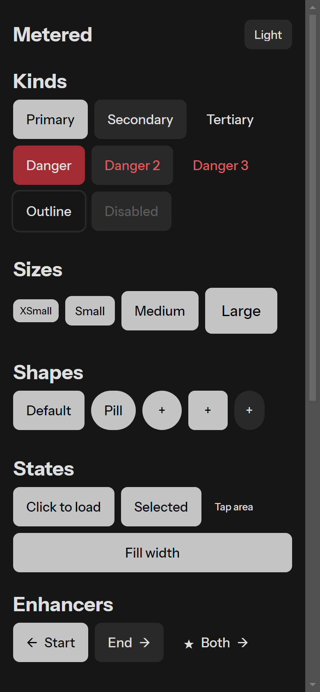
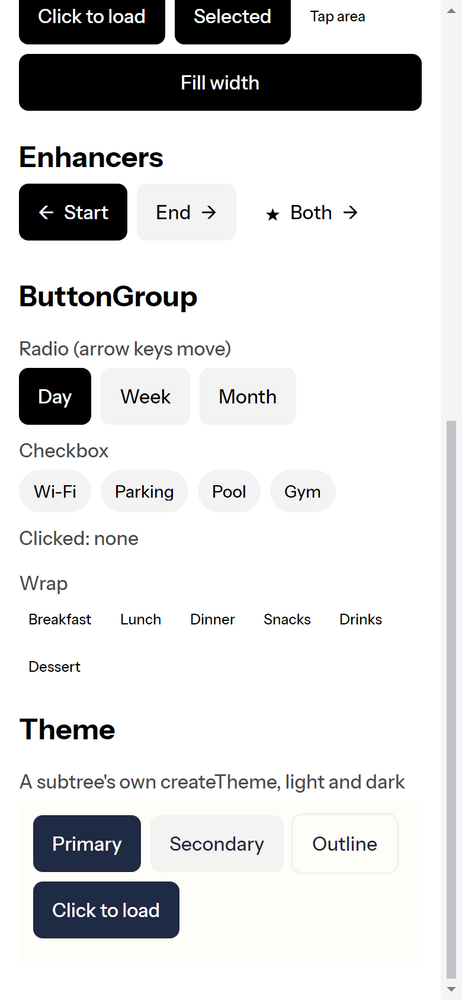

# Metered

A faithful reproduction of Uber's [Base design system](https://baseweb.design) (Base Web, npm
`baseui`) for [AvaloniaUI](https://avaloniaui.net/), mobile first. Not affiliated with or endorsed
by Uber or the AvaloniaUI team.

<p>



</p>

The desktop sample, drawn headless. More in [PREVIEW.md](PREVIEW.md).

> **Status: early, not yet published.** Two controls, Button and ButtonGroup, on the tokens, the
> parts and states, Base Web's overrides API and its theme builder. The inventory of controls is
> next; see [`docs/ROADMAP.md`](docs/ROADMAP.md).

## What "faithful" means here

- **Measured, not remembered.** The tokens are generated from the pinned `baseui` package's own
  themes, and the controls are tested against Base Web's own style functions, evaluated for each
  kind, size, shape and state (`tools/reference/`).
- **Base Web's names.** Every token under its own name (`colors.buttonPrimaryFill`,
  `sizing.scale600`); every prop, part and override key as Base Web has it.
- **The overrides API.** Each control's named parts take `Overrides`: Base Web's `style`, `props`
  and `component`, per part, nested ([ADR 0001](docs/decisions/0001-parts-states-and-overrides.md)).
- **The theme builder.** Base Web's `createTheme` and `createDarkTheme` as
  `BaseTheme.CreateTheme` and `CreateDarkTheme`, every derived token written out, and
  `ThemeProvider` for a subtree ([ADR 0002](docs/decisions/0002-theme-builder.md),
  [`docs/theming.md`](docs/theming.md)).
- **Fonts are substituted.** Uber Move is proprietary and isn't shipped. Base Web's two families map
  to Instrument Sans (UberMoveText) and Figtree (UberMove), OFL fonts chosen by measurement against
  baseweb.design ([ADR 0003](docs/decisions/0003-font.md)). The tests and the sample embed them and
  map the families (`samples/Metered.Sample.Desktop/Program.cs`); the packages don't carry them yet.

## Packages

| Package | Contents |
|---|---|
| `Metered` | Everything: the one most apps want |
| `Metered.Controls` | The controls and the overrides API, no visual opinion |
| `Metered.Themes` | Base Web's light and dark themes: `BaseTheme`, and the theme builder and `ThemeProvider` |

Targets .NET 8, Avalonia 12.

```xml
<Application.Styles>
  <b:BaseTheme xmlns:b="using:Metered.Themes" />
</Application.Styles>
```

## Building

```sh
npm install                 # Base Web's package, pinned, for the generators (not committed)
dotnet build Metered.sln
dotnet test  Metered.sln
```

## Attribution

Metered reproduces the design of Uber's Base design system and Base Web (© Uber Technologies, Inc.,
MIT licensed; the notice is in [`src/Metered.Themes/LICENSE-baseweb.txt`](src/Metered.Themes/LICENSE-baseweb.txt)).
It is an independent implementation for the AvaloniaUI ecosystem and is not affiliated with or
endorsed by Uber or the AvaloniaUI team. Uber and Uber Move are trademarks of Uber Technologies, Inc.

## Licence

Apache License 2.0; see [LICENSE](LICENSE).
