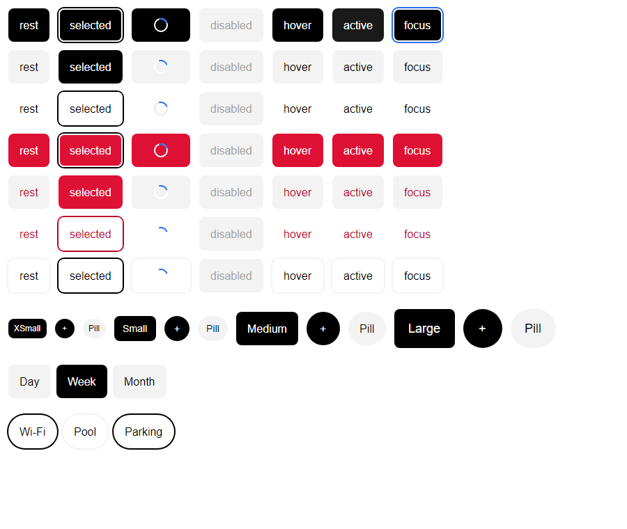
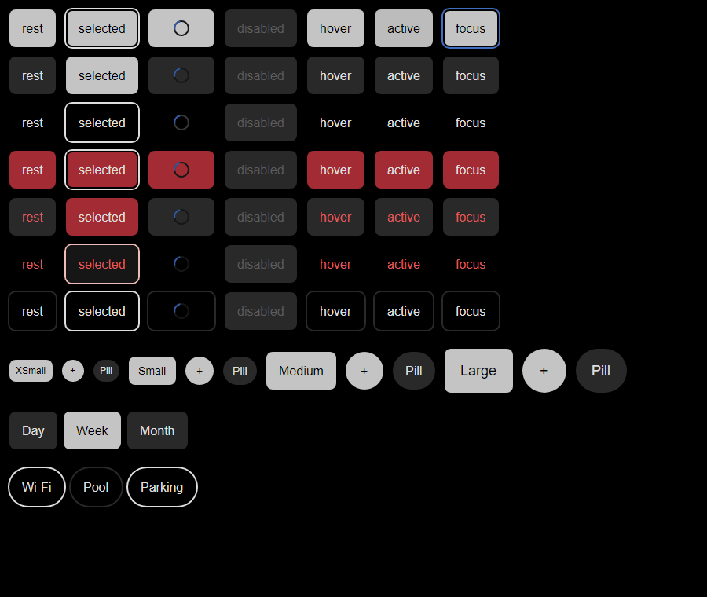

# Button

Base Web's `Button` (baseui 18.2.0, `button/`), as `Metered.Controls.Button`, an Avalonia `Button`.

Each row is a kind (primary, secondary, tertiary, dangerPrimary, dangerSecondary, dangerTertiary,
outline), each column a state; then the four sizes with the circle and pill shapes, and two
ButtonGroups. Drawn by `Controls/ButtonFrames` with `METERED_FRAMES` set, in Inter, as Uber Move isn't
available.

## API

| Base Web | Metered |
|---|---|
| `kind` | `Kind` (`ButtonKind`, with `Outline`, Base Web's button-group-only kind) |
| `size` | `Size`: all seven names (`mini` = `xSmall`, `compact` = `small`, `default` = `medium`) |
| `shape` | `Shape`: all seven names (`default` = `rectangular`, `rounded` = `pill`) |
| `widthType` | `WidthType` |
| `minHitArea` | `MinHitArea` |
| `isLoading` | `IsLoading` (no click while loading) |
| `isSelected` | `IsSelected` |
| `backgroundSafe` | `BackgroundSafe` |
| `startEnhancer`, `endEnhancer` | `StartEnhancer`, `EndEnhancer`; `artworkSize` is `ArtworkSize` |
| `disabled` | `IsEnabled` |
| `onClick` | `Click`, `Command` |
| `overrides` | `Overrides`: `BaseButton` (or `Root`), `StartEnhancer`, `EndEnhancer`, `StartEnhancerButtonContentContainer`, `LoadingSpinnerContainer`, `LoadingSpinner` |
| `colors` | not yet |

## Held by

- `ButtonColourTests`: 308 cases (each kind × 11 states × backgroundSafe × light and dark): the
  `BaseButton` part's background, text colour and box-shadows against Base Web's own style function.
  Hover, press and keyboard focus are real input.
- `ButtonLayoutTests`: 40 cases (each size × shape × width type): padding, radius, sizes, type,
  and the laid-out height.
- `ButtonPartsTests`: the spinner (112 cases), loading, the enhancers, `artworkSize`, touch not
  hovering, the tap band, and the parts' mirrored state.
- `ButtonFrames`: the hover overlay's and the focus ring's pixels.

## Known differences

1. **`component` replaces a part's theme, not its element** (ADR 0001).
2. **Loading height** is the larger of the content's and the spinner's; Base Web's is the
   spinner's, as it squashes the content to no height. The same for text at every size.
3. **`StartEnhancerButtonContentContainer` is always there**; Base Web renders it only for
   `widthType="fill"`, so an override of it applies in more cases here.
4. **`outline`'s hover overlay** is Base Web's `::after` (a fill and a ring) drawn as the button's
   own box-shadows, first, on top.
5. **The spinner's arc** ends square; a CSS border's colour changes on a diagonal mitre.
6. **`round`** (deprecated) is drawn with a 999 radius: Base Web's 50% makes an ellipse of a
   button that isn't square.
7. **`minHitArea="tap"`** widens the Button's bounds to the 48 px band after layout (spikes);
   `Bounds` is the band, the `BaseButton` part keeps the button's own size.
8. **Fonts**: Base Web's stack starts with Uber Move, which isn't shipped; Avalonia falls back
   along it to the platform's default.
