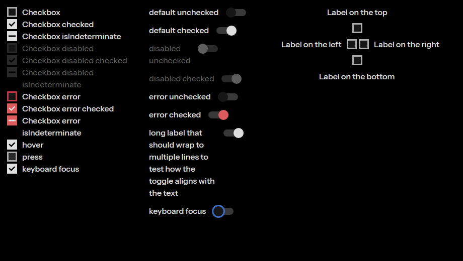

# Checkbox

Base Web's checkbox-v2 `Checkbox` and `StatefulCheckbox` (baseui 18.2.0, `checkbox-v2/`), as
`Metered.Controls.Checkbox`, an Avalonia `CheckBox`.

The sample's page, drawn headless by `PreviewGallery` in Instrument Sans, the substitute for Uber Move Text
([ADR 0003](../../decisions/0003-font.md)).

Base Web's own scenarios, drawn headless by `Controls/CheckboxFrames` with `METERED_FRAMES` set:
`checkbox-v2-states` (the left column), `checkbox-v2-placement`, and `checkbox-v2`'s "click me" and its long label in
a 200 px box. Under the states: a mouse pressed on "press" and keyboard focus on "keyboard focus"; in the `-hover`
frames, a mouse over "hover" instead (one pointer a frame).

## Which checkbox

Base Web 18.2.0 ships two: `baseui/checkbox` (v1: `STYLE_TYPE` default and toggle, four label placements) and
`baseui/checkbox-v2`. At 18.2.0 (commit `3adb0478c965`, the one whose `package.json` is 18.2.0: the repository has no
`v18` tags) the v1 page, `documentation-site/pages/components/checkbox.mdx`, says it is about to be deprecated in favour
of two components, Checkbox-v2 and Switch. Metered reproduces Base Web's v2 controls (the developer's decision of
2026-11-17), so `Checkbox` is checkbox-v2, as `Radio` is radio-v2. The v1 toggle style is Base Web's `Switch` now: an
app that had `CheckmarkType="Toggle"` moves to Metered's `Switch` (#43).

## API

| Base Web | Metered |
|---|---|
| `checked` | `IsChecked` (Avalonia's `null` is drawn indeterminate too) |
| `isIndeterminate` | `IsIndeterminate`: a click toggles `IsChecked` and leaves it, as Base Web's `StatefulCheckbox` does |
| `labelPlacement` | `LabelPlacement` (`CheckboxLabelPlacement`: `Right`, the default, or `Left`) |
| `error` | `Error` |
| `disabled` | `IsEnabled` |
| `children` | `Content`, the label (text or a control); none, or an empty string, and the `Label` part isn't shown |
| `onChange` | `IsCheckedChanged`, `Click`, `Command` |
| `overrides` | `Overrides`: `Root`, `CheckmarkContainer`, `Checkmark`, `Label` |
| `title` | `ToolTip.Tip` |
| `onMouseEnter`, `onFocus`, `onKeyDown`, … | Avalonia's own events |
| `containsInteractiveElement` | not needed: a control in the label takes its own press |
| `inputRef`, `autoFocus`, `id`, `name`, `value`, `required`, `aria-*` | not yet: Avalonia's focus and `AutomationProperties` |

**Top and bottom placements aren't there.** checkbox-v2's `constants.js` keeps only right and left, with the note
"top and bottom label placements are deprecated from checkbox v2", and its alternatives: a left or right placement, or
the checkbox with no label inside a container of the app's own. Its `checkbox.js` renders the label only for left and
right, so a v2 checkbox given top or bottom shows no label at all. Metered's `CheckboxLabelPlacement` has the two v2
keeps; an app with `LabelPlacement="Top"` or `"Bottom"` (v1's) puts a label of its own above or below a checkbox with
none.

Parts: `Root` (a `RadioRootPanel`, radio-v2's root: the row, the label first for the left placement),
`CheckmarkContainer` (a `Border`, the backplate), `Checkmark` (a `CheckboxMark`: radio-v2's `RadioMark`, a box with CSS's
outline and its offset, that also draws Base Web's background image, the tick or the dash), `Label` (a
`ContentPresenter`, drawn as given: no access key). The pointer states are `BackplatePointer`'s, the same as the radio's.
`CheckboxAutomationPeer` reports an indeterminate box as mixed, as Base Web's input's `indeterminate` does, and its
toggle is a click (`Click` and `Command` run).

## Behaviour, as Base Web's

- The box is 17 px, its 2 px border `contentTertiary`, radius 4, nothing inside; checked or indeterminate, it fills
  with `contentPrimary` under a transparent border and shows the tick or the dash (`contentInversePrimary`, Base Web's
  17 px SVG of a 24 px viewBox, centred over the box); error, `tagRedContentSecondary`; disabled,
  `contentStateDisabled`. The fill and the border change over 200 ms (`timing200` on `easeOutCurve`), not on the first
  appearance.
- The container (8 padding, 8 radius, at least 32) tints under a mouse and while pressed; the unchecked box itself tints
  while the mouse is anywhere over the checkbox, and while pressed. Error uses the negative tints; disabled, none.
- Keyboard focus: the unchecked box's border `borderSelected`, and an outline of 2 px of `brandBorderAccessible`, 2 px
  from the box. A mouse's focus shows nothing. The outline is the checkbox's own (unlike a radio on its own, whose
  focus ring is its group's).
- Space toggles it, as the native input; Enter toggles it when it is let go (checkbox.js's `onKeyUp`). Either held is a
  press (`onKeyDown`): the unchecked box takes the pressed tint, the container doesn't (it isn't the input's ancestor).
- A press is any pointer's on the checkbox (`onMouseDown`), ended by any button's release and by the pointer leaving the
  checkbox (`onMouseLeave`, which radio-v2's doesn't clear); coming back with the button held doesn't press it again. The
  container's own tint is the primary button's or a finger's (CSS's `:active`), until it is let go.
- The label in `ParagraphSmall`, `contentPrimary` (`contentStateDisabled` disabled), 6 down so its first line sits by
  the box and 4 from the container on its side. The checkbox hugs its content (`inline-flex`) and its label wraps in
  the room left.
- A coarse pointer (a phone or tablet) pads the checkbox by 8 all round, a 49 px target, so a tap 8 outside the
  container still toggles it.

## Held by

- `Controls/CheckboxColourTests`: 128 cases (checked × indeterminate × error × rest, mouse over the container, mouse
  over the label, mouse pressed, finger pressed, keyboard focus, Space held, and disabled; light and dark): the box's
  fill, border, glyph, the glyph's size, viewBox and colour, the outline, the container's fill and the label's colour
  against Base Web's style functions. The states are real input.
- `Controls/CheckboxLayoutTests`: 4 cases (placement × pointer): the parts' lengths and type, and where layout puts them;
  a long label wrapping in a 200 px box; no label (6 in all).
- `Controls/CheckboxPartsTests`: click, the tap area, Space and Enter, keys held, the indeterminate scenario, null as
  indeterminate, disabled, hover over the label and the container, a finger, the mouse leaving, focus by mouse and
  keyboard, focus and keys in the label, Enter's press and its own release, a finger dragged off, mirrored states, the
  label only when given, the coarse pointer, automation, a control as the label, disabling, a label drawn as given,
  overrides and the transition, any button's release, a finger leaving, the focus leaving during a key's and a mouse's press: 31 in all.
- `Controls/CheckboxFrames`: the tick's pixels at 17 px over the box, the border, the outline beyond its gap, and the
  container's and the box's hover tints one over the other (4, and the gallery).
- `Sample/CheckboxPageTests`: the sample's page, 3.

The part themes are generated (`tools/tokens/checkbox.js`) by the engine radio-v2's use too (`tools/tokens/parts.js`):
checkbox-v2's style functions evaluated on Base Web's theme with each colour replaced by its own name, for every
combination of the states, written as the fewest layered state styles (each naming only the states that must be on,
as Base Web's if-chains decide) and checked against Base Web's for every combination. The oracle
(`tools/reference/checkbox.js`) evaluates the same functions on the real light and dark themes.

## Known differences

1. **No `Input` part.** Base Web's hidden native input is the `Checkbox` itself: it takes focus and keys. An `Input`
   override has nothing to apply to.
2. **Hover is a mouse's; a press is any pointer's.** Base Web's `$isHovered` comes from `mouseenter`, which a phone's
   browser fires on a tap and keeps until the next tap elsewhere; here a finger never hovers (ADR 0001). Its
   `$isActive` comes from `mousedown`, which a phone's browser sends with the `mouseup` after the finger lifts, so a
   finger held on a Base Web checkbox never shows the box's pressed tint (the container's CSS `:active` is the browser's); here it shows
   both while held, as the radio does (`BackplatePointer`).
3. **`@media (pointer: coarse)` is the platform**: Android and iOS are coarse, desktops fine, whatever pointer a
   touch-screen laptop has.
4. **The root is radio-v2's panel** (`RadioRootPanel`): Base Web orders the label before the container in its markup for
   the left placement; here the panel's `LabelFirst` lays it out first.
5. **The glyph is drawn over the border**, where CSS draws a background image under it: the glyph never reaches the
   border, which is transparent wherever there is one (or, disabled, the fill's colour), so the pixels are the same.
6. **Enter is the checkbox's.** Base Web toggles on any Enter let go on its input, one pressed on another control
   whose release finds the checkbox focused included, and lets the press go on to the page. Here only an Enter pressed
   on the checkbox toggles it, and the checkbox takes it, so a default button doesn't act on it too. A key held as the
   focus leaves ends the press, which Base Web's `isActive` keeps until a key goes up on its input.
7. **The container's hover is its rectangle**; a browser's follows its rounded corners.
8. **`containsInteractiveElement`**: Avalonia's controls take their own press, so a control in a label never toggles
   the checkbox; Base Web's does unless the prop is set.
9. **The not-allowed cursor isn't shown.** Avalonia doesn't hit-test a disabled control, so the cursor is its
   parent's. The theme still sets Base Web's (`Cursor` No), as the radio's does.
10. **RTL** isn't done: Base Web mirrors the label's padding.
11. **Fonts**: Base Web's stack starts with Uber Move, which can't ship ([ADR 0003](../../decisions/0003-font.md)), so a
    label wraps a little differently from baseweb.design's.
12. **Transparent** is Avalonia's `#00FFFFFF` where Base Web's is `#00000000`; both draw nothing.
