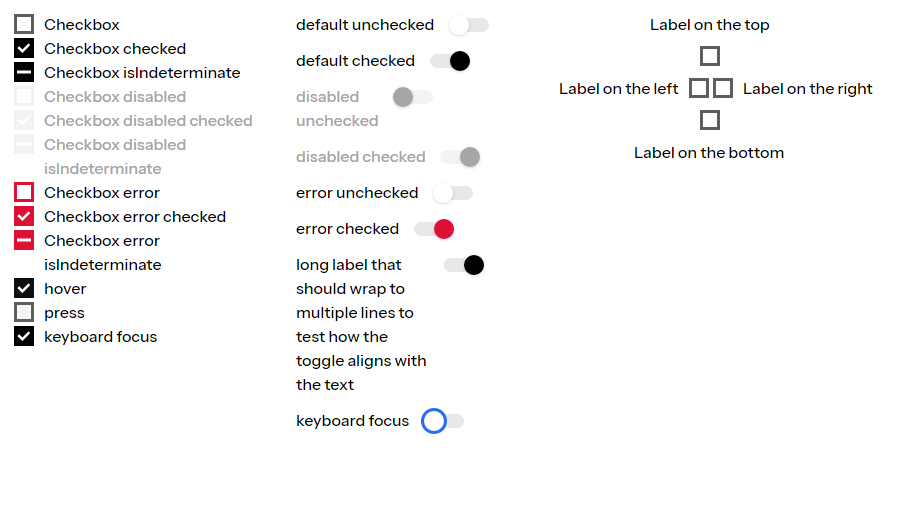

# Checkbox

Base Web's `Checkbox` (baseui 18.2.0, `checkbox/`), as `Metered.Controls.Checkbox`, an Avalonia `CheckBox`:
a box with a tick or, with `CheckmarkType="Toggle"`, a knob on a track.

Base Web's own scenarios: `checkbox-states` (the left column), `checkbox-toggle` (the middle column,
200 px wide) and `checkbox-placement`. Under the states: a mouse pressed on "press" and keyboard focus
on the last toggle above; a mouse over "hover" and keyboard focus on "keyboard focus" in the frames
`checkbox-gallery-light-hover.png` and `checkbox-gallery-dark-hover.png` (one pointer and one focus a
frame). Drawn headless by `Controls/CheckboxFrames` with `METERED_FRAMES` set, in
Instrument Sans, the substitute for Uber Move Text ([ADR 0003](../../decisions/0003-font.md)).

## Which checkbox

Base Web 18.2.0 ships two: `baseui/checkbox` (v1: `STYLE_TYPE` default and toggle, four label
placements) and `baseui/checkbox-v2` (a different look, left and right only, no toggle: its toggle
became `baseui/switch`). baseweb.design's sidebar at 18.2.0 (`documentation-site/routes.jsx`, at
commit 3adb0478c9, the one whose `package.json` is 18.2.0: the repository has no `v18.2.0` tag)
lists **Checkbox** at `/components/checkbox`, the v1 page, with its toggle example; Checkbox-v2 is
its own entry. The v1 page carries a notice that it is to be deprecated in favour of Checkbox-v2 and
Switch. Metered's `Checkbox` is v1.

## API

| Base Web | Metered |
|---|---|
| `checked` | `IsChecked` (Avalonia's `null` is drawn indeterminate too) |
| `isIndeterminate` | `IsIndeterminate`: a click toggles `IsChecked` and leaves it, as Base Web's `StatefulCheckbox` does |
| `checkmarkType` | `CheckmarkType` (`CheckboxStyleType`: `Default`, `Toggle`; `toggle_round` is `toggle`) |
| `labelPlacement` | `LabelPlacement` (`LabelPlacement?`): unset, right, or left for the toggle (`ActualLabelPlacement`) |
| `error` | `Error` |
| `disabled` | `IsEnabled` |
| `children` | `Content`, the label (text or a control); none, and there's no Label part |
| `onChange` | `IsCheckedChanged`, `Click`, `Command` |
| `overrides` | `Overrides`: `Root`, `Checkmark`, `Label`, `ToggleTrack`, `Toggle` |
| `title` | `ToolTip.Tip` |
| `inputRef`, `autoFocus`, `id`, `name`, `value`, `required`, `aria-*` | not yet: Avalonia's focus and `AutomationProperties` |
| `containsInteractiveElement` | not yet |

Parts: `Root` (a `LabelPlacementPanel`, the flex line), `Checkmark` and `Toggle` (`CheckboxMark`, a
box that also draws Base Web's background-image glyph and CSS's outline), `ToggleTrack` (`Border`),
`Label` (`ContentPresenter`, drawn as given: no access key). As Base Web renders the checkmark or the
toggle, never both, there are two templates, the toggle's chosen by `:toggle`. `:active` is a mouse's
press only, as Base Web's `isActive` is (`onMouseDown`, cleared by `onMouseUp` and `onMouseLeave`):
not Space, not a finger. `CheckboxAutomationPeer` reports an indeterminate box as mixed, as Base Web's
input's `indeterminate` does, and its toggle is a click (`Click` and `Command` run). `LabelPlacementPanel` and `LabelPlacement` are for any control with
Base Web's label placements (Radio's v1 has the same four).

## How the themes are made

`tools/tokens/checkbox.js` evaluates Base Web's style functions on a theme whose every colour is its
own token name, for all 128 combinations of `$disabled`, `$error`, `$checked`, `$isIndeterminate`,
`$isHovered`, `$isActive` and `$isFocusVisible`, and writes the fewest layered styles that give each
part's property the same token in every combination (it checks that before it writes). So no
branch of `getBackgroundColor` or `getBorderColor` is ported by hand; the lengths are read from the
same functions on the light theme.

## Held by

- `CheckboxColourTests`: 120 cases against the oracle (`tools/reference/checkbox.js`): the default
  in every combination of checked, indeterminate, error and disabled, at rest, hovered, pressed and
  with keyboard focus (80), and the toggle likewise (40), light and dark; the Checkmark's fill,
  border, glyph and its colour and the focus outline, the Toggle's fill, box-shadow or ring and its
  travel, the track's fill, the label's colour. Hover, press and keyboard focus are real input.
- `CheckboxLayoutTests`: each placement for both types (direction, cross alignment, label padding,
  order and position), the default placement, the sizes and the label's type, and a long label
  wrapping beside the mark in Base Web's 200 px toggle scenario.
- `CheckboxPartsTests`: click, Space but not Enter, the indeterminate scenario, the whole row taking
  the tap, disabled, touch not hovering, a mouse's press alone being active and leaving ending it,
  mouse focus without the ring, mirrored states, no label, a control as the label, the type switch
  and its new template appearing in place, disabling ending hover and press, automation's mixed
  state and click, a label drawn as given, overrides and the transitions waiting for load.
- `CheckboxFrames`: the tick's pixels contained inside the border, the border, the 3 px focus
  outline, and the knob at either end, in the oracle's colours.
- `Sample/CheckboxPageTests`: the sample's page.

## Known differences

1. **Hover is a mouse's only.** Base Web's v1 sets `$isHovered` on `mouseenter` with no
   `@media (hover: hover)`, so a phone's browser, which sends a tap's compatibility mouse events,
   leaves a tapped checkbox hovered until the next tap elsewhere. Here a finger never hovers, as for
   the Button.
2. **The toggle's focus ring is an outline.** Base Web draws it as a `0 0 0 3px` box-shadow in
   `borderAccent`; Avalonia's `BoxShadows` take no theme resource for a colour, so `CheckboxMark`
   draws the same ring as an outline, which follows the theme. The Checkmark's is CSS's `outline`.
3. **No `Input` part.** Base Web's hidden native input is the `Checkbox` itself: it takes focus and
   keys. An `Input` override has nothing to apply to.
4. **`Root`'s flex direction follows the placement in the theme; the label's order is the control's.**
   An override of `Root` can change `Orientation` and `AlignItems`, not which side the label is on.
5. **The tap area is the row,** as Base Web's `label` element is (the full width, 24 px tall for a
   single line). There is no 48 px band: v1 has none (v2's `@media (pointer: coarse)` padding is v2's).
6. **RTL** isn't done: Base Web mirrors the label's padding and the toggle's travel.
7. **Fonts**: the label's UberMoveText draws in Instrument Sans ([ADR 0003](../../decisions/0003-font.md)),
   so a label wraps a little differently from baseweb.design's.
8. **The not-allowed cursor** over a disabled checkbox doesn't show: Base Web's Root sets it, and the
   theme does too, but Avalonia doesn't hit-test a disabled control, so the pointer is over its parent.
9. **`LabelPlacementPanel` takes its last visible child as the label.** A `Root` override or a
   template that adds a child after the label changes which child shrinks.
10. **Transparent** is Avalonia's `#00FFFFFF` where Base Web's is `#00000000`; both draw nothing.
