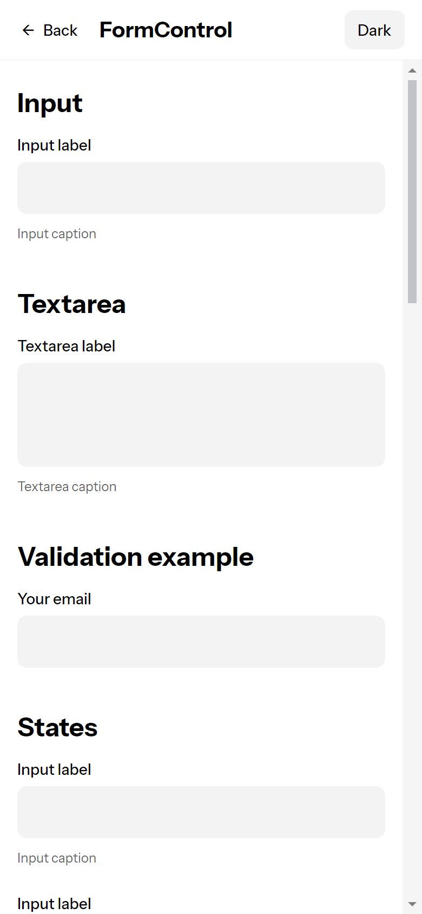
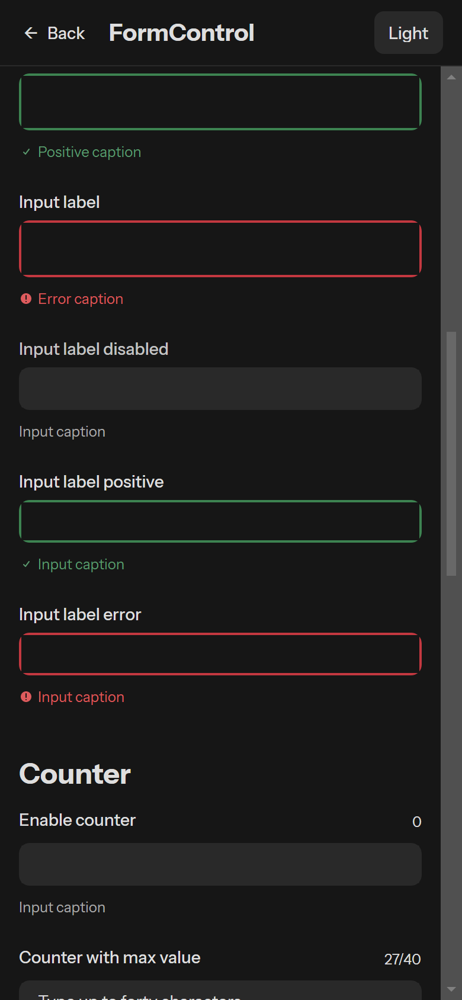
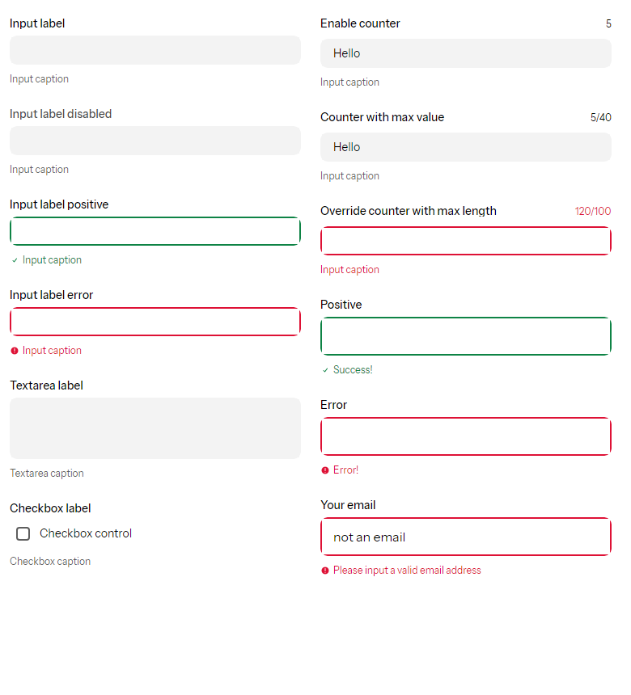
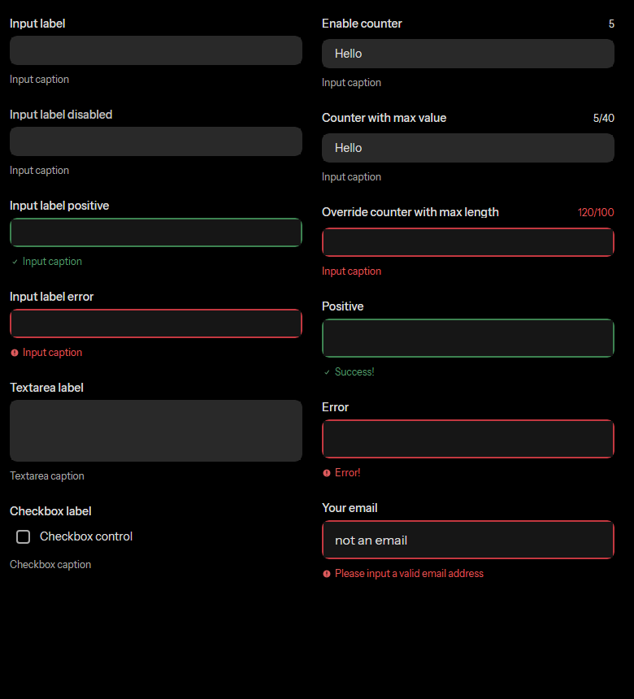

# FormControl

Base Web's `FormControl` (baseui 18.2.0, `form-control/`), as `Metered.Controls.FormControl`, an Avalonia
`ContentControl` whose `Content` is Base Web's one child: a label above it, and a caption, an error or a positive message
below it.

The sample's page, drawn headless by `PreviewGallery` in Instrument Sans, the substitute for Uber Move Text
([ADR 0003](../../decisions/0003-font.md)). The scenarios, from `FormControlFrames`' gallery (headless):
`form-control.scenario` (the states round a compact input, a textarea and a checkbox), `form-control-with-counter.scenario`
(with a value typed, and a length past the maximum), `input-form-control-states.scenario`, and the documentation's
validation example with its error shown:

## Which form control

Read from `node_modules/baseui/form-control/` (`form-control.js`, `styled-components.js`, `types.d.ts`), the icons it
renders (`icon/alert.js`, `icon/check.js`, `icon/styled-components.js`), the override helpers (`helpers/overrides.js`),
its scenarios and tests (`src/form-control/__tests__/`: `form-control.scenario.tsx`, `form-control-id.scenario.tsx`,
`form-control-with-counter.scenario.tsx`, `form-control.test.tsx`; and `src/input/__tests__/input-form-control-states.scenario.tsx`),
and its documentation page and examples (`documentation-site/pages/components/form-control.mdx`,
`examples/form-control/`) at commit `3adb0478c96569dc4e593ab39c24f36dc59e39f5`, the 18.2.0 publish. There is no
`form-control-v2`, the page has no deprecation notice, and no prop is marked deprecated.

**Base Web's FormControl has no `required` prop** (`types.d.ts`): `required` is the child's own (its tests put
`<Textarea required />` in one). Metered's has none either.

## API

| Base Web | Metered |
|---|---|
| `children` (one) | `Content` |
| `label` | `Label`: content, or a `Func<FormControlState, object?>` |
| `caption` | `Caption`: the same |
| `error`, `positive` | `Error`, `Positive`: a boolean for the state alone (`{x:True}` in XAML; `"True"` is text, as Base Web's `"true"` is); other content is also the message shown in the caption's place; or a function, its message with no icon |
| `labelEndEnhancer` | `LabelEndEnhancer`: content or a function |
| `counter` (`false`, `true`, `{ length, maxLength, error }`) | `Counter`, a `FormControlCounter?`: null for `false` (the default), `True` or `False` in XAML, or one with `Length`, `MaxLength` and `Error` |
| `disabled` | `IsEnabled` (Avalonia's) |
| `htmlFor` | `HtmlFor`, an `IInputElement` resolved by name in XAML, as Avalonia's `Label.Target` |
| `overrides` (`Label`, `LabelEndEnhancer`, `LabelContainer`, `Caption`, `CaptionMessage`, `CaptionIcon`, `ControlContainer`) | `Overrides`, the same seven parts |
| the `$` props each part and function is given (`sharedProps`) | `FormControlState`, and the control's `State` |

A value is something when JavaScript would call it true: null, an empty string, false, 0 and NaN are nothing. The
states, set on the form control and every part: `:disabled` (Avalonia's), `:error` (its error, or a counter past its
maximum), `:positive`, `:counter-error`, and `:icon-alert` or `:icon-check`, the caption's icon.

## Behaviour, as Base Web's

From `form-control.js`:

- **The hint** (`chooseRenderedHint`): an error that isn't a boolean, else a positive that isn't, else the caption; a
  function is called with the shared props as they are before the counter changes them. Nothing is rendered below the
  child when the hint is nothing.
- **Its icon** (`chooseRenderedHintIcon`): Base Web's `Alert` for an error, `Check` for a positive, 12 px, `aria-hidden`;
  none for a function, and none without a hint. An error as a boolean with a caption: the caption, red, with the alert.
- **The label** renders with its row only when it is something; the end enhancer only with a label, when it is
  something. The label's function is called after the counter.
- **The counter**: the length is the counter's, else the child's text's (Base Web's child's `value`), else 0; the
  maximum the counter's unless 0 (JavaScript's falsy), else the child's `MaxLength` (0 is none, Avalonia's). The end
  enhancer shows `length` or `length/max` unless one is given. A length past the maximum is an error unless the
  counter's `Error` says otherwise: `$counterError`, and `$error`, which the caption and the child take. Base Web gives
  `$maxLength` the length, not the maximum (`sharedProps.$maxLength = length`); `FormControlState.MaxLength` is kept so.
  The counter follows the text as it is typed, as Base Web re-renders with the child's `value`.
- **The child is given** what `cloneElement` gives it: the error and the positive when the form control's are on, below
  the child's own values (a local value wins, as the child's own prop does); disabled with the form control, as
  `onlyChildProps.disabled || disabled`. Base Web's `Textarea` has `error: false` in its defaultProps, which React
  resolves before FormControl reads them: **a Textarea isn't given the form control's error**. Input, Checkbox and
  RadioGroup are. Each is let go when the child is taken out or the state goes.
- **`overrides`**: `CaptionMessage` and `CaptionIcon` are rendered with no props (`React.createElement(CaptionIcon, null,
  …)`, and `getOverride` reads only `component`): an override's `Style` and `Props` for those two are ignored, its
  `Component` taken.

From its style functions (`styled-components.js`):

- The label: `font250`, `contentPrimary`, `contentSecondary` when disabled; `display: block`, `width: 100%`.
- The label's row: a flex row, 8 px (`scale300`) above and below. The end enhancer: `font100`; `contentPrimary`,
  `contentStateDisabled` when disabled, `contentNegative` past the counter's maximum; `flex: 0` with `width: 100%`, so a
  basis of 0 that doesn't grow: its min-content width (its widest word; "Optional field" wraps to two lines), the label
  the rest; both as tall as the row.
- The caption: `font100`, `contentTertiary`, `contentNegative` in error, `contentPositive` when positive; 8 px above and
  below; a flex row of the icon (4 px, `scale100`, above and after its 12 px box, at the top) and the message.
- The control container: 16 px (`scale600`) below.

From the browser, since Base Web renders a block flow and a `<label htmlFor>`:

- **Margins collapse** inside the form control, as a browser's block flow: the caption's 8 px below are inside the
  control container's 16 (`FormControlStack`). So 8 + the label's line + 8 above the child, and 8 + the caption's line +
  16 below it.
- **A click or a tap on the label focuses what it labels**: a press on it and a release on it, the pointer not taken
  from it in between, as a browser's `click`. A press alone does nothing (Avalonia's own `Label` focuses on a press). On a
  phone a finger that lands on a label to scroll the page scrolls it and focuses nothing: the scroller takes the pointer.
  Its hit area is the label's box: the row's width less the end enhancer's, the row's height.
- **UI Automation**: the label is text, named by its content; it names what it labels (`AutomationProperties.LabeledBy`,
  as `<label for>` names an input). The hint's text is the child's help text when Base Web gives the child
  `aria-describedby` (a caption or a positive) or `aria-errormessage` (an error). The caption's icon is in no view
  (`aria-hidden`).

## Held by

- `Controls/FormControlColourTests`: 20 states, light and dark: the label's, the end enhancer's and the caption's colours,
  the icon and the text shown; and the alert drawn in the caption's colour inside its padding, its "!" cut out (2).
- `Controls/FormControlLayoutTests`: 9 cases of label, end enhancer and hint: where each box is for an input's height, the
  margins collapsed; the end enhancer at its min-content width; the caption's icon box and the message beside it; the
  fonts; long text wrapping at its words.
- `Controls/FormControlTests`: the hint, its icon, the parts rendered, the state and the functions' arguments, the
  child's help text (78); the counter (132); what each kind of child is given (120); the counter following typing and
  its maximum; `Counter` in XAML; a child let go; Base Web's defaults; `HtmlFor` or the child; a click and a tap on the
  label, not a press; a touch drag from the label in a page that scrolls; disabled; a label with nothing focusable;
  overrides; UI Automation; a function called again when the state changes; the input states scenario.
- `Controls/FormControlFrames`: the label, the counter past its maximum and the caption drawn in their colours, light and
  dark; the gallery above.
- `Sample/FormControlPageTests`: the sample's page, 5: its place, its form controls as set, `{x:True}`, a tap on a label
  and on one with `HtmlFor` by name, the counters, the validation example.

The part themes are generated (`tools/tokens/form-control.js`): `styled-components.js`' functions evaluated on Base
Web's theme with each colour replaced by its own name for every combination of disabled, error, positive, counter error
and the icon, through radio.js's writer, as the fewest layered styles checked against Base Web's for each combination;
the icons' paths and size from Base Web's FormControl rendered. The oracle (`tools/reference/form-control.js`) renders
Base Web's own FormControl (react-dom/server) with every part overridden by a recorder, round a child that records what
it is given with the defaultProps of Base Web's Input, Textarea, Checkbox or RadioGroup, on the real light and dark
themes, and computes the block flow's positions from the style functions' margins and lines.

## Known differences

1. **Two form controls one under the other are 8 px further apart than on baseweb.design.** A browser collapses the
   first's 16 px below with the next's 8 px above into 16; Avalonia's layout has no margin collapsing between controls,
   so they add to 24. Inside one form control the margins do collapse. An app that wants Base Web's spacing gives the
   following form control a `-8` top margin, or overrides `LabelContainer`'s margin.
2. **`htmlFor` defaults to the child.** Base Web's label is for `htmlFor` or the child's `id`; with neither it labels
   nothing. Avalonia has no `id`: the child is labelled unless `HtmlFor` names another (For you to decide, in the PR).
3. **The label focuses what it labels; it doesn't click it.** A browser's label also activates a checkbox, a radio or a
   button it labels (it toggles the checkbox). Base Web's documentation puts a checkbox's and a radio group's text in
   their own labels, so its examples don't rely on it.
4. **`disabled` is `IsEnabled`**: a form control inside a disabled panel is disabled too, its label greyed; Base Web's
   prop is the form control's own.
5. **The end enhancer's min-content width breaks text at spaces only.** CSS's line breaking also breaks after a hyphen
   and between some other characters. Content that isn't text is as wide as it asks.
6. **The help text is the hint's text**: a hint that is a control other than a text block gives the child none, where
   `aria-describedby` would read its text.
7. **The validation example** checks an address with a plain pattern, not the `email-validator` package, and leaves out
   its `After` override (an 18 px alert in the input).
8. **On a phone, that a tap on a label opens the soft keyboard is untried**: it focuses the text box by a pointer, which
   Avalonia's Android backend takes to show the keyboard: #102 (hands-on), with the drag from a label.
