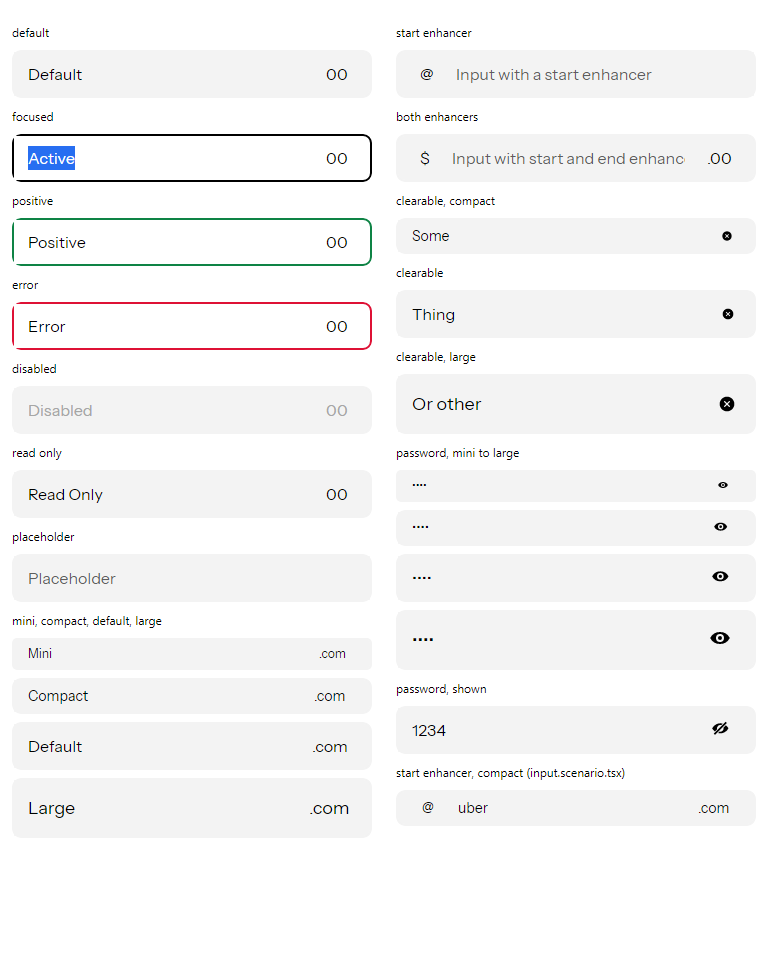
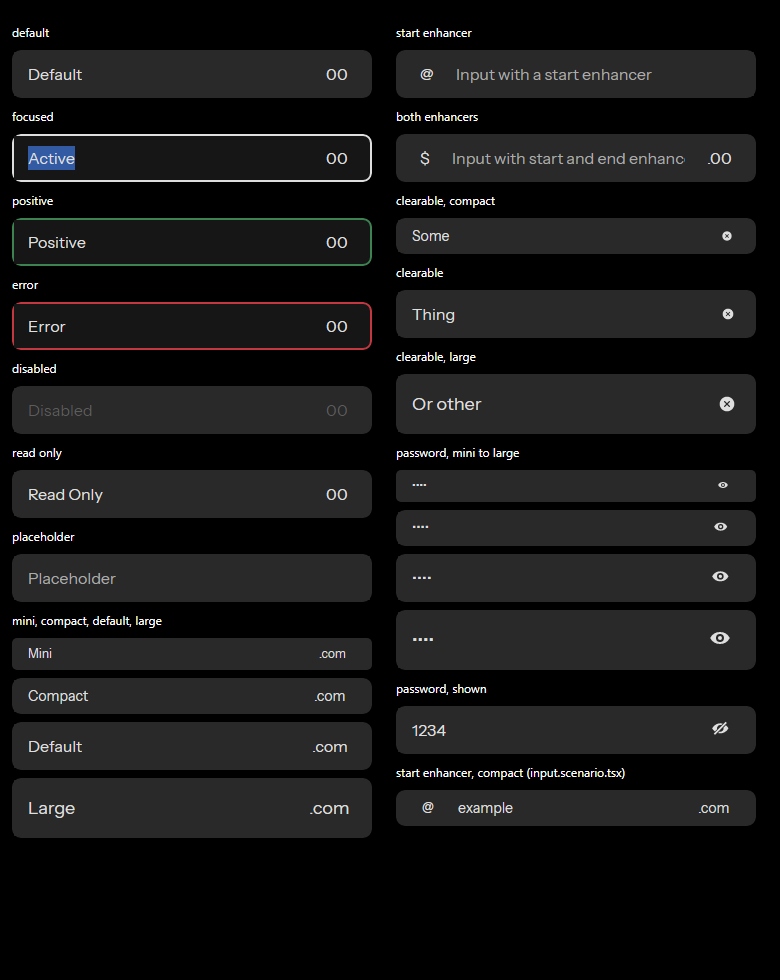

# Input

Base Web's `Input` and its `BaseInput` (baseui 18.2.0, `input/`), as `Metered.Controls.Input`, an Avalonia `TextBox`,
on `Metered.Controls.BaseInput`, the base Textarea (#85) shares ([`docs/controls/Textarea`](../Textarea/README.md)).

The sample's page, drawn headless by `PreviewGallery` in Instrument Sans, the substitute for Uber Move Text
([ADR 0003](../../decisions/0003-font.md)). The scenarios, from `InputFrames`' gallery (headless): `input-states`
(default, focused by keyboard, positive, error, disabled, read only, with an end enhancer), a placeholder,
`input-sizes`, the documentation's enhancers, `input-clearable`, `input-password` at the four sizes and once shown, and
`input.scenario` (both enhancers, compact; its value reads "example" where the scenario's reads "uber", as the sample page's filled example reads "value": Metered carries no Uber mark):

## Which input

Read from `node_modules/baseui/input/` (`input.js`, `base-input.js`, `styled-components.js`, `utils.js`, `constants.js`,
`stateful-container.js`, `types.d.ts`), the icons it renders (`icon/delete-alt.js`, `icon/show.js`, `icon/hide.js`,
`icon/icon.js`, `icon/styled-components.js`), its scenarios and tests (`src/input/__tests__/`, `input.e2e.ts` among
them), and its documentation page and examples (`documentation-site/pages/components/input.mdx`,
`documentation-site/examples/input/`) at commit `3adb0478c96569dc4e593ab39c24f36dc59e39f5`, the 18.2.0 publish. There is
no `input-v2`, the page has no deprecation notice, and no prop is marked deprecated.

Base Web's `<input>` is the element that takes focus, keys and text, so the control is a `TextBox`: Avalonia's caret,
selection, clipboard, undo, IME and soft keyboard, and its touch selection handles, are the input's. Its template is
Base Web's tree of parts round the text box's text presenter.

## API

| Base Web | Metered |
|---|---|
| `value`, `onChange` | `Text`, `TextChanged` (Avalonia's) |
| `placeholder` | `PlaceholderText` (Avalonia's) |
| `disabled`, `readOnly`, `maxLength` | `IsEnabled`, `IsReadOnly`, `MaxLength` (Avalonia's: `MaxLength` limits what is typed or pasted, as HTML's) |
| `size` (`mini`, `compact`, `default`, `large`) | `Size`, an `InputSize`; `Default` by default |
| `startEnhancer`, `endEnhancer` (a node, or a function of the shared props) | `StartEnhancer`, `EndEnhancer`: content, shown when it is something (not null, `""` or `false`; `0` is one, as `isEnhancer` reads it) |
| `adjoined` | `Adjoined`, read-only: input.js overwrites the prop with what the enhancers give (`getAdjoinedProp`) |
| `error`, `positive` | `Error`, `Positive`; both draw error, as Base Web does (and warns) |
| `clearable`, `clearOnEscape` | `Clearable`, `ClearOnEscape` (true by default) |
| `type="password"` | `Type = InputType.Password`; `IsMasked`, read-only, base-input.js's `isMasked` |
| `overrides` (`Root`, `StartEnhancer`, `EndEnhancer`, `InputContainer`, `Input`, `Before`, `After`, `ClearIconContainer`, `ClearIcon`, `MaskToggleButton`, `MaskToggleShowIcon`, `MaskToggleHideIcon`) | `Overrides`, the same twelve parts |
| `overrides.Before`, `overrides.After` (nothing unless overridden) | the text box's `InnerLeftContent`, `InnerRightContent`; or an override's `Content` |
| `onFocus`, `onBlur`, `autoFocus`, `inputRef` | `GotFocus`, `LostFocus`, `Focus()`, the control itself |
| `autoComplete`, `name`, `id`, `pattern`, `required`, `role`, `inputMode`, `min`, `max`, `step`, other `type`s | not mapped: a form's and a browser's; the soft keyboard's kind is Avalonia's `TextInputOptions` on the input |
| `aria-*` | `AutomationProperties` on the input; `aria-invalid` isn't mapped |

`BaseInput` is abstract: Base Web exports its `BaseInput` component, which renders the container and what is inside it
without a root or enhancers; here it is the base of `Input` and, next, `Textarea`, not a control of its own.

The states, set on the input and mirrored onto every part (`Parts`), are the shared props (utils.js's `getSharedProps`):
`:size-mini`, `:size-compact`, `:size-default`, `:size-large`, `:is-focused` (the text box has focus, by any means),
`:error`, `:positive`, `:is-read-only`, `:adjoined-none`, `-left`, `-right`, `-both`, `:has-icon-trailing` (clearable or a
password: input.js's `$hasIconTrailing`), and `:loaded`; `:disabled` is Avalonia's. The clear icon and the toggle take
focus themselves, and their own `:focus-visible` (Avalonia's, on a keyboard's focus) is base-input.js's
`isFocusVisibleForClear` and `isFocusVisibleForMaskToggle`.

## Behaviour, as Base Web's

From its style functions (`styled-components.js`):

- The root: a 2 px border, `inputBorderRadius` (8; `inputBorderRadiusMini`, 4, at mini), fill and border by state:
  disabled (`inputFillDisabled`), then focused (`borderSelected` round `inputFillActive`: the focus ring), then error
  (`inputBorderError`, `inputFillError`), then positive, else `inputBorder` and `inputFill`. 14 px of padding on a side
  with an enhancer, and at the end when there is a trailing icon. The font by size: `font100`, `font200`, `font300`,
  `font400`. Its border's colour moves over `timing200` on `easeOutCurve`.
- The enhancers: padded by size (10, 10, 8, 6 a side), centred, their text `contentPrimary` (`inputEnhancerTextDisabled`
  when disabled), their fill the root's; colour and fill move over `timing200`.
- The container: the rest of the row, its fill by state; the text: padded by size (4, 6, 10, 14 above and below; 14 a
  side), its colour `contentPrimary` (`inputTextDisabled` when disabled), the caret `contentPrimary`, the placeholder
  `inputPlaceholder` (`inputPlaceholderDisabled`), the cursor a text cursor (`not-allowed` when disabled). An input's
  height is its padding and its line: 32, 36, 48 and 60 at the four sizes.
- The clear icon (`delete-alt`): 14, 14, 16, 22 px by size, in a container padded 6, 6, 4, 2 a side, centred in the
  height, `contentPrimary`; a pointer cursor; a 3 px `borderAccent` outline on keyboard focus.
- The mask toggle: a borderless button padded 10, 10, 8, 6 a side, its icon (`show` while masked, `hide` after) 12, 16,
  20, 24 px, `contentPrimary`; the same outline on keyboard focus.

From base-input.js and input.js, and its e2e test:

- The clear icon shows only for a clearable input with a value that is neither disabled nor read-only. A click on it (or
  a finger's tap, or Enter or Space with it focused) clears the value, as an edit (one `TextChanged`, undoable), and
  focuses the input. Escape in a clearable input that isn't read-only clears it too, unless `ClearOnEscape` is false,
  and goes no further (`stopPropagation`); in an input that isn't clearable it does nothing of Base Web's.
- A password is masked until the toggle is clicked; the toggle's label and title are "Show password text", then "Hide
  password text"; it is a button, so it takes the focus, and Enter on it toggles; Enter in the input doesn't. The mask is
  a browser's: Metered draws U+2022, as Chrome does, and tells the soft keyboard it is a password while masked
  (`TextInputOptions.ContentType`), as a browser does for `type="password"`. Copying is off while masked (Avalonia's
  text box, as a browser's).
- The tab order is the input, the clear icon, the toggle: their order in Base Web's markup.
- **A finger's (or a pen's) drag on the input scrolls the page round it**, focused or not, as a phone's browser does
  with an `<input>`: the caret moves by a tap or its handle, never by a drag, nor where a drag that nothing scrolled
  lifts, nor where a finger lifts after another has pressed (Avalonia's text box would move it by a drag, and keep the
  page from panning: #94; a tap is Avalonia's, a release within the platform's tap size of the press). After a hold, a
  drag extends the hold's selection, as the text box's. A mouse's drag selects, and a press anywhere on the box
  focuses it (known differences, 1). `BaseInput` does this, so Textarea's text has it too.
- The icons are Base Web's own paths, rendered from its icons by the generator and the oracle, each drawn in its
  `viewBox` (24 × 24) at the size base-input.js gives it, filled with the colour its container passes down
  (`currentColor`). Metered has no icon set: these three are all Input needs.

## Held by

- `Controls/InputColourTests`: 30 cases: 11 states (rest, focused by a real Tab, error, positive, both, focused in error
  and in positive, disabled, disabled in error, read-only, read-only and focused), light and dark, every part's colours,
  the caret's, the placeholder's and the cursor; and the clear icon's and the toggle's outline with and without keyboard
  focus (8).
- `Controls/InputLayoutTests`: 48: the four sizes × no enhancer, a start one, an end one, both × no trailing icon, the
  clear icon, the toggle: adjoined, the trailing flag, every length and font, the icons' sizes, the height, and where
  each part is.
- `Controls/InputTests`: 93: Base Web's defaults, and `IsMasked` by type and toggle; the parts it renders and their
  labels in 48 cases of clearable, value, disabled, read-only, type and mask; the clear icon by click, touch (and a
  second finger), a press dragged off, Enter and Space (its text not typed, and not eaten later); keys, text, focus, a
  press and a menu on the template's own controls kept from the text box, and the text's selection kept;
  Escape's rules (and that it stops there); the toggle, Enter in the input and on the toggle, hiding it and relabelling
  it and the clear icon by an override; `MaxLength`; typing and `:is-focused` on every part; the tab order; a touch's
  focus; a finger's drag that moves the page and not the caret, focused or not, one that nothing scrolls (and a tap that
  does place it), a finger lifted after another pressed, and a mouse's that selects; enhancers (JavaScript's truth, NaN
  and 0) and adjoined; Before and After; overrides on six parts; the icons' paths, viewBox and fill rule; transitions after load; UI Automation (the clear icon a button that invokes only where a
  click could, the toggle a button, the input an edit).
- `Controls/InputFrames`: the drawn border and fill and the focus ring, the clear icon and its outline, the toggle's ring, the show
  and hide icons, and the gallery above: 6.
- `Sample/InputPageTests`: the sample's page, 4, a finger's tap in the page's ScrollViewer and typing, and a finger's drag
  on an input scrolling the page, among them.

The part themes are generated (`tools/tokens/input.js`): the input's style functions evaluated on Base Web's theme with
each colour replaced by its own name, for every combination of size, adjoined, the trailing flag, focus, disabled,
error, positive and keyboard focus, written by `radio.js`'s theme writer as the fewest layered styles and checked
against Base Web's for each combination. The icons' sizes come from Base Web's Input rendered, and their paths from its
icons rendered. The oracle (`tools/reference/input.js`) renders Base Web's own Input (react-dom/server) with every part
overridden by a recorder, on the real light and dark themes, and evaluates each part's style function with the props
Base Web gave it, so which parts render, their labels and sizes are Base Web's.

## For Textarea (#85)

Base Web's Textarea renders the same `BaseInput` with `StyledTextAreaRoot`, `StyledTextareaContainer` and
`StyledTextarea`, which call Input's `getRootStyles`, `getInputContainerStyles` and `getInputStyles`. What it takes:

- `BaseInput` (C#): derive `Textarea` from it with `base("Textarea", parts)`, its own `Root` and no enhancers or toggle;
  the clear icon, Escape, the states, the parts' guards and the overrides come as they are (`IsPassword` stays false).
- `InputField`, `InputIcon`: the text's element and the clear icon, as they are; the template's `PART_ScrollViewer`
  with `AcceptsReturn` and wrapping, and the clear icon's container aligned to the top (`$alignTop`).
- `tools/tokens/input.js`: `parts({ Root, InputContainer, Input })` makes the part definitions for other styled
  components, and `themes('Textarea', list)` writes them keyed `Textarea.Styled<Part>`; `AXES` is the states. The
  textarea's own differences (`resize`, `$alignTop`, no `$size` on its root) are its generator's.
- `Input.ContextFlyout` (Input.axaml), the cut, copy and paste menu, by its key.

## Known differences

1. **A press anywhere on the input focuses it.** Base Web's enhancers, the root's padding and the clear icon's container
   are `div`s outside its `<input>`, which a press doesn't focus; here they are inside the text box's template, and
   Avalonia focuses the text box and moves its caret to the nearest end, as for its own padding. On a phone that makes
   the whole box a target. A control in an enhancer (a button) keeps its own press. A deviation that comes with the text
   box; for the developer to keep (`A_press_on_an_enhancer_focuses_the_input_as_a_text_boxs_own_box_does`).
2. **The selection's colour is Metered's.** Base Web leaves it to the browser; here it is `colors.accent` with
   `colors.contentOnColor` text, by token.
3. **The mask toggle is disabled with the input.** Base Web's toggle has no `disabled`, so a disabled password can still
   be shown; Avalonia disables everything inside a disabled control. Its look is the same.
4. **The cut, copy and paste menu is the app theme's text.** A browser's menu; here `Input.ContextFlyout` with the
   strings Avalonia's Simple and Fluent themes define (`StringTextFlyoutCutText` and the others).
5. **`clearOnEscape` follows `Clearable` now.** base-input.js adds its Escape listener only if the input is clearable when
   it mounts, so turning `clearable` on later doesn't enable Escape; here Escape follows the current value. As Base
   Web's, Escape in a clearable input goes no further even with nothing to clear (`stopPropagation`): in a dialog or a
   flyout that closes on Escape, the input takes it first, as Base Web's input keeps it from a modal.
6. **Before and After** are the text box's inner content, not a component override: an override can't render another
   element (ADR 0001), only restyle or hide one. The documentation's `MaskToggleButton: () => null` is an override whose
   `Props` set `IsVisible` false; its `MaskToggleShowIcon: () => "🐵"` has no equivalent.
7. **Transitions start after load**, as on every Metered control: CSS doesn't transition a first paint.
8. **`IsMasked` follows the type until the toggle is clicked.** base-input.js sets `isMasked` once, from the type the
   input is made with, so an input made as text and turned into a password later is shown unmasked. Avalonia sets
   properties after a control is made, so here it is whether the type is a password until the toggle is clicked, and the
   toggle's after: the same for an input made a password, as every example and scenario does.
9. **The text box's own controls.** The parts that take focus are inside the text box's template, so Metered keeps from
   the text box what Avalonia would give it from them: keys, text, focus, a press, a menu asked for. A finger's tap and
   a held finger on them still reach it: neither can be seen headless (#90). A Space that clears from the clear icon
   doesn't type a space into the input it focuses (Base Web's `preventDefault`).
10. **On a phone, untried.** The caret, the selection handles, the soft keyboard and the clear icon under a finger are
   Avalonia's and tested headless only; the device run is #90 (hands-on). Holding isn't raised headless, so the drag
   after a hold, which extends its selection, is untested here too.
11. **A long value doesn't scroll sideways under a finger.** The text's scroller has no scroll gesture, and a finger's
   drag no longer moves the caret (#94), so a sideways drag on a value longer than the box moves nothing; the text still
   scrolls to keep the caret in view (a tap, typing, the keys). Whether a phone's browser scrolls an `<input>`'s
   overflowing text under a finger is for the device run (#90).
