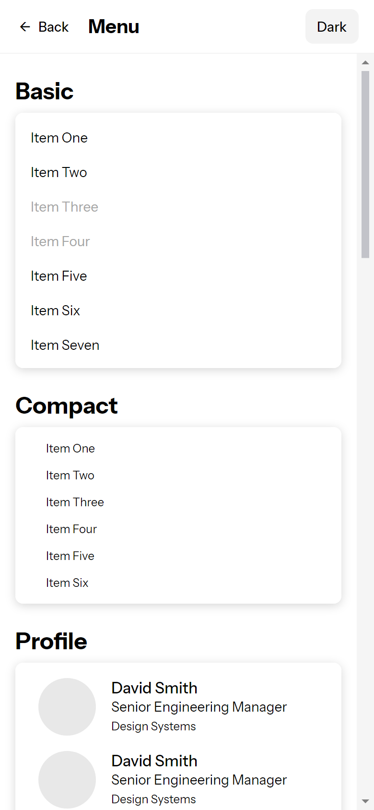
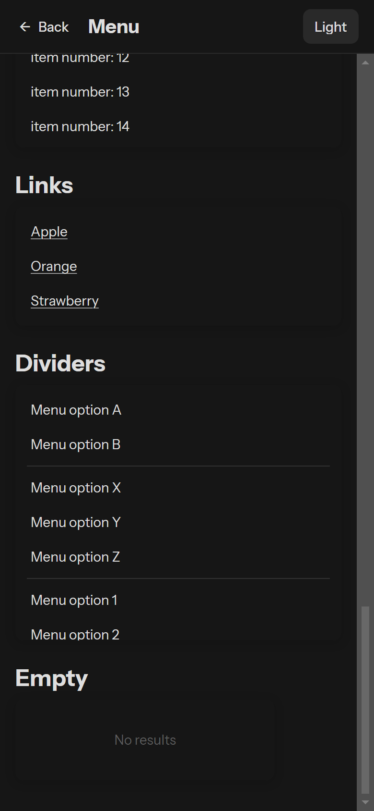
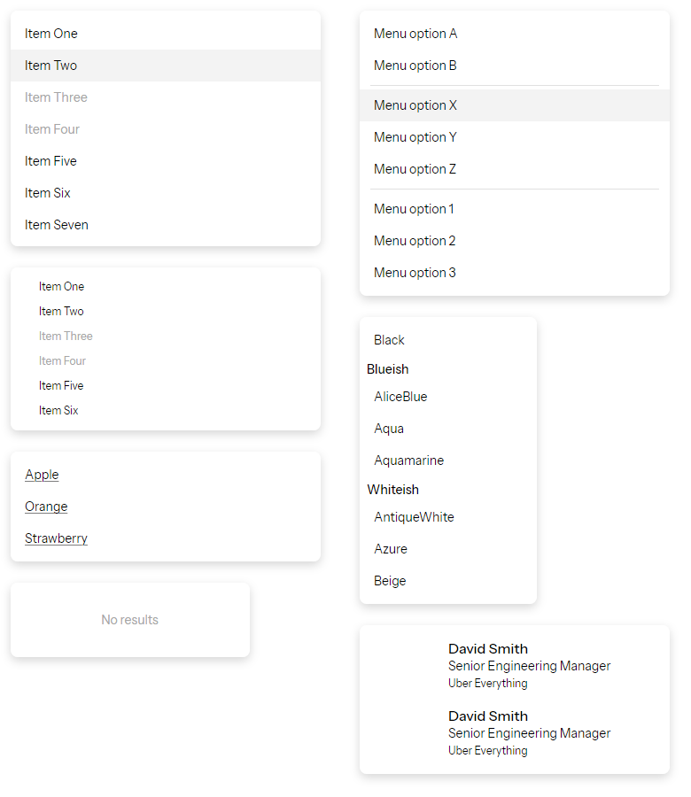
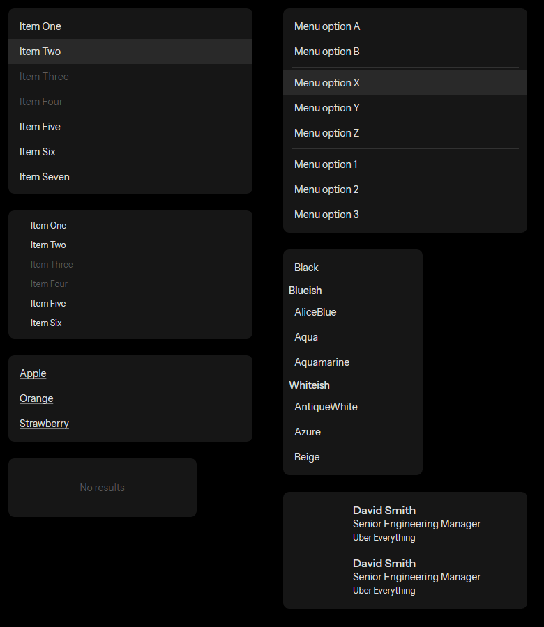

# Menu

Base Web's `StatefulMenu` and `Menu` (baseui 18.2.0, `menu/`), as one `Metered.Controls.Menu`, an Avalonia
`TemplatedControl`: a list of options with its keyboard highlight, type-ahead and scrolling, groups, dividers, its empty
state, Base Web's two options (`OptionList` and `OptionProfile`), nested menus in a Popover (#106), its parts and
overrides. Select (#97) lists its options with it.

The sample's page, drawn headless by `PreviewGallery` in Instrument Sans, the substitute for Uber Move Text
([ADR 0003](../../decisions/0003-font.md)). The documentation's examples and scenarios at their own widths, from
`MenuFrames`' gallery (headless): basic with Item Two highlighted and the menu focused, compact, dividers with an option
highlighted (the menu not focused), grouped, links, the empty state and the profile option:

## Which menu

Read from `node_modules/baseui/menu/` (`menu.js`, `stateful-menu.js`, `stateful-container.js`, `option-list.js`,
`option-profile.js`, `maybe-child-menu.js`, `nested-menus.js`, `utils.js`, `styled-components.js`, `constants.js`,
`locale.js`, `types.d.ts`), its scenarios and tests (`src/menu/__tests__/`: `menu.scenario.tsx`,
`menu-stateful.scenario.tsx`, `menu-child.scenario.tsx`, `menu-child-in-popover.scenario.tsx`, `menu-dividers.scenario.tsx`,
`menu-empty.scenario.tsx`, `menu-grouped-items.scenario.tsx` and its e2e, `menu-profile-menu.scenario.tsx`,
`menu-virtualized.scenario.tsx`, `menu.e2e.ts`) and its documentation page and examples
(`documentation-site/pages/components/menu.mdx`, `examples/menu/`) at commit `3adb0478c96569dc4e593ab39c24f36dc59e39f5`, the
18.2.0 publish. There is no `menu-v2`, the page has no deprecation notice, and no prop is marked deprecated.

## API

| Base Web | Metered |
|---|---|
| `items`: an array, or grouped (`{ __ungrouped: [...], Group: [...] }`) | `Items` (the XAML content) or `ItemsSource`: any objects; a `MenuItemData` has Base Web's `label`, `disabled`, `divider` and `href`; a `MenuGroup` (`Label`, `Items`) is a grouped key (known difference 2) |
| `initialState` (`highlightedIndex`, `isFocused`), the state | `HighlightedIndex` (-1 for none) and `IsMenuFocused`, two-way; `State` reads both |
| `stateReducer` | `StateReducer`: `(MenuStateChangeType, MenuState changes, MenuState current) => MenuState` (known difference 3) |
| `onItemSelect` | the routed event `ItemSelect`, its `Item` |
| `typeAhead` (true), `forceHighlight`, `keyboardControlNode` | `TypeAhead`, `ForceHighlight`, `KeyboardControlNode` (any element) |
| `noResultsMsg` ("No results") | `NoResultsMsg`, any content |
| `aria-label` ("Menu") | `AutomationProperties.Name` on the menu, given to its list |
| `overrides` (`List`, `Option`, `OptgroupHeader`, `MenuDivider`, `EmptyState`, and the options' `ListItem`, `ListItemAnchor`, `ChildMenuPopover` and the profile's seven) | `Overrides`, the same parts |
| `overrides.Option.props`: `size` (`default`, `compact`), `getItemLabel`, `getChildMenu`, `renderHrefAsAnchor`, `overrides` | the `Option` override's `Props`, a theme of `MenuOptionList` setting `Size`, `GetItemLabel`, `GetChildMenu`, `RenderHrefAsAnchor`, `Overrides` |
| `overrides.Option.component: OptionProfile`, its props `getProfileItemLabels`, `getProfileItemImg`, `getProfileItemImgText` | an `Option` override whose theme (`Component`, `Style` or `Props`) targets `MenuOptionProfile`, setting `GetProfileItemLabels` (a `MenuProfileLabels`), `GetProfileItemImg`, `GetProfileItemImgText` |
| `NestedMenus` | `NestedMenus`, a `Decorator` round the menu |
| `renderAll`, `rootRef`, `getRequiredItemProps`, `onActiveDescendantChange`, the options' `id` | none (known differences 9 and 10) |

The menu makes the parts Base Web renders some number of times (`Parts.Place`): an `OptgroupHeader` (a `TextBlock`)
for each group, an `Option` for each item, a `MenuDivider` (a `Border`) for each divider, and `EmptyState` (a
`ContentPresenter`) when no group has an item. Unlike any other part's, an option's element type is chosen by its override,
as Base Web's `component` is: the menu makes the elements itself, of the type the `Option` override's theme targets. Each
option is a templated control with parts of its own (`ListItem`, a `ContentPresenter`, round its label or its
`ListItemAnchor`; or the profile's), made in code as its item needs them, which take the menu's overrides (menu.js gives
`overrides: props.overrides`) unless its own `Overrides` replace them (dropdown.js does).

The states: on each option and its parts, Base Web's `$isHighlighted`, `$isFocused` (the menu's) and `$disabled` as
`:is-highlighted`, `:is-focused` and `:is-disabled` (an option is never Avalonia-disabled, so a disabled one keeps its
`not-allowed` cursor), `$size` as `:size-default` and `:size-compact`, and `:loaded`, so its colour and background
transition doesn't run on its first look. The profile option keeps `$isHighlighted` from its parts, as option-profile.js
does, and its box has its own `:hover`. The list (`MenuList`) has Avalonia's own `:focus-visible`, Base Web's
`$isFocusVisible` on `:focus`.

## Behaviour, as Base Web's

From `stateful-container.js`, `menu.js` and `utils.js`:

- **Keys** reach the menu on its focused list while it is focused (menu.js's `onKeyDown`), or on its
  `KeyboardControlNode` instead. ArrowUp and ArrowDown move the highlight by one, stopping at the ends; Home and End to
  them; over dividers and disabled items, which take an index as Base Web's do. Enter chooses the highlighted item unless it
  is disabled (a divider is chosen, as Base Web's is). ArrowRight focuses a child menu shown, ArrowLeft the parent.
- **Type-ahead**: every other key is added to the letters typed, by the DOM's name for it (`a`, `B`, a space, and
  `Shift`, `Escape`, `PageDown`: Base Web adds those too, so a capital letter typed with Shift matches nothing); 500 ms
  after the last key they're let go. The first label that starts with them is highlighted, else the first that has them
  inside. Items with no labels (the first item's) have no type-ahead.
- **Scrolling**: after each key the highlighted option is scrolled into view by Base Web's `scrollItemIntoView` (to the
  list's end for the last, its start for the first), and a first highlight to the list's centre once it is laid out
  (componentDidMount). The list's padding scrolls with its options, as an overflow box's does. Page Up, Page Down and Space
  scroll the focused list a page, as a browser does for a key Base Web lets through.
- **Focus**: the list focused (onFocus) focuses the menu, the first item highlighted if none is; losing focus unfocuses
  it, its highlight kept (drawn as `menuFontSelected`). A mouse over the list focuses it too (onMouseOver), and over an
  option highlights it, not a disabled one; a click chooses it and highlights it.
- **Touch first**: a phone's browser sends no mouse events for a drag that scrolls, and mouseover, mouseenter and click as a
  tap lifts. A finger's drag over a long menu scrolls it (its scroll gesture) and focuses, highlights and chooses nothing; a
  tap focuses the menu, highlights the option and chooses it. A finger's press doesn't focus the list as it lands, before it
  is a tap or a drag. A click is a press and a release on the same option, the pointer not taken by a scroller between.
- **componentDidUpdate**, after each change of state or items (not on the first render): `forceHighlight` highlights the
  first item when none is; an empty menu has no highlight; a highlight past the end goes back to the first.
- **Links**: an item's `href` makes its label a link (underlined, by a browser's own stylesheet, in the default colour
  whatever the option's state: option-list.js gives the anchor none of the option's props). A click on the link chooses the
  item and opens the link with the platform's launcher; Enter chooses it only.
- **Nested menus** (maybe-child-menu.js, nested-menus.js): an option's `GetChildMenu` gives its child menu, shown in a
  Popover at the option's right, its top, while the option is highlighted (its `IsOpen` held to the highlight, as a
  controlled Base Web popover's: a click or a tap on the option chooses it and doesn't toggle or close the popover, even for
  a moment). `NestedMenus` keeps the menus shown in order; a mouse back over a
  shallower menu lets a deeper one's highlight go, and 200 ms after it has left them all, every one's. Escape in a child
  resets its parent (onEsc: resetMenu), which closes it; the focus Avalonia's popup gives back as it closes, when the focus
  was in the child, is let go, as a browser leaves it on the page. Avalonia's back request while a child is open is that Escape (Metered's, known
  difference 15): the parent reset and the child closed, the request handled. Tab stays in a child menu. A menu hidden when it is shown isn't nested (addMenuToNesting's
  offsetHeight). A menu taken out of the tree (a child's popover closed) starts again at its first state when it is shown
  again, as Base Web's unmounted container does, and an input method's keys ("Process") are type-ahead's, never Enter's.
- **UI Automation**: the list is a list named by `aria-label` ("Menu"), its children the options, the headers and the empty
  state's message; an option a list item, selected while highlighted and the menu focused (`aria-selected`), not enabled
  when disabled (`aria-disabled`), named by its label or, with a child menu, by Base Web's `parentMenuItemAriaLabel`;
  selecting it chooses it. The empty state is a polite live region.

## How it is tested

The oracle, `tools/reference/menu.js`, runs Base Web itself: its `StatefulMenu` rendered (react-dom/server) for each case
with every part recorded, and each part's style function evaluated with the props it was given; its own
`MenuStatefulContainer` driven step by step in Node as a browser and React would drive it (DOM focus, React's batched
state, `componentDidUpdate`); and its own `scrollItemIntoView` on the geometry its styles give. The themes come from
`tools/tokens/menu.js`, which checks them against the style functions for every combination of states. 105 tests:

- `MenuStructureTests` (14): what each case renders, in order, against Base Web's (basic, its states, compact, dividers,
  grouped, empty, empty groups, a message, href, href not as a link, named, profile): text, size, the parts' states, links,
  and what UI Automation reads for role, `aria-selected` and `aria-disabled`.
- `MenuColourTests` (14): an option in six states, light and dark, its text, fill, cursor and link; the list, its outline on
  keyboard focus, a header, a divider, the empty state and the profile option's hover.
- `MenuLayoutTests` (5): an option's box by size, the list's padding inside its scroller, a header, a divider (its line and
  margins), the empty state (centred), the profile option's row, the transition.
- `MenuBehaviourTests` (21): Base Web's container's state after each step of 21 sequences, replayed with real keys, focus
  and a real mouse: highlight, focus, the items chosen, the reducer's change types.
- `MenuScrollTests` (4): the list's offset after each key, against `scrollItemIntoView`'s scrollTop.
- `MenuTests` (24): a finger's drag and a tap (its changes: focus, mouseEnter, click), a press let go elsewhere, a mouse moving on one option, the menu's focus reaching every option, keys while the menu isn't focused, Page Down and Space
  (not the parent's, from a child's content), `keyboardControlNode` as Select uses it (the text's caret kept), overrides (an
  option's own, its template, a theme's template after the option is made again), the profile option by override (a picture that isn't an image: none), links (followed
  whatever `ItemSelect` does), UI Automation, items that change, options made again taking their controls, a menu following
  its collection only in the tree and letting its letters go out of it, the empty state's content, keys by name.
- `MenuNestedTests` (14): a child open while highlighted, the arrow keys between menus, a child opened again afresh, Escape,
  the back request as that Escape (a child a tap opened, a focused child, a child above the popover the menu is in, a
  child that Escape leaves open, the parent's focus after an unfocused child closed),
  the nested hover, a hidden menu not nested, a click and a tap on a parent option (its popover never closed), the
  `ChildMenuPopover` override.
- `MenuFrames` (2, and the gallery): drawn pixels of the list and a highlighted option. `MenuPageTests` (5): the sample's
  page, and in the shell Back closing the child menu before it goes back.

## Known differences

1. **One control for `Menu` and `StatefulMenu`** (chosen, as Popover's and ButtonGroup's): `HighlightedIndex` and
   `IsMenuFocused` are the state, set by the keys, the pointer and focus whatever bound them.
2. **Items** (chosen): Base Web's items are any objects it reads `label`, `disabled`, `divider` and `href` from. Here a
   `MenuItemData` has them; any other object is its own label (shown as content, as an `ItemsControl`'s item is; Base Web
   shows nothing for an object with no `label`), and a string is its label for type-ahead too. A `MenuGroup` is a grouped
   key; items outside a group are its `__ungrouped`, and may come anywhere among the groups, where Base Web's key comes
   in its object's order.
3. **`StateReducer` is given the whole state the change would make** (chosen): Base Web's `changes` are only the keys that
   change; a C# reducer gets a `MenuState` and the change's type, which says what changed.
4. **The reducer sees focusMenu's change once** (forced): a mouse over a menu not focused calls focusMenu, whose `focus()`
   raises a focus event that calls it again before React has applied the first's state, so Base Web's reducer sees
   `focus` twice; Avalonia applies the state at once. The state is the same.
5. **`ItemSelect` gives the item, not a DOM event** (forced): the routed event is Avalonia's.
6. **No scroll bars** (chosen, as Metered's other scrollers): a desktop browser draws `overflow: auto`'s bar in the list,
   narrowing its options; a phone's is drawn over them while they move.
7. **A pen never hovers, and the profile option's `:hover` is a mouse's** (chosen, ADR 0001): Base Web's `:hover` on
   `ListItemProfile` has no `@media (hover: hover)`, so a phone's browser keeps it after a tap.
8. **A profile picture given as a string is loaded from a resource (`avares://`) or a file** (chosen): Base Web's ``
   loads any address; a control library doesn't reach the network. An image, or a control, is drawn as it is.
9. **`renderAll`, and a `List` override's `component`** (forced): `renderAll` renders hidden child menus for server
   rendering and search engines, which nothing in Avalonia reads. An override can't render another element for the list
   (ADR 0001), so Base Web's virtualized example (a `List` of react-window's) has no counterpart: the sample's long list is
   100 items, all made.
10. **`rootRef`, `getRequiredItemProps`, `onActiveDescendantChange` and the options' ids** (not yet): the list is the
    `List` part; UI Automation's peers say which option is selected in place of `aria-activedescendant`. A follow-up if
    Select needs them.
11. **Links** (forced, and chosen): a relative `href` (`#a`, `/apple`) isn't opened, as there is no page to resolve it
    against; one without a scheme (`//host/path`, Base Web's example's) is opened by https (chosen).
12. **English strings** (not yet): "No results" and the parent option's name are Base Web's locale's defaults; there is no
    `LocaleProvider`. `NoResultsMsg` and `AutomationProperties.Name` replace them.
13. **Right to left** (not yet).
14. **On a phone, tried on a Pixel 8** (Android 17, 2026-11-24, #126): a tap highlights an option, a tap on a disabled one
    does nothing, a finger's drag in the long list scrolls the list, and a tap opens a child menu. Found: a tap on an
    option of a menu partly below the screen's foot scrolls the page to bring the whole menu into view (#132); the
    child menu's popover reaches over Android's navigation bar (#129: since cut to the safe area, as every popover is,
    tried headless only). Not tried yet: the keys, the profile pictures,
    links, and everything in a real window.
15. **Android's back request with a child menu open is that Escape** (chosen; decided 2026-11-24, #131; Base Web has no
    back request). Metered's popover closes on it when Escape would close it (#123), but a child menu's Escape resets its
    parent rather than closing its popover, which is held to the highlight, so that rule passed over it and Back went on
    to the page. The child menu's popover takes the request as its Escape (`EscOnBack`, as Select's dropdown does): the
    parent menu reset and the child closed, the request handled before any popover below (the one the menu is in) and
    before the app goes back (the sample's shell); with no child open, or one that Escape leaves open (as `ForceHighlight`
    highlights its option again), the request goes on as before. Tried headless
    (`MenuNestedTests`, `MenuPageTests`), not yet on a phone.

