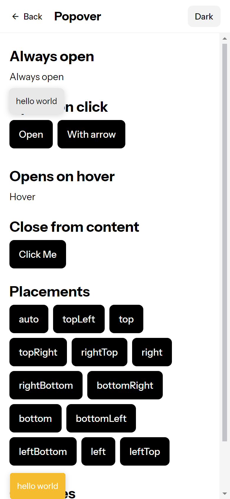
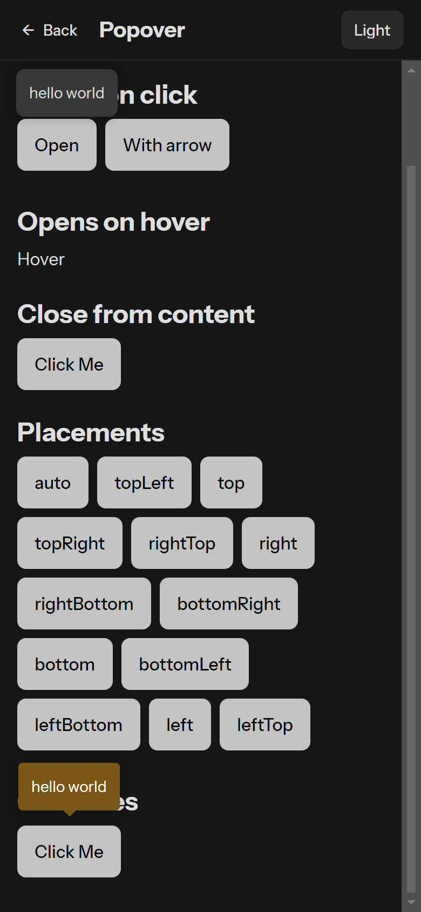
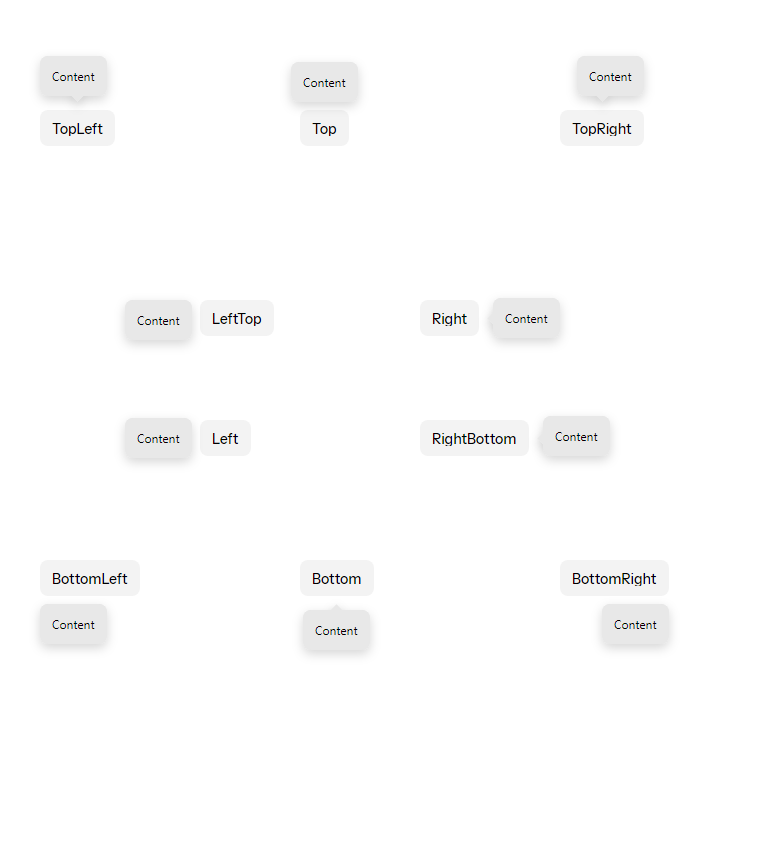
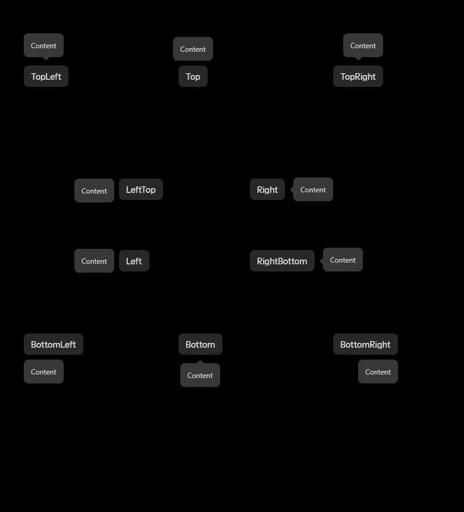

# Popover

Base Web's `Popover` and `StatefulPopover` (baseui 18.2.0, `popover/`), as one `Metered.Controls.Popover`, an Avalonia
`TemplatedControl`: content shown in a layer against its anchor, opened by a click or a hover, placed as popper.js places
it, dismissed by a click outside and Escape. Its anchoring (`Tether`) and its dismissal (`Layers`) are shared, for Select
(#97) and Menu (#107).

The sample's page, drawn headless by `PreviewGallery` in Instrument Sans, the substitute for Uber Move Text
([ADR 0003](../../decisions/0003-font.md)). The documentation's placements, from `PopoverFrames`' gallery (headless),
every other one with its arrow:

## Which popover

Read from `node_modules/baseui/popover/` (`popover.js`, `stateful-container.js`, `styled-components.js`, `utils.js`,
`constants.js`, `default-props.js`, `types.d.ts`), the layer it renders in (`layer/layer.js`, `layer/layers-manager.js`,
`layer/tether.js`, `layer/utils.js`), popper.js 1.16.1, which `tether.js` drives, its scenarios and end-to-end tests
(`src/popover/__tests__/`: `popover.scenario.tsx`, `popover-click.scenario.tsx`, `popover-hover.scenario.tsx`,
`popover-large-margin.scenario.tsx`, `popover-position.scenario.tsx`, `popover.e2e.ts`, `popover-autofocus.e2e.ts`) and
its documentation page and examples (`documentation-site/pages/components/popover.mdx`, `examples/popover/`) at commit
`3adb0478c96569dc4e593ab39c24f36dc59e39f5`, the 18.2.0 publish. There is no `popover-v2`, the page has no deprecation
notice, and no prop is marked deprecated.

## API

| Base Web | Metered |
|---|---|
| `children` (the anchor) | `Anchor`, the XAML content; `AnchorTemplate` |
| `content`: a node, or a function (StatefulPopover's is given `{close}`) | `Content`: any content (text, a control, data with `ContentTemplate`), or a `Func<Action, object?>` called with a function that closes it each time it opens; shown by the `Inner` part |
| `isOpen` (Popover), `initialState` (StatefulPopover) | `IsOpen`, two-way |
| `triggerType` (`click`, `hover`) | `TriggerType` (`Click`, `Hover`) |
| `placement` (`auto` and the twelve) | `Placement` (`PopoverPlacement`); the one popper.js chose is `ActualPlacement` |
| `showArrow`, `popoverMargin` (8) | `ShowArrow`, `PopoverMargin` |
| `onMouseEnterDelay`, `onMouseLeaveDelay` (200 ms) | `MouseEnterDelay`, `MouseLeaveDelay`, in milliseconds |
| `animateOutTime` (0 ms) | `AnimateOutTime`, in milliseconds |
| `autoFocus` (true), `focusLock` (false), `returnFocus` (true) | `AutoFocus`, `FocusLock`, `ReturnFocus` |
| `accessibilityType` (`menu`, `tooltip`, `none`) | `AccessibilityType` |
| `ignoreBoundary` | `IgnoreBoundary` |
| `dismissOnClickOutside`, `dismissOnEsc` (StatefulPopover's, true) | `DismissOnClickOutside`, `DismissOnEsc` |
| `onOpen`, `onClose` (StatefulPopover's), `onClickOutside`, `onEsc` | the routed events `Open`, `Close`, `ClickOutside`, `Esc` |
| `onClick`, `onMouseEnter`, `onMouseLeave`, `onFocus`, `onBlur` (on the anchor) | the anchor's own Avalonia events |
| `overrides` (`Body`, `Arrow`, `Inner`) | `Overrides`, the same three parts |
| `StyledPadding` (12 px) | the `Popover.StyledPadding` theme, for a `Border` round content |
| `mountNode`, `renderAll`, `popperOptions`, `stateReducer`, `focusOptions`, `id`, `data-baseweb` | none (known difference 9) |

The states, set on the popover and its three parts (popover.js's `sharedProps`): `:is-open`, `:is-animating`,
`:show-arrow`, `:is-hover-trigger`, and `:placement-*`, the placement popper.js chose (`:placement-bottom-left`).

## Built on Avalonia's `Popup`

The template is the anchor's presenter and a `Popup` whose child is `Body`, its `PopoverBodyPanel`, `Arrow` and `Inner`
(the decision, with `FlyoutBase` and a hand-made overlay against it, is the plan on #106):

- **In the template**, so the three parts are named template parts with `Popover.Styled{Part}` themes and overrides, as
  every Metered control's are (ADR 0001); the content is a logical child, so data context and inherited text flow from
  the page.
- **In the window's overlay layer** (`ShouldUseOverlayLayer`), as Base Web's layer is in the page, never outside the
  window; on Android and iOS the overlay is all there is. A window needs a template with an overlay layer, as every
  theme's window has (known difference 8).
- **Placed exactly** by `Tether`: `AnchorAndGravity`, top-left to bottom-right, the offset in the window's coordinates,
  no constraint adjustment. Avalonia's popup puts its child's border box at its offset, its margin round it, so the body's
  margin is added to popper.js's offset (its margin box's). The popup follows: the anchor's box, the body's size and the
  window's size are read after each layout pass, and a change places it again, as popper.js's update on a scroll or a
  resize and `Tether`'s on a size change.
- **Light dismiss and Avalonia's placement are off**: Metered does Base Web's own. The popup's host clips its child and
  keeps Tab inside it; Base Web's layer does neither, so the host's clip is turned off (the body's shadow reaches past its
  box) and Tab may leave it unless the focus is locked.

### For Select and Menu

- **`Tether.Compute`** (`internal`): the anchor's rectangle, the body's border-box size and margins, the arrow's size,
  the placement, the viewport and `preventOverflow`'s boundaries; it gives the placement chosen, the margin box's
  offset and the arrow's offset, as popper.js's first update does with Base Web's options. A dropdown builds on the
  Popover (Select renders its dropdown in one, with `PopoverMargin` 0) or calls `Tether` itself.
- **`Layers.Of(topLevel).Add(new Layer(onEscape, onDocumentClick))`** (`internal`): Base Web's `LayersManager`. A layer
  added is on top; Escape's release goes to the top layer's handler, a press (a finger's tap) to the top click layer's
  with the element pressed, which decides whether it was outside (`Layers.IsWithin`). Dispose the result to take it off.

## Behaviour, as Base Web's

From `stateful-container.js` and `popover.js`:

- **A click trigger** toggles on a click on the anchor: a button anchor's `Click` (a press and release, a tap, Enter or
  Space), any other anchor's tap or click (a second one soon after is Avalonia's double tap, and a click all the same).
- **A hover trigger** opens `MouseEnterDelay` after a mouse enters the anchor, and closes `MouseLeaveDelay` after it
  leaves, unless it reaches the body first; leaving the body closes it after the same delay. Keyboard focus on the anchor
  (Tab or the arrow keys, Base Web's `isFocusVisible`) opens it; losing it closes it unless `AutoFocus` or `FocusLock`
  (which is why a default hover popover stays open when the anchor loses focus). Its body takes no pointer for its
  first 0.1 s each time it opens (`animationName`).
- **Dismissal** (`layer.js`, `layers-manager.js`): a press outside the anchor and the body closes a click popover
  (`onClickOutside`, `DismissOnClickOutside`); a hover popover has no such handler. Escape's release closes it
  (`onEsc`, `DismissOnEsc`). Each goes to the layer on top only: of two popovers open, the later; of a popover in
  another's content, the inner one, and a press in its body is inside it and never reaches the outer. A popover that
  closes keeps its layer until it is gone (20 ms on), and one opened again in that time keeps its place in the stack.
  **Touch:** a mouse's or a pen's press is Base Web's `mousedown`; a finger's is a tap (its release within the
  platform's tap distance), as a phone's browser sends `mousedown` only for a tap, so a finger's drag outside (a page
  scrolled) leaves it open.
- **Placement** (`tether.js`, popper.js): `Tether` is popper.js's first update with Base Web's options, ported, its
  quirks kept (a side read after a modifier moved the other is the one computed before, sizes are whole pixels, `auto`'s
  areas are the viewport's unpadded size): `auto` (the side with the most room that the body fits), the placement's start
  or end, `preventOverflow` (padding 0, Base Web's; off with `IgnoreBoundary`), `keepTogether`, the arrow, and `flip` (to
  the other side when the body overlaps the anchor or leaves the viewport less 5 px). The body's margin is read as
  popper.js reads it, its own: the margin at Base Web's state's placement, which is the one asked for until popper.js
  has run (none for `auto`) and the one chosen after; so a body that opens with `auto` and goes above or to the left
  touches its anchor until it is placed again (the anchor moved, the page scrolled), as Base Web's does. When it has
  gone, the state's placement goes back to the one asked for.
- **Its entrance** (`getBodyStyles`): shown at opacity 0 at its start, `getStartPosition`'s, 16 px towards the anchor
  (12 with the arrow, 2 × `popoverMargin` without); 20 ms after it is placed (`ANIMATE_IN_TIME`), `$isAnimating`: opacity
  1 and its place over 0.1 s on `easeOutCurve`. **Its exit**: `$isOpen` goes false at once, opacity 0 over
  `animateOutTime` on `easeInCurve` (at once by default); it is gone 20 ms plus `animateOutTime` later. Opened again in
  that time, it stays.
- **Focus** (`react-focus-lock`): once placed, focus goes to the first focusable element inside (`autoFocus`), unless it
  is a tooltip or focus is already inside; shown with the focus ring if focus was the keyboard's. `FocusLock` keeps Tab
  inside the body and gives focus back to where it was when it closes (`returnFocus`), never for a hover popover or a
  tooltip.
- **Accessibility** (`getAnchorProps`, `getPopoverBodyProps`): a tooltip's body is a tooltip to UI Automation, and its
  text is the anchor's help text while it is open (`aria-describedby`).

From its style functions (`styled-components.js`): `Body` in `backgroundTertiary`, `popoverBorderRadius`, `shadow600`,
its margin on the side facing the anchor `ARROW_SIZE + popoverMargin` (`getPopoverMarginStyles`); `Arrow` a 9 px
(`ARROW_WIDTH`) square turned 45° in `backgroundTertiary` with `shadow600`, `ARROW_SIZE - 2` = 4 px beyond the body's
side and popper.js's offset along it (`getArrowPositionStyles`), drawn under `Inner`, which covers its inner half;
`Inner` in `backgroundTertiary`, the radius, `contentPrimary` text.

What the theme holds and what the popover gives its parts: the theme holds each part's look by state, generated; the
body's margin and its entrance's start depend on `popoverMargin`, a number, and its exit's transition on
`animateOutTime`, so the popover gives those from Base Web's helpers (`getPopoverMarginStyles`, `getStartPosition`) at
the template's priority, below an override's (an override of the body's margin wins, and the body is placed with it),
and the arrow's offset as its margin. The exit's transitions are the body's own value for the exit alone, above the
theme's entrance, so its opacity goes over them the moment the state changes.

## Held by

- `Controls/PopoverTetherTests`: `Tether` against popper.js itself, 1170 cases from `tether.g.json`: nine anchors
  (the middle, each corner and edge, the page's width, a fractional one), three bodies (small, wide, taller than the room
  on either side), each placement, with and without the arrow, a margin of 8 and of 0, and no boundary: the placement
  chosen, the body's offset and the arrow's.
- `Controls/PopoverLayoutTests`: the body and the arrow drawn where popper.js and Base Web put them (184 cases, four
  anchors including a fractional one laid out unrounded); every `getPopoverMarginStyles` and `getStartPosition` case
  (96); the margin given at the placement chosen.
- `Controls/PopoverColourTests`: Body's, Arrow's and Inner's fill, radius, shadow and text colour, light and dark; the
  arrow's size and turn; `StyledPadding`; the entrance's transitions and none before or at the exit; a hover body's first
  0.1 s.
- `Controls/PopoverTests`: Base Web's defaults; a click, a tap, a button's click, Enter and Space; a hover trigger not
  opened by a click; a press outside (a press, not a click), inside the body, on the anchor; a finger's tap and drag
  outside; `DismissOnClickOutside`; a hover popover not closed by a press; Escape on its release, `DismissOnEsc`; the
  top layer of two, and a popover in another's; the hover delays, the body keeping it open, a finger not hovering,
  keyboard focus, `AutoFocus` and the blur; the entrance from its start, the exit at once and over `animateOutTime`,
  opened again during it; focus going inside or not by `AutoFocus` and accessibility type; the focus lock; content as a
  function, text, a control and data with its template; a binding following the clicks, `Open` and `Close`; opened on
  load and taken out; overrides of the three parts, and of the body's margin; UI Automation; a page that scrolls; a flip
  near the window's foot; changes while it is shown (an Avalonia toggle button as the anchor, the arrow shown, the
  trigger type, a new anchor), a tab put away and back, a window close that is cancelled.
- `Controls/PopoverFrames`: the body and the arrow's tip drawn in Base Web's fill, light and dark; the gallery above.
- `Sample/PopoverPageTests`: the sample's page, 5: its place, the examples as set, a tap opening and closing, the dismiss
  example, each placement.

The oracle: `tools/reference/tether.js` runs popper.js 1.16.1 (`node_modules/popper.js`) in headless Chromium on plain
boxes in a 390 × 844 page with `TetherBehavior`'s and `Popover`'s options and the margin Base Web's Body has before
popper.js runs, and writes `tools/reference/tether.g.json` (generated; by hand, as `fonts.js`: it needs a Chromium, not
the network). `tools/reference/popover.js` folds it into `popover.oracle.json` with the style functions evaluated on the
real themes, the helpers, the constants and the default props, so `cases.js --check` needs no browser. The part themes
are generated (`tools/tokens/popover.js`): the style functions evaluated with each colour, radius and shadow replaced by
its token's name, for every combination of the states, through radio.js's writer as the fewest layered styles, with the
entrance's transition and the hover body's pointer as Base Web's.

## Known differences

1. **Controlled and stateful are one** (as ButtonGroup's and RadioGroup's): a click on the anchor, a click outside and
   Escape set `IsOpen` whatever bound it. Base Web's controlled `Popover` only calls `onClick`, `onClickOutside` and
   `onEsc`; its `StatefulPopover` changes its own state. `DismissOnClickOutside` and `DismissOnEsc` false give the
   controlled behaviour for those two. `Open` and `Close` are raised whenever it opens or closes, an app's change
   included, where StatefulPopover's `onOpen` and `onClose` are called for its own changes.
2. **A finger never hovers** (touch first; as Radio's, Checkbox's and Switch's `:is-hovered`): a hover popover isn't
   opened by a tap. A phone's browser fires `mouseenter` on a tap, so Base Web's opens and stays open until a tap
   elsewhere. Keyboard focus still opens it. The alternative: a tap toggles a hover popover.
3. **`preventOverflow` keeps the body inside the anchor's scroll viewer's box.** popper.js keeps it inside the anchor's
   scroll parent: in a page that scrolls as a document, the whole document, so a popover goes off the screen with its
   anchor; in a scrolling element, that element's box. An app's page is a scroll viewer: Metered takes it as the
   scrolling element, so a popover whose anchor scrolls away stays at the scroller's edge (`flip` keeps to the window,
   the viewport). Without a scroll viewer, the window.
4. **Without a focus lock, focus goes back to the anchor when it closes.** Base Web's leaves focus on the page when the
   focused element inside goes; Avalonia's popup gives focus back to what had it before it opened.
5. **A menu's anchor isn't marked as having a popup or expanded** (`aria-haspopup`, `aria-expanded`,
   `aria-controls`/`aria-owns`): Avalonia has no way to add an expand state to another control's automation peer. A
   tooltip's description is its text as the anchor's help text (a string, where `aria-describedby` names an element), as
   FormControl's caption.
6. **The sample's placements open on a click**, so a finger can open them; Base Web's example opens them on hover.
7. **The window's overlay layer**: a popover in a window without a template (no theme's) shows nothing, where Avalonia's
   popup would throw.
8. **Closed as its window closes.** Avalonia 12.1.4 fails taking down a window with an overlay popup open in another's
   content (each closes itself as the overlay layer's children are walked), so a popover closes on its window's
   `Closing`, and is shown again if a handler cancels the close.
9. **Not ported:** `mountNode` (the overlay layer is the window's), `renderAll` (server-side rendering), `popperOptions`
   (popper.js's own modifiers), `stateReducer`, `focusOptions`, `id` and `data-baseweb`.
10. **Not tried on a phone or in a real window** yet (#119): a tap and a drag outside, the hover trigger under a mouse,
    focus, the overlay over the soft keyboard. Android's back button doesn't close a popover (Base Web has none).
