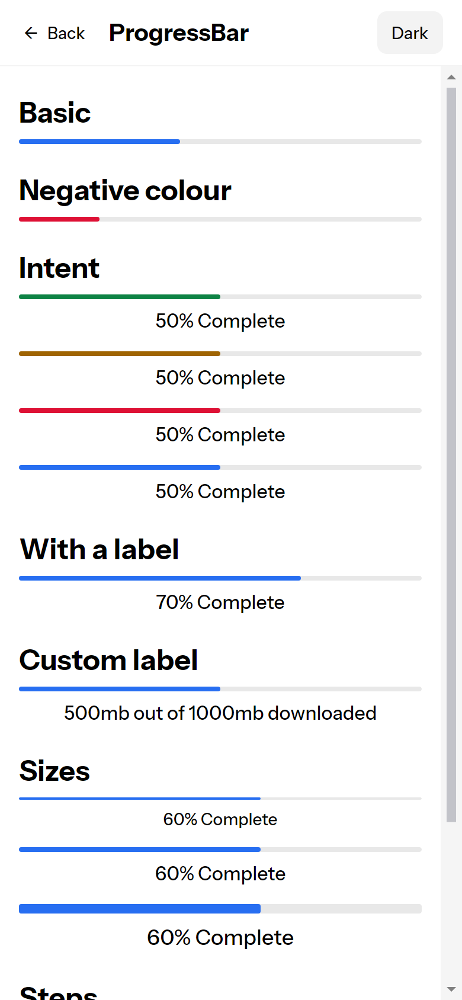
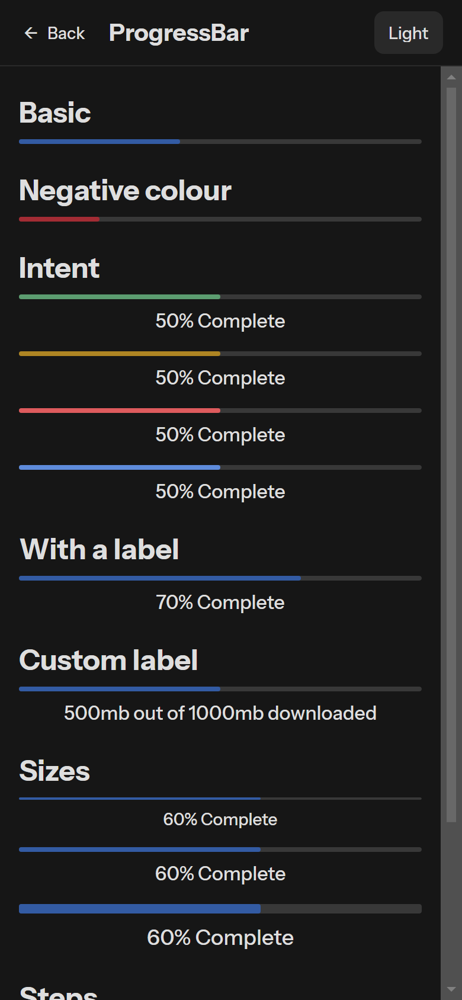

# ProgressBar

Base Web's `ProgressBar` (baseui 18.2.0, `progress-bar/`), as `Metered.Controls.ProgressBar`, an Avalonia `RangeBase`.

The sample's page, drawn headless by `PreviewGallery` in Instrument Sans, the substitute for Uber Move Text
([ADR 0003](../../decisions/0003-font.md)).

## Which progress bar

Read from `node_modules/baseui/progress-bar/` (`progressbar.js`, `progressbar-rounded.js`, `styled-components.js`,
`constants.js`, `types.d.ts`), its scenarios and unit tests (`src/progress-bar/__tests__/`), and its documentation page,
examples and yard config (`documentation-site/pages/components/progress-bar.mdx`, `documentation-site/examples/progress-bar/`,
`documentation-site/components/yard/config/progress-bar.ts`), at commit `3adb0478c96569dc4e593ab39c24f36dc59e39f5`, the
18.2.0 publish. The page has no deprecation notice and the package no `progress-bar-v2`: this is the one to build.

**`ProgressBarRounded` is left out.** The same folder exports a second component, a rounded rectangle stroked round
its edge with the percentage inside: its own five parts and overrides, its own API (`progress` from 0 to 1, `animate`,
`inline`), and a fill that JavaScript moves frame by frame (`requestAnimationFrame` over a dash offset), which wants a
test clock (#13) to test. One control per pull request: it is a follow-up of its own.

On Avalonia's `RangeBase`, not its `ProgressBar`: Avalonia's requires a `PART_Indicator` whose width it sets itself,
where Base Web's fill is the bar's whole width moved along. `RangeBase` brings `Value`, `Minimum` and `Maximum`, and
Avalonia's progress bar automation peer.

## API

| Base Web | Metered |
|---|---|
| `value`, `minValue`, `maxValue` | `Value`, `Minimum`, `Maximum` (0, 0 and 100), **clamped as `RangeBase` clamps them**, where Base Web's aren't (known difference 11); `Value` binds one way by default |
| `size` (`SIZE.small`, `.medium`, `.large`) | `Size` (`ProgressBarSize`), medium by default |
| `intent` (`INTENT.default`, `.positive`, `.warning`, `.negative`, `.brand`) | `Intent` (`ProgressBarIntent?`): null, Base Web's prop left out, is `backgroundAccent` |
| `steps` | `Steps`, 1 by default |
| `infinite` | `Infinite` |
| `showLabel` | `ShowLabel` |
| `getProgressLabel` | `GetProgressLabel`, a `Func<double, double, double, string>` called as Base Web calls it, (value, maximum, minimum); null is Base Web's default, "20% Complete". A string, not any content |
| `overrides` | `Overrides`: `Root`, `BarContainer`, `Bar`, `BarProgress`, `InfiniteBar`, `Label` |
| `aria-label`, `ariaLabel` | Avalonia's `AutomationProperties.Name` |
| `errorMessage` | **none**: deprecated in 18.2.0 and ignored by `progressbar.js` ("This prop is ignored and has no effect"; its type says to use a Banner, an Alert or a Toast instead) |
| `successValue` | **none**: its own description says "Should be replaced by maxValue prop"; Base Web uses it only when `maxValue` is left at 100 |

## Behaviour, as Base Web's

- A column: the bars, then, with `ShowLabel`, the label `scale300` (8) under them, the whole width of its parent.
- Each step a bar: `backgroundTertiary`, `scale0` (2) corners, 2, 4 or 8 high by size, each an equal share of the row
  (`flex: 1`), 8 apart (`scale300`, the left margin of every bar but the first, by Avalonia's `:nth-child(1)`).
- The fill: the intent's colour (`contentAccent`, `contentPositive`, `contentWarning`, `contentNegative`,
  `brandBorderAccessible`; `backgroundAccent` with none), the bar's whole box with its own 2 corners, moved along by
  Base Web's `translateX(-${100 - (value - min) * 100 / (max - min)}%)` and clipped by the bar. The value is never
  past the range here (known difference 11); over an empty range Base Web's text is `translateX(-NaN%)`, which isn't
  CSS, so a browser draws no transform: the bar is full, here too.
- Stepped: a step whose share of the range is reached is completed (`translateX(0%)`); the next is in progress, Base
  Web's 2.1 s endless slide in from −102 % and fade out (linear); the rest await (−102 %). Base Web's own arithmetic,
  percentages against shares of the range, is kept: `StepState`.
- Infinite: no track, two halves side by side, each a gradient three times its width (transparent, the colour from
  25 % to 75 %, transparent) swept across it for 1.5 s endlessly, the left from the middle leftwards and the right
  from the middle rightwards, their outer corners rounded. The label, if shown, says Base Web's 0 %.
- The fill's moves take 0.5 s on CSS's `ease`, once the bar is loaded, as CSS doesn't transition a first paint.
- The label: `LabelSmall`, `LabelMedium` or `LabelLarge` by size, `contentPrimary`, centred inside 16 (`scale600`) on
  each side. Base Web's default: `${Math.round(percent)}% Complete`, JavaScript's rounding (a half up) and numbers kept.
- The accessible name: the app's, or Base Web's: "Loading" when infinite, "Step 3 of 4" with steps
  (`Math.ceil` of the steps reached), otherwise the label. Its role is a progress bar, its range read only, and it is
  a polite live region (`aria-live="polite"`), whose name's change is raised as the value, the steps or the label move it.
- Not focusable, nothing to press: there's nothing to touch, so no touch target.
- A bar made while the page is up (steps or infinite changed) is drawn at its value at once: a browser doesn't
  transition a new element's first style.

## Motion

The fill's transition and both endless animations are written from Base Web's style functions into the part themes
(duration, iteration, curve and every keyframe). **They are tested at their end values**, as Switch's knob is: the
transition's definition and where the fill is once it is over, each animation's definition and keyframes, and where
each element stands when its animation isn't running. A test of the frames between needs a test clock that moves
Avalonia's animations by hand (#13, `docs/ROADMAP.md`), which Metered doesn't have yet.

The endless animations run only while their element isn't `:metered-still` (`^:not(:metered-still)` in the shipped
theme): `PreviewGallery` sets it on every element of a page before each picture, so the pictures don't change from
run to run. Still, each stands at its plain values, which are its animation's first keyframe (the generator checks):
the step in progress at −102 % and the infinite halves with their gradients outside them, so neither draws anything in
the pictures. An app never sets it.

## Held by

- `Controls/ProgressBarColourTests`: 12 cases (no intent and the five, light and dark): the track, the fill, the
  infinite halves and the label against Base Web's.
- `Controls/ProgressBarLayoutTests`: 6 cases (three sizes, of one step and of three): the root's gap, the bars' height,
  corners, margins and shares of the row, the fill's box, the label's place, padding and type, the infinite halves;
  the steps sharing a row of three widths, and a negative margin (10 in all).
- `Controls/ProgressBarTests`: 35 values Base Web's scenarios, unit tests and examples use, the ends, and the values a
  clamped bar shows, rendered by Base Web itself (the bars, each step's state and fill, the label, the name), each
  built as given and expected to render Base Web's case for its clamped value; the 7 past the range, Base Web's own
  output for them still what its formulas give; the value clamped again as the range moves, set in any order with its range (and a
  minimum over the maximum standing, which throws in `RangeBase`), a new data context's clamped to its range, and
  given to `GetProgressLabel` clamped; `GetProgressLabel`; the range for assistive
  technology; the parts' state; steps and value changing; the transition and both animations with
  `:metered-still`; the gradient drawn at four positions and in a new colour, the fill and the steps drawn; overrides on every part
  (and over the value's offset); the name's change raised as the value moves; a new bar at its value at once; the label
  only with `ShowLabel`; one offset held however often the value changes; no `ErrorMessage`: 81 in all.
- `Sample/ProgressBarPageTests`: the sample's page, 5.

The part themes are generated (`tools/tokens/progress-bar.js`): the style functions evaluated on Base Web's theme with
each colour replaced by its own name, for every combination of the states, written by `radio.js`'s layered writer,
which checks its state styles reproduce Base Web's for each combination. The oracle (`tools/reference/progress-bar.js`)
renders Base Web's own `ProgressBar` (react-dom's server renderer) with every part overridden by a component that
records the props `progressbar.js` gives it, and evaluates each part's style function with them, on the real light and
dark themes: nothing of `progressbar.js` is ported to get the expected values.

## Known differences

1. **The parts Base Web renders many times are made by the bar.** The template has `Root`, `BarContainer` and
   `Label`; each `Bar` with its `BarProgress`, and the two `InfiniteBar`s, are made in code and take their themes,
   states and overrides through `Parts.Place`.
2. **The fill's offset in a bar of one step is the bar's**, set at Template priority: above the theme's plain setter
   (the empty bar), below its stepped state styles and an override's setter. A theme can't compute a length from a
   value.
3. **The fill and the infinite halves draw themselves** (`ProgressBarFill`, `ProgressBarInfiniteBar`): Avalonia's
   transforms take pixels and its brushes can't hold CSS's `background-size` and `background-position` percentages of
   the element's own width. The gradient's transparent ends are the colour with no alpha, as CSS interpolates
   premultiplied. Base Web's gradient angles (90 and 270 degrees) aren't kept: its stops are symmetric (the generator
   checks), so both draw the same.
4. **Layout rounding**: Avalonia rounds each bar's edges to whole device pixels, so steps are within a pixel of an
   equal share where a browser keeps the fraction; together they still fill the row exactly.
5. **The accessible name** follows the app's `AutomationProperties.Name`. Base Web's own precedence,
   `propsAriaLabel || this.props.infinite ? 'Loading' : …`, makes a camel-case `ariaLabel` read "Loading" (rendered
   and checked: `aria-label="Loading"`); its kebab-case `aria-label` overrides that through the spread props. Metered has
   one name, which always wins, as `aria-label` does.
6. **`aria-busy` and the missing `aria-valuenow`** of an infinite bar have no counterpart in Avalonia's range value
   pattern: it still reports the value.
7. **Right to left isn't done**: Base Web's `translateX` doesn't turn for `rtl` either, and Metered's themes are left
   to right; a `FlowDirection` of `RightToLeft` hasn't been tried.
8. **No width of its own.** Base Web's `width: 100%` is its parent's; where a parent gives no width (a horizontal
   `StackPanel`), the bars have none either and the bar is 0 wide, as an empty block is in a shrink-to-fit box. Give
   it a width or a parent that stretches it.
9. **`borders.useRoundedCorners`** false (square bars) isn't followed: the themes are generated from Base Web's light
   theme, where it is true.
10. **Fonts**: Base Web's stack starts with Uber Move, which can't ship ([ADR 0003](../../decisions/0003-font.md)).
11. **The value is clamped to the range, as Avalonia's `RangeBase` clamps it** (#67; the developer's choice on
    2026-11-20, against Base Web, because an Avalonia app expects a `RangeBase` to clamp). Base Web clamps nothing: a
    value of 150 on a bar of 0 to 100 reads "150% Complete" and `aria-valuenow` 150, a fill whose
    `translateX(--50%)` a browser drops (a full bar), and a value under the minimum leaves every step awaiting (−10 of
    4 steps: no step in progress, "Step 0 of 4"); a maximum under the minimum is kept, and the arithmetic runs
    backwards. Here `RangeBase`'s own coercion of `Minimum` and `Maximum` is kept: the maximum at or above the
    minimum, a number that isn't finite refused. `Value`'s is `RangeBase`'s clamp to `[Minimum, Maximum]` but for
    two cases where `RangeBase`'s goes wrong, both measured (Avalonia 12.1.4, `RangeBase.cs`):
    - **a minimum set over the maximum still standing, before the value** (`Minimum="150" Value="160" Maximum="200"`,
      in XAML's order or code's): before the bar is initialized `RangeBase` doesn't raise the maximum to the minimum,
      and its `MathUtilities.Clamp(160, 150, 100)` throws. Metered clamps to the maximum `RangeBase` makes of it, at
      least the minimum, so nothing throws, and the value is clamped again once the bar is initialized;
    - **a new data context**: `RangeBase` clamps nothing again while a data context changes, nor once it has, so bound
      ends that arrive after the value leave it clamped to the old range or outside the new one. Metered clamps the
      maximum and the value again once the change is over.

    The label (the default and `GetProgressLabel`'s), the fill, the step states, the infinite bar's label,
    the accessible name and the range assistive technology reads all take the clamped value: 150 reads "100% Complete",
    −10 of 4 steps has its first step in progress. When `Minimum` or `Maximum` changes, `RangeBase` clamps again from
    the value as it was set, so a range that grows back gives the value back, and XAML's order doesn't matter (the
    value is clamped again once the bar is initialized). `Value` still binds one way by default; a two-way binding,
    the app's own choice, is `RangeBase`'s. A maximum under the minimum makes an empty range, which reads, as Base Web's does, "NaN% Complete".
    The tests keep Base Web's output for a value past the range as it recorded it, beside the clamped bar's, which is
    Base Web's own for the clamped value.
