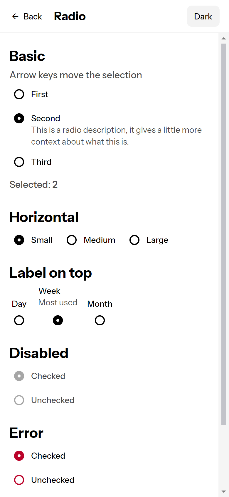
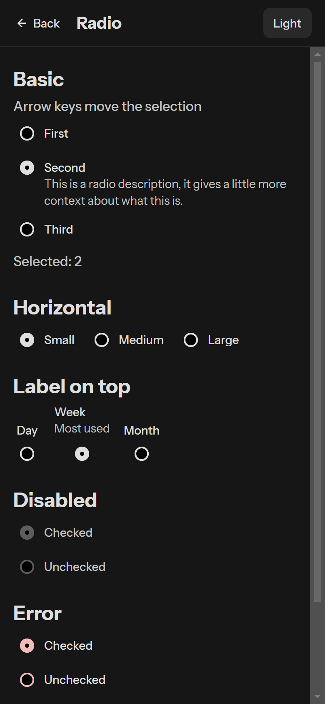

# Radio

Base Web's radio-v2 `Radio`, `RadioGroup` and `StatefulRadioGroup` (baseui 18.2.0, `radio-v2/`), as
`Metered.Controls.Radio`, an Avalonia `RadioButton`, and `Metered.Controls.RadioGroup`, an `ItemsControl` of them.

The sample's page, drawn headless by `PreviewGallery` in Instrument Sans, the substitute for Uber Move Text
([ADR 0003](../../decisions/0003-font.md)).

## Which radio

baseweb.design at 18.2.0 (the publish is commit `3adb0478c965`; the repository has no `v18` tags) lists two:
"Radio", `baseui/radio`, under a banner that says it is about to be deprecated in favour of Radio-v2 and that new
work should start with Radio-v2; and "Radio-v2", `baseui/radio-v2`, whose page is also headed "Radio". Metered's is
radio-v2: Base Web's advice for new work, the same API as the first's, and the one made for touch (a backplate, and
padding for a 48 px target under `@media (pointer: coarse)`).

## API

| Base Web | Metered |
|---|---|
| `checked` | `IsChecked`, which a click sets (an Avalonia radio button's) |
| `disabled` | `IsEnabled` |
| `children` | `Content`, the label |
| `description` | `Description` |
| `value` | `Value` |
| `align` | `Align` (`RadioAlign`) |
| `labelPlacement` | `LabelPlacement` (`RadioLabelPlacement`) |
| `error` | `Error` |
| `name` | `GroupName` (Avalonia's own) |
| `overrides` | `Overrides`: `Root`, `RadioBackplate`, `RadioMarkOuter`, `RadioMarkInner`, `LabelWrapper`, `Label`, `Description` |
| `isFocused`, `isFocusVisible`, `tabIndex` | set by the group |
| `onChange`, `onFocus`, `onBlur`, `onMouseEnter`, … | Avalonia's own events (`IsCheckedChanged`, `GotFocus`, …) |
| `containsInteractiveElement` | not needed: a control in the label takes its own press |
| `autoFocus`, `required`, `inputRef`, `aria-*` | not yet |

| Base Web's group | Metered's `RadioGroup` |
|---|---|
| `value`, `initialState.value` | `Value`, two-way: a click or an arrow key sets it |
| `align`, `labelPlacement`, `error` | `Align`, `LabelPlacement`, `Error`: each radio draws them in place of its own, which it keeps for when it leaves |
| `disabled` | `IsEnabled`; a radio's own stays |
| `onChange` | `Value`'s change |
| `overrides` | `Overrides`: `RadioGroupRoot` |
| `role="radiogroup"` | announced as a group (Avalonia has no radio group); `aria-invalid` has no equivalent |
| `name`, `autoFocus`, `required`, `stateReducer`, `aria-*` | not yet |

## Behaviour, as Base Web's

- The unchecked mark is a 17 px ring, 2 px wide, its inside the inverse colour; checked, the inside shrinks to a 5 px
  dot over 200 ms (`timing200` on `easeOutCurve`), not on the first appearance.
- The backplate (8 padding, 8 radius, at least 32) tints under a mouse and while pressed; the inner disc tints while
  the mouse is anywhere over the radio, and while pressed. Error uses the negative tints; disabled, none.
- The focus outline (2 px of `brandBorderAccessible`, 2 px from the mark) only on a checked radio focused by keyboard
  in a group. A radio on its own never draws it: Base Web's takes `isFocusVisible` from its app.
- Label placement: the label right (default) or left of the mark, top-aligned, 4 apart, the label wrapper 8 down so
  the first line sits by the mark; or above or below it, centred. Horizontal: the label wrapper at most 240 wide, the
  label and description at most three lines each, then an ellipsis.
- The label in `LabelSmall`, `contentPrimary` (`contentSecondary` disabled); the description in `ParagraphSmall`,
  `contentSecondary`, with a text cursor. Neither is there unless given.
- A coarse pointer (a phone or tablet) pads the radio by 8 all round, so a tap 8 outside the backplate still checks it.
- The group: a column 8 apart, or a row 16 apart that wraps onto lines 8 apart, the radios at the top of a line (at
  its bottom with the label on top, so the marks line up). Only the checked radio (or the first, with none) is a tab
  stop; the arrow keys (with no Alt, Ctrl or Meta) move the selection and the focus to the next or previous enabled
  radio, wrapping. Space checks the focused radio; Enter doesn't.
- A press is any button's on the radio (Base Web's `onMouseDown`), the backplate's tint only the primary button's or a
  finger's (CSS's `:active`). A control in the label taking the focus doesn't give the radio its outline.

## Held by

- `Controls/RadioColourTests`: 56 cases (checked × error × rest, mouse over the backplate, mouse over the label, mouse
  pressed, finger pressed, keyboard focus, and disabled; light and dark): every part's colour, the inner disc's size,
  the overlay and the outline against Base Web's style functions. The states are real input.
- `Controls/RadioLayoutTests`: 16 cases (placement × align × pointer): the parts' lengths and type, and where layout
  puts them; and the three-line clamp.
- `Controls/RadioGroupTests`: the root against `RadioGroupRoot` for each align and placement (8 cases), wrapping, and
  each behaviour of the group above.
- `Controls/RadioTests`: the parts' state, hover and press by mouse and finger, the coarse pointer, the label and
  description only when given, the transition, overrides, and the drawn dot, outline and overlay.
- `Sample/RadioPageTests`: the sample's page.

The part themes are generated (`tools/tokens/radio.js`): radio-v2's style functions evaluated on Base Web's theme
with each colour replaced by its own name, so every colour is a token by name and every length is read, for every
combination of the states; the generator checks its state styles reproduce Base Web's for each combination. The
oracle (`tools/reference/radio.js`) evaluates the same functions on the real light and dark themes.

## Known differences

1. **No `Input` part.** Base Web's hidden `input` is the radio itself.
2. **A radio on its own checks itself on a click**, as an Avalonia radio button does; Base Web's is controlled only.
   In a group, Base Web's controlled and stateful groups are one: `Value` is set by a click whatever bound it.
3. **Hover is a mouse's.** Base Web's `$isHovered` comes from `mouseenter`, which a phone's browser fires on a tap
   and keeps until the next tap elsewhere; here a finger never hovers (ADR 0001). A press is any pointer's.
4. **`@media (pointer: coarse)` is the platform**: Android and iOS are coarse, desktops fine, whatever pointer a
   touch-screen laptop has.
5. **The root is a panel of its own** (`RadioRootPanel`): Base Web orders the label wrapper before the backplate in
   its markup for the top and left placements; here the panel's `LabelFirst` lays it out first. The label wrapper's
   top padding is a margin (a `StackPanel` has no padding, and draws nothing).
6. **The group's direction, wrap and gaps are its items panel's** (`RadioGroup.axaml`), as ButtonGroup's are, so an
   override of `RadioGroupRoot` doesn't change them. Its `alignItems: flex-end` (horizontal, label on top) is the
   radio's own bottom alignment, so a radio on its own with those props sits at the bottom of its slot too.
7. **A vertical group doesn't wrap**: a CSS column wraps only in a box of fixed height, which a group isn't given.
8. **The backplate's hover is its rectangle**; a browser's follows its rounded corners.
9. **`containsInteractiveElement`**: Avalonia's controls take their own press, so a control in a label never checks
   the radio; Base Web's does unless the prop is set.
10. **Marks are drawn by `RadioMark`**: the overlay (Base Web's `inset 999px 999px 0px` shadow) and the outline (CSS's
    `outline` and `outline-offset`), which a `Border`'s box-shadows can't take as tokens.
11. **Fonts**: Base Web's stack starts with Uber Move, which can't ship ([ADR 0003](../../decisions/0003-font.md)).
