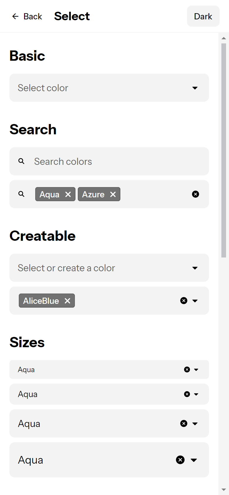
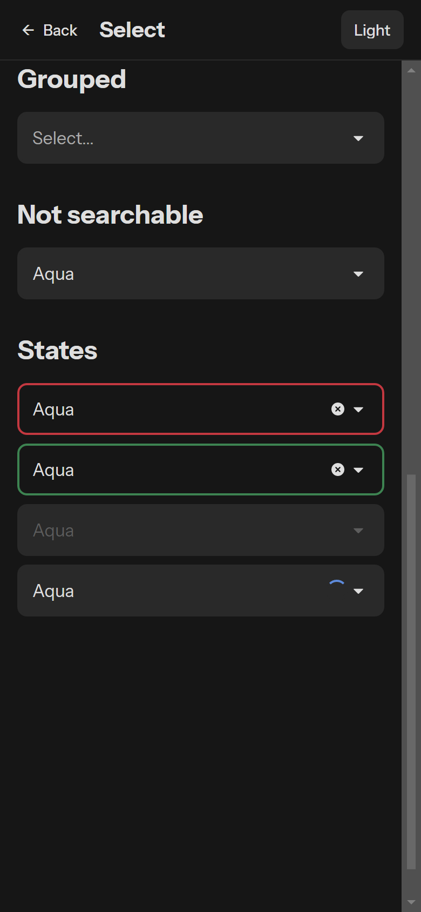
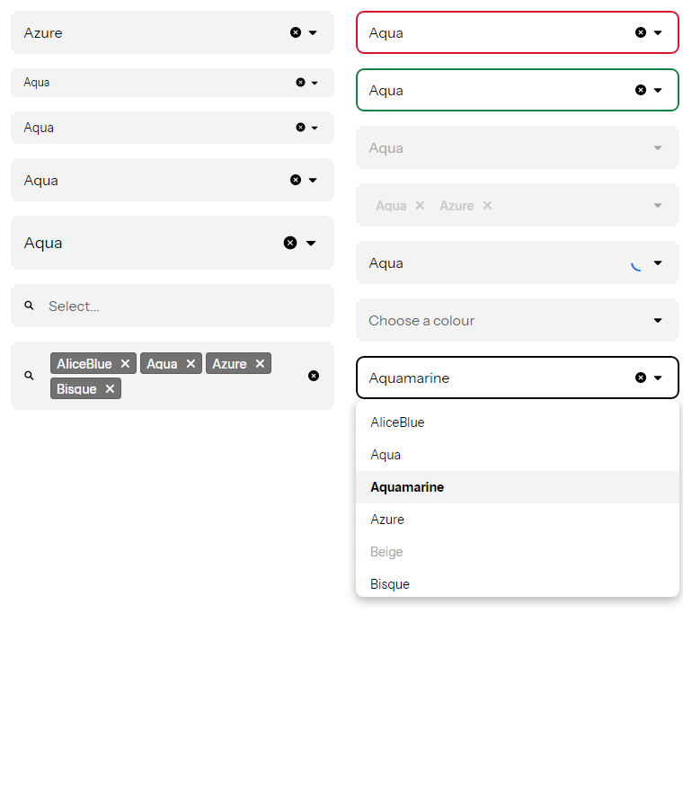
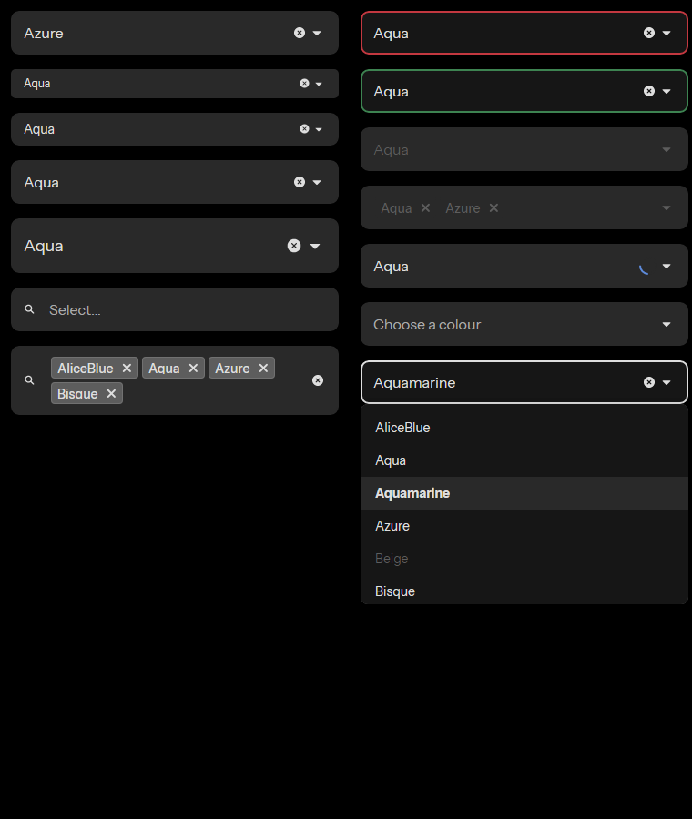

# Select

Base Web's `Select` and `StatefulSelect` (baseui 18.2.0, `select/`), as one `Metered.Controls.Select`, an Avalonia
`TemplatedControl`: single and multi, searchable and creatable, clearable, its tags for a multi value, its four sizes,
error and positive, loading, the search type, and its dropdown of options, which is Metered's `Popover` (#106) round
Metered's `Menu` (#107), as `dropdown.js` shows Base Web's own. PhoneInput (#89) is to use it.

The sample's page, drawn headless by `PreviewGallery` in Instrument Sans, the substitute for Uber Move Text
([ADR 0003](../../decisions/0003-font.md)). The documentation's examples and scenarios, from `SelectFrames`' gallery
(headless): a value, the four sizes, search single and multi, error, positive, disabled (single and multi), loading, a
placeholder, and a select open with its value highlighted:

## Which select

Read from `node_modules/baseui/select/` (`select-component.js`, `select.js`, `stateful-select.js`,
`stateful-select-container.js`, `dropdown.js`, `value.js`, `multi-value.js`, `autosize-input.js`, `utils/`,
`styled-components.js`, `default-props.js`, `constants.js`, `locale.js`, `types.d.ts`), Base Web's Tag as `multi-value.js`
renders it (`tag/tag.js`, `tag/styled-components.js`), its scenarios and tests (`src/select/__tests__/`: `select.scenario.tsx`,
`select-states.scenario.tsx`, `select-sizes.scenario.tsx`, `select-search-single.scenario.tsx`, `select-search-multi.scenario.tsx`,
`select-creatable.scenario.tsx`, `select-creatable-multi.scenario.tsx`, `select-option-group.scenario.tsx`, `select-open.scenario.tsx`,
`select-backspace-behavior.scenario.tsx` and its e2e, `select-click-maintains-focus`, `select-maintains-input-value`,
`select-controlref`, `select.e2e.ts`, `select.test.tsx`) and its documentation page and examples
(`documentation-site/pages/components/select.mdx`, `examples/select/`) at commit `3adb0478c96569dc4e593ab39c24f36dc59e39f5`, the
18.2.0 publish. There is no `select-v2`, the page has no deprecation notice, and no prop is marked deprecated.

## API

| Base Web | Metered |
|---|---|
| `options`: an array, or grouped (`{ __ungrouped: [...], Group: [...] }`) | `Options`: any objects; a `SelectOption` (a `MenuItemData`) has Base Web's `id`, `label`, `disabled` and `clearableValue`; a `SelectGroup` (`Label`, `Items`) is a grouped key (known difference 2) |
| `value` (always an array), `onChange({ value, option, type })` | `Value` (`IReadOnlyList<object>`), two-way; the routed event `Change` (`Value`, `Option`, `Type`: `SelectChangeType` select, remove, clear) |
| the state's `isOpen` (`startOpen`), `inputValue`; `onOpen`, `onClose`, `onInputChange` | `IsOpen` and `InputValue`, two-way (their first values are `startOpen`'s and the text's); `Open`, `Close`, `InputChange` |
| `multi`, `searchable` (true), `creatable`, `clearable` (true), `disabled`, `error`, `positive`, `isLoading`, `required` | `Multi`, `Searchable`, `Creatable`, `Clearable`, `IsEnabled`, `Error`, `Positive`, `IsLoading`, `Required` (UI Automation's) |
| `size` (`mini`, `compact`, `default`, `large`), `type` (`select`, `search`) | `Size` (`SelectSize`), `Type` (`SelectType`) |
| `placeholder` ("Select..."), `noResultsMsg` (the menu's "No results") | `Placeholder` (text: known difference 5), `NoResultsMsg` (any content) |
| `maxDropdownHeight` ("40vh") | `MaxDropdownHeight`, a CSS length: `vh` (of the window's height) or `px` |
| `closeOnSelect`, `backspaceRemoves`, `backspaceClearsInputValue`, `deleteRemoves`, `escapeClearsValue`, `filterOutSelected`, `ignoreCase`, `onBlurResetsInput`, `onCloseResetsInput`, `onSelectResetsInput`, `openOnClick`, `autoFocus` | the same names, the same defaults |
| `getOptionLabel({ option, optionState })`, `getValueLabel({ option })` | `GetOptionLabel` (`(option, SelectOptionState) => content`), `GetValueLabel` (`option => content`) |
| `filterOptions(options, filterValue, excludeOptions, { valueKey, labelKey })` | `FilterOptions` (`(options, text, exclude) => options`); `Select.DefaultFilterOptions` is Base Web's `defaultFilterOptions` |
| `controlRef`: `setDropdownOpen`, `setInputValue`, `setInputFocus`, `setInputBlur` | the methods `SetDropdownOpen`, `SetInputValue`, `SetInputFocus`, `SetInputBlur` |
| `aria-label` | `AutomationProperties.Name` on the select (known difference 10) |
| `overrides` | `Overrides`, by the same keys (below) |
| `valueKey`, `labelKey`, `mountNode`, `inputRef`, `id`, `onFocus`, `onBlur`, `aria-describedby`, `aria-errormessage`, `aria-labelledby` | none (known differences 2, 9, 10) |

**Parts**, by Base Web's override keys. The template's: `Popover` (the dropdown's: a `ControlledPopover`, the root its
anchor), `Root`, `ControlContainer`, `ValueContainer` (a `SelectValueContainer`: CSS's flex row, wrapping for multi),
`SingleValue`, `InputContainer` (a `SelectInputContainer`), `Input` (a `SelectInput`, Base Web's `AutosizeInput`: a bare
text box as wide as its text and 2 px), `Placeholder`, `IconsContainer`, `LoadingIndicator` (a `SpinnerRing`),
`ClearIcon`, `SelectArrow`, `SearchIconContainer`, `SearchIcon` (each icon an `InputIcon` with Base Web's own path). The
ones the select makes: `Tag` (`MultiValue` too) for each multi value (a `SelectTag`), `DropdownContainer` and
`StatefulMenu` (the dropdown's `Menu`) each time it opens, and an `OptionContent` (a `SelectOptionContent`) for each option
shown. And `Dropdown`, `DropdownOption` and `DropdownListItem`, which are the menu's `List`, `Option` and `ListItem`: the
select gives them to the menu as its overrides, under its own (the list's max height, the option's label), as dropdown.js
merges them. The `Popover` override's props are merged over select-component.js's own props for it (placement bottom, no
margin, no auto focus or focus lock, accessibility none), as Base Web spreads them after.

**The tag**: `SelectTag`, Base Web's Tag at what `multi-value.js` gives it (gray, primary, small, closeable, its root's 2 px
margins), with Tag's parts `Root` (a `RadioMark`, which draws its overlay and its ring), `Text`, `Action` and `ActionIcon`,
their themes `SelectTag.Styled{Part}` and its own `Overrides` (known difference 6). A label that React renders as text, a
string or a number (as `String(n)` writes it), is a line of LabelSmall's line height (16 px) centred in the tag's 24 px, over
its padding and drawn whole, as tag.js's border-box root, a flex row that centres its items, centres its `Text` span
(`SelectTag.TextTemplate`, #137); a control is laid out as itself, and any other label is drawn by the app's data templates.

**States**, on the select and every part (getSharedProps): `:size-*`, `:is-focused`, `:is-pseudo-focused`, `:is-open`,
`:error`, `:positive`, `:multi`, `:has-value` (`!$isEmpty`), `:searchable`, `:type-search`, `:is-loading`,
`:clearable`, Avalonia's `:disabled`, and `:loaded` (the control's border and fill transition after its first look). An
option's label: `:is-selected`, `:is-disabled`, `:is-highlighted` (its option's). A tag: `:disabled`, `:focus-visible`
(its ring), and its root's own `:hover` (a mouse's) and `:active`.

## Behaviour, as Base Web's

Its state is `select-component.js`'s, its handlers ported one by one, their `setState` calls batched as React batches them
(a focus event a handler sets off reads the state from before the handler, as Base Web's does).

- **A click or a tap on the control** (its `onClick`; a tap is a phone's click, a drag none): focuses the input and opens
  the dropdown (`openOnClick`); clicked again while focused, it closes, the caret at the text's end (Base Web's
  `this.input.value = ''`, which React's render undoes, writing the state's text back); a not-searchable one toggles, and
  unfocuses as it closes. A
  click on the input opens it. A press anywhere in the control but the input lets a browser's focus go, so the focus its
  click gives back is a focus event: that is kept (focus after a clear doesn't open it until the next click).
- **The keys** (its `onKeyDown`, on the input's keys before the input has them): Space (not searchable), the arrows, Page
  Up and Down, Home and End (not with Shift) open it; Tab closes and unfocuses it, the text reset unless a reset is off;
  Escape closes it (the popover's `onEsc`, on its release, while open: pseudo-focused), and while closed clears the value
  (`escapeClearsValue`) and unfocuses it; Backspace with no text removes the last value and gives its label back to the
  input but its last letter (`backspaceClearsInputValue` gives nothing back); Delete with no text removes the last value.
  A value that isn't `clearableValue` stays. While it is open the dropdown's menu takes the keys on the select
  (`keyboardControlNode`): the arrows, Home and End move the highlight, Enter chooses; the input's caret stays.
- **Typing** filters the options (`defaultFilterOptions`: the text, trimmed, anywhere in an option's id or label, case
  ignored; a multi select's values left out, `filterOutSelected`) and opens the dropdown; a creatable select offers
  `Create “text”` when no option or value has exactly that label (`ignoreCase`).
- **The dropdown**: as wide as the select, below it (`placement: bottom`, no margin), its menu at most `maxDropdownHeight`
  high, made afresh each time it opens, its `initialState` focused and highlighting the first value's option (or the first),
  `forceHighlight` on, type-ahead off; options grouped as `groupOptions` groups them (the ungrouped first). Choosing an
  option (a click, a tap, Enter) sets the value (single), adds it or removes it if chosen (multi), resets the text
  (`onSelectResetsInput`) and closes it (`closeOnSelect`). A disabled option is never chosen. The menu's list never takes
  the focus from the input (known difference 3).
- **Blur**: focus gone elsewhere, a click outside (the document's listener, from the first focus), or a tap outside closes
  and unfocuses it, the text reset (`onBlurResetsInput`); focus gone to a tag or the dropdown doesn't. A finger down
  outside while it is open closes it at once (Base Web's `touchstart` listener), whatever the finger does next. A
  selection's own click on the document is let go (`justSelected`), and, as Base Web's flag, a choice by Enter lets the
  next click outside go too. A tag's action stops its click: the document's listener never hears it.
- **The clear icon** (shown while clearable, enabled, not loading, with a value or text): clears the value (but values that
  aren't `clearableValue`) and the text, and focuses the input. **A tag's action** removes its value; so do Backspace and
  Delete on a focused tag (known difference 4).
- **Touch first**: a finger's drag over the select scrolls the page and opens nothing; a drag in the dropdown scrolls its
  list and chooses nothing (Menu's); a tap chooses. Avalonia's back request closes an open dropdown as Escape does
  (#123's rule: `Popover.EscOnBack`), and is the page's when it is closed.
- **UI Automation**: the input (or the input's box, not searchable) is a combo box named as Base Web's `aria-label` is
  (`Selected Aqua, Azure. ` and the select's name), expanded and collapsed as the dropdown opens and closes, and expanding
  it opens it; a tag is a button, `Remove Aqua`, invoked to remove it; the clear icon `Clear value` or `Clear all`; the
  dropdown's list a list, each option named by its label.

## How it is tested

The oracle, `tools/reference/select.js`, runs Base Web itself: its `Select` rendered (react-dom/server) for each case with
every part recorded, and each part's style function evaluated with the props it was given; the dropdown rendered from the
Popover's `content` as the Popover renders it; each tag rendered as Base Web's own Tag with `multi-value.js`'s props; and its
own `Select` class driven step by step in Node as a browser and React would drive it (focus events, the document's
listeners, React's batched state). The themes come from `tools/tokens/select.js`, which checks them against the style
functions for every combination of states. 159 tests:

- `SelectBehaviourTests` (30): Base Web's state (open, focused, pseudo-focused, the text) and value after each step of 30
  sequences, replayed with a real mouse, real touch, real keys and typing: the click, the tap and the drag, the keys that
  open, Escape and Tab, typing and its filter, choosing, the clear icon, Backspace and Delete, a tag's action, creatable,
  the resets, disabled.
- `SelectStructureTests` (26): which parts each of 16 cases shows, their text, sizes and what UI Automation reads, and the
  popover's props; and what 10 dropdowns list, in order: each option's label and states, which is highlighted first, the
  groups' headers, the empty state, the list's height and width, where it is placed.
- `SelectColourTests` (20): the control's border, fill, colour and cursor, the placeholder, the input, the arrow and the
  search icon in eight states, light and dark; the tag (its hover, its press, its ring, disabled); the loading ring; an
  option's label selected, highlighted and not.
- `SelectLayoutTests` (30): 28 cases (four sizes × single, multi, search, not searchable, empty or not): borders, radius,
  padding, height, fonts, the icons, the input's box and the input, the single value, the search icon, the tags' boxes and
  places; the clear icon's sizes; tags wrapping and a long value cut.
- `SelectFilterTests` (12): `defaultFilterOptions` against Base Web's.
- `SelectTests` (30): a finger's drag over the select in a page that scrolls, a tap, a drag in the dropdown, a finger down
  outside; typing and the menu's keys, Space's key and its text, the dropdown opened by a key, a tag's keys, the back request, disabled, `autoFocus`,
  the search icon's click; `controlRef`; labels and creatable; options changing while it is open; the dropdown's width and
  height; overrides (its own parts, the popover's, the dropdown's, a tag's, a collection changed after it is set); a tag's
  content, and a label of the app's own type drawn by the app's data template; opened out of the tree; a new template while open; the caret after a click; grouped options' highlight; tags
  removed one after another while focused; a taller value container and a label that wraps; searchable changed at run
  time to UI Automation; an override based on another theme; UI Automation; the transition and the ring.
- `SelectFrames` (5, and the gallery): drawn pixels of the control, a tag and a highlighted option; a tag's text drawn whole,
  its line centred in the tag (a string, and a number under another culture). `SelectPageTests` (4):
  the sample's page.

## Known differences

1. **One control for `Select` and `StatefulSelect`** (chosen, as Popover's and Menu's): `Value`, `IsOpen` and
   `InputValue` are set by the select whatever bound them.
2. **Options** (chosen): Base Web's options are any objects it reads `valueKey` and `labelKey` from. Here a
   `SelectOption` has `Id` and `Label` (the default keys); any other object is its own label and its own value. A
   `SelectGroup` is a grouped key; the dropdown lists the ungrouped options first, as Base Web's `groupOptions` does, and
   highlights the value in that order (Base Web's index is the options' given order, the same whenever its `__ungrouped`
   key comes first, as it conventionally does). As Base Web's `expandValue`, a value is shown as the option with the same
   id (as text).
3. **The dropdown's list never takes the focus** (chosen): Base Web's list (`tabIndex={0}`) takes it on a press, and a
   single select's choice gives it back to the input (`focus()`); a multi select's leaves it on the list, which goes as the
   dropdown closes, so the page has no focus while the select looks focused. Here the input keeps it in both. The
   alternative: the list focusable, as Base Web's.
4. **A tag's Backspace and Delete are the tag's alone** (chosen): in Base Web the key removes the focused tag (tag.js) and
   then reaches the select's own handler, whose `popValue`, reading the value from before the first removal, removes the
   last value in its place, so the focused tag stays unless it is the last. Here only the focused tag goes. The
   alternative: Base Web's.
5. **`Placeholder` is text** (chosen): Base Web's is any node. The alternative: any content, as `NoResultsMsg` is.
6. **The tag is `SelectTag`, only what the select uses of Base Web's Tag** (not yet): until Metered has the Tag control. Its
   parts and overrides are Base Web's Tag's; a `Tag` override's `component` can't replace it (ADR 0001, forced).
7. **Back closes the dropdown** (chosen, as built; Base Web has no back request): Avalonia's back request is the popover's
   Escape while it is open (#123's rule), so the shell stays on its page.
8. **No hidden `Input` in a select that isn't searchable** (forced): its input's box is the focusable element, as
   Checkbox's control is the native input.
9. **`onFocus`, `onBlur`, `inputRef`, `mountNode`, `id`** (not yet): the input's own `GotFocus` and `LostFocus` bubble
   through the select; the dropdown is in the window's overlay layer (Popover 7).
10. **`aria-describedby`, `aria-errormessage`, `aria-labelledby`, `aria-activedescendant`** (not yet): UI Automation reads
    the name and the expanded state; the highlighted option is the menu's (Menu 10).
11. **English strings** (not yet): "Select...", "Create", "Clear value", "Clear all", "Remove …" and the menu's "No results"
    are Base Web's locale's defaults; there is no `LocaleProvider`.
12. **Right to left** (not yet).
13. **The autosize input starts at the text's width** (forced, and invisible): Base Web's `AutosizeInput` is 5 px until it
    has measured its sizer once mounted; here it is measured before it is drawn.
14. **On a phone and in a real window** (not yet): tested headless only (#133).
