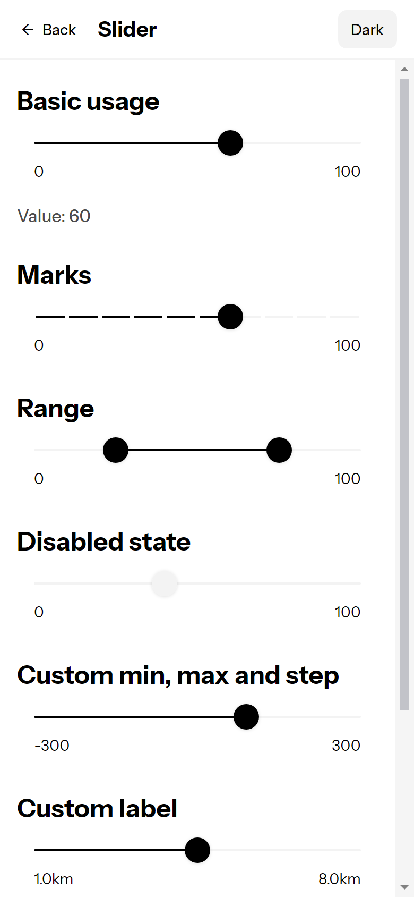
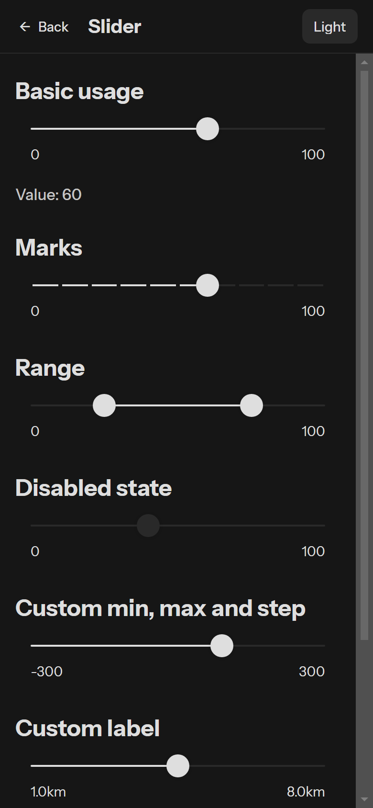
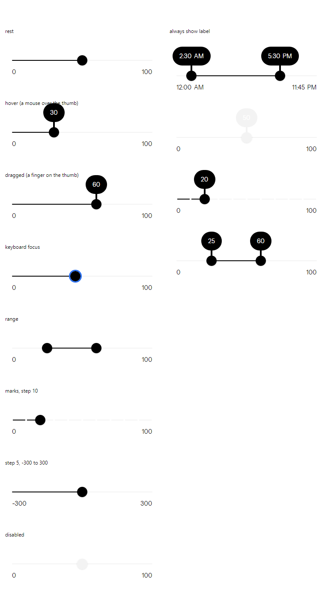
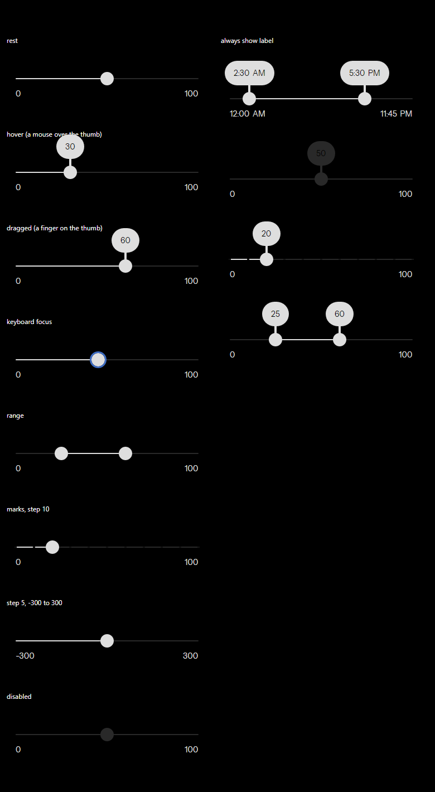

# Slider

Base Web's `Slider` and `StatefulSlider` (baseui 18.2.0, `slider/`), as `Metered.Controls.Slider`, a `TemplatedControl`,
dragged and stepped as react-range 1.10.0 does it (`react-range/lib/Range.js`, `utils.js`), which Base Web's slider
renders through.

The sample's page, drawn headless by `PreviewGallery` in Instrument Sans, the substitute for Uber Move Text
([ADR 0003](../../decisions/0003-font.md)). The states, from `SliderFrames`' gallery (headless): at rest, a mouse over a
thumb, a finger on one, keyboard focus, a range, marks, a step of 5 on −300 to 300, disabled, and labels always shown
(with the scenario's time of day as the label):

## Which slider

Read from `node_modules/baseui/slider/` (`slider.js`, `styled-components.js`, `stateful-slider-container.js`,
`constants.js`, `types.d.ts`), react-range's `Range.js` and `utils.js` (1.10.0, as `baseui` installs it), the scenarios
(`src/slider/__tests__/`) and the documentation page and examples (`documentation-site/pages/components/slider.mdx`,
`documentation-site/examples/slider/`) at commit `3adb0478c96569dc4e593ab39c24f36dc59e39f5`, the 18.2.0 publish. There is
no `slider-v2`, the page has no deprecation notice, and its yard config marks no prop deprecated.

A `TemplatedControl`, not Avalonia's `Slider`: Base Web's value is an array of one or two thumbs, each its own tab stop,
where Avalonia's `Slider` (a `RangeBase`) has one thumb, its own drag, and keys react-range hasn't (Home and End).

## API

| Base Web | Metered |
|---|---|
| `value` (one or two numbers) | `Value`, an `IReadOnlyList<double>`, two-way; set in code or bound |
| `min`, `max`, `step` | `Min`, `Max`, `Step` (0, 100, 1) |
| `disabled` | `IsEnabled` |
| `marks` | `Marks` |
| `persistentThumb` | `PersistentThumb` |
| `valueToLabel` | `ValueToLabel`, a `Func<double, object?>`: each thumb's label and both ticks |
| `onChange`, `onFinalChange` | `Change` and `FinalChange`, routed events with the value, raised where react-range calls them |
| `overrides` | `Overrides`: `Root`, `Track`, `InnerTrack`, `Thumb`, `InnerThumb`, `ThumbValue`, `Tick`, `TickBar`, `Mark`; a part there are several of takes its override on each |
| `initialState`, `stateReducer` (`StatefulSlider`) | not needed: the slider keeps its value, which an app binds. No value is `StatefulSlider`'s start, the middle: `[Math.round((max − min) / 2) + min]` |

The parts: `Root` (a column) holds the `Track` (the band a press starts on, padded `scale600` round the line) and the
`TickBar`. The `Track` holds the `InnerTrack` (`SliderInnerTrack`), the line, which holds a `Mark` at each step and a
`Thumb` (`SliderThumb`) for each value, each with its `ThumbValue` and `InnerThumb` while its label shows. The `TickBar`
holds two `Tick`s, the minimum and the maximum (`MinTick` and `MaxTick` in the template). The slider makes the marks,
thumbs and labels, and places them, and the two ticks, as their parts (`Parts.Place`).

## Behaviour, as Base Web's

- **The line**: 2 px, `radius100`, inside the track's 16 px padding; react-range's `getTrackBackground` with a hard stop
  at each thumb: `borderSelected` from the start to one thumb or between two, `borderOpaque` for the rest; disabled,
  `borderOpaque` and `borderStateDisabled`.
- **A thumb**: 24, round, `sliderHandleFill` (`sliderHandleFillDisabled` disabled) over Base Web's
  `0 1px 4px rgba(0, 0, 0, 0.12)`; centred on its value along the line (react-range's `getOffsets`: the line's width ×
  the value's place − half the thumb) and on the line across it.
- **Its label**, while a mouse is over the thumb or it is dragged (by a pointer or a held key), always with
  `PersistentThumb`, never disabled unless persistent (slider.js): `ThumbValue`, the value in `font200`,
  `contentInversePrimary` on `sliderHandleInnerFill`, padded 16 by 12 and fully rounded, 56 above the thumb's top and
  centred over it; and `InnerThumb`, a 4 × 20 stem from 16 above the thumb into it. Both overflow the slider, as Base Web's do.
- **Marks**, with `Marks`: a 4 × 2 gap in `backgroundPrimary` at each step (react-range's `calculateMarkOffsets`, its
  whole pixels included), under the thumbs.
- **Ticks**: the minimum and the maximum, `font200`, `contentPrimary`, under the line at its ends (`TickBar`: padding
  16, 0, 16, 10; `space-between`).
- **A press on the track**, by a mouse's primary button, a finger or a pen (react-range's `onMouseDownTrack` and
  `onTouchStartTrack`): the closest thumb (`getClosestThumbIndex`, the first on a tie) is focused, with no ring, and
  moved to the pointer; a press on a thumb drags that one, even where another is closer (`onMouseOrTouchStart`), so of
  two thumbs on one value the later, drawn on top, takes it. The drag follows the pointer anywhere, captured, until the
  release (react-range listens on the document); `FinalChange` then, whether anything moved or not.
- **A move** is taken only half a step or more from the thumb's value (`onMove`), and lands where react-range's
  `normalizeValue` puts it: between its neighbours, inside the ends, on a step from `Min`, rounded to the step's
  decimals.
- **Touch first**: a touch that starts on the track (the line, its 16 px band, a thumb or its label) is the slider's.
  Base Web's `touchmove` handler prevents the page's scrolling; here the press skips Avalonia's gesture recognisers
  (`PreventGestureRecognition`, as Cornflower's `PhoneNoManipulation`), so a drag across, or mostly up the page, moves
  the thumb and never pans a `ScrollViewer`; the same drag off the slider pans it, as does one the slider doesn't take
  (a second finger, or a slider with no range).
- **Keys** on a focused thumb (react-range's `onKeyDown`): ArrowRight, ArrowUp, `k` and PageUp up a step (PageUp ten),
  ArrowLeft, ArrowDown, `j` and PageDown down; `Change` each time, even at an end; the thumb is dragged (its label shows)
  until the key's release, which makes the change final. `K` (Shift) isn't `k`. Tab, or any other key, makes a change the
  keys made final. Each thumb is a tab stop.
- **Focus**: a keyboard's focus rings its thumb with Base Web's `0 0 0 3px borderAccent` in place of the shadow; a
  pointer's doesn't. A keyboard's ring stays through a drag of the thumb it's on, as react-range's focus of a focused
  thumb raises nothing.
- **Hover is a mouse's** (ADR 0001): a finger shows a thumb's label while it drags it, and not after. A mouse over the
  label is over its thumb (the label is the thumb's child, as `mouseenter` counts it).
- **`:range`** (two values), **`:is-dragged`** (the track and line for any thumb; a thumb, its value and its stem for
  their own) and **`:focus-visible`** (a thumb for its own keyboard focus, the other parts for the slider's) are the
  parts' states, from Base Web's `$` props.
- **UI Automation**: each thumb is a `Slider` with a range value: its value, bounded by its neighbours or the ends
  (`aria-valuemin`, `aria-valuemax`), a step small and ten large; named by the slider's `AutomationProperties.Name`. A
  change of its value, or of a neighbour's that bounds it, is raised.

## Held by

- `Controls/SliderColourTests`: 24 cases (one thumb and two × rest, mouse over, finger pressed, keyboard focus, labels
  always shown, disabled; light and dark): the track, the line's selection and rest, the marks, the thumb's fill and its
  shadow or ring, whether its label shows and its colours, and the ticks, against Base Web's style functions. The states
  are real input.
- `Controls/SliderLayoutTests`: 12: the track's padding and the line, the tick bar and the ticks, each thumb on its value
  (six values), the label above its thumb, the marks for three steps (one fractional), and marks turned on and off, the
  ones there kept.
- `Controls/SliderTests`: 258: react-range's `normalizeValue` on 198 cases from the oracle; a number as JavaScript writes it
  (18 cases, `String(n)`, for the labels and a step's decimals); a click, a press on a thumb,
  a drag off the slider, a right press, two thumbs (the closer, the one pressed, never crossing), a touch drag and a touch
  on the track, a touch drag in a ScrollViewer across, mostly up, and off the slider; two thumbs on one value; a finger
  never hovering; the eight keys, Shift+K, another key and Tab, a step past the end, Tab between thumbs, the ring for a
  keyboard's focus only and through a drag, a key's drag ended by disabling, the focused thumb taken away; the label under
  a mouse and on it, `PersistentThumb`, disabled; a minimum not below the maximum, and a touch it doesn't take still panning the page; the dragged thumb taken away; steps past counting; the value's start, its checks, a second thumb; `ValueToLabel`; the parts' states;
  overrides on every element of a part; UI Automation.
- `Controls/SliderFrames`: the drawn line, two thumbs' selection, the marks' gaps, the round thumb over its shadow, the
  ring, and the gallery above: 7.
- `Sample/SliderPageTests`: the sample's page, 3, a touch drag on its first slider in the page's ScrollViewer among them.

The part themes are generated (`tools/tokens/slider.js`): the slider's style functions evaluated on Base Web's theme with
each colour replaced by its own name, for every combination of the states, written by `radio.js`'s theme writer as the
fewest layered styles and checked against Base Web's for each combination; it also checks that no style function reads
a prop the states leave out. The oracle (`tools/reference/slider.js`) evaluates the same functions on the real light and
dark themes, and calls react-range's own `normalizeValue`.

## Known differences

1. **A neighbour at 0 holds a thumb.** react-range's `normalizeValue` tests a neighbour by its truthiness
   (`if (prev && prev > value)`), so a neighbour at 0 doesn't hold the thumb, and on a slider from below 0 two thumbs can
   cross (`[0, 20]` on −50 to 50: thumb 2 dragged to −10 goes there). Here it stops at 0, as at any other neighbour. The
   oracle's cases leave those out; `A_neighbour_at_zero_holds_a_thumb_as_any_other_does` holds the difference. A
   deviation Avalonia doesn't force: for the developer to keep or undo.
2. **The thumb's shadow is a token.** Base Web writes `rgba(0, 0, 0, 0.12)` in its style function; Metered keeps literal
   colours in `Tokens/` (CLAUDE.md, rule 5), so it is `slider.boxShadow.thumb` (`Tokens/SliderBoxShadows.g.axaml`), the
   same in both themes, and a built theme copies it.
3. **The focus ring is drawn as an outline.** Base Web's `0 0 0 3px borderAccent` is a spread-only shadow, which on a round
   box is a 3 px ring at no offset; a `BoxShadows` value can't take a colour by token, so `SliderThumb` draws it as a line
   (`OutlineBrush`, `OutlineThickness`, `OutlineOffset`), and its `BoxShadow` is none meanwhile, as Base Web's
   `boxShadow` is the ring alone.
4. **Cursors**: Avalonia has no grab cursors, so react-range's `grab` and `grabbing` on a thumb, and the track's
   `grabbing`, are the hand, as `pointer` is; `not-allowed` is `No`; CSS's `inherit` is a binding to the parent's cursor.
   A disabled slider takes no pointer here (Avalonia doesn't hit-test it), so its `not-allowed` isn't seen.
5. **The mark's margin is spent.** react-range places a mark from the root (the line isn't positioned), and Base Web's
   `marginLeft: 16px` brings it back by the track's padding; here a mark is placed from the line, so the generator checks
   the margin equals the padding and doesn't set it.
6. **Moves aren't put off to the next frame.** react-range runs `onMove` once a frame (`schd`); here each pointer move is
   taken as it comes. The value at the end is the same.
7. **One pointer at a time.** react-range follows `touches[0]`; here the pointer that started the drag, and any other
   press waits for its release.
8. **A component override that renders something else** (Base Web's `InnerThumb: () => null`, or a `TickBar` of six
   ticks) has no equivalent: an override here is a theme for the part's element, which can hide it or restyle it.
9. **The value's checks**: Base Web throws for more than two values, and react-range for a value outside the ends, two out
   of order, a step of 0, or a minimum not below the maximum. Here more than two and a step of 0 or less are refused
   (`ArgumentException`); a value outside the ends is held at the nearer, two out of order are put in order, as Avalonia's
   `RangeBase` coerces; and a slider whose minimum isn't below its maximum is drawn and takes no input, as `Min` and `Max`
   are set one at a time.
10. **A key's drag ends with the slider's focus or its use.** react-range ends a held key's drag on its release, on the
    thumb; if the thumb loses the focus first, or the slider is disabled, that release never comes and Base Web's label
    stays shown. Here the drag ends then, and its change is final. So does a pointer's drag of a thumb the app takes
    away (two values become one), whose index react-range would go on reading.
11. **Right to left isn't done**, as for Switch: react-range inverts the keys and mirrors the gradient for `rtl`; the
    themes are generated left to right, and a `FlowDirection` of `RightToLeft` hasn't been tried.
12. **Accessibility**: react-range labels every thumb "Accessibility label" (Base Web passes no `label`); here a thumb
    takes the slider's `AutomationProperties.Name`.
13. **Fonts**: Base Web's stack starts with Uber Move, which can't ship ([ADR 0003](../../decisions/0003-font.md)).
14. **Tried on a Pixel 8** (Android 17 (API 37), Release, 2026-11-21, #64): a touch drag across a slider moves its thumb and not
    the page; a drag mostly up the page that starts on the thumb still moves the thumb and doesn't scroll; a drag from a
    heading scrolls the page; a tap on the line moves the thumb there; a held finger shows the thumb's label and lifting
    it hides it, with no sticky hover. The touch tests are otherwise headless (Avalonia's headless touch through its real
    input pipeline, and Avalonia's own ScrollViewer with the Simple theme's gesture recogniser). The real-window run
    (`tools/real-window/drive.ps1`, Windows' injected touch and the mouse, 2026-11-21) passed its slider section too.
