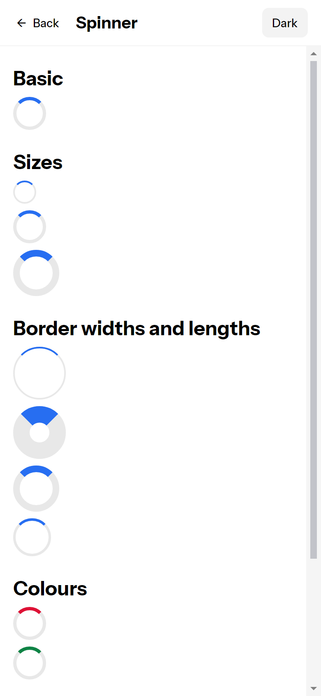
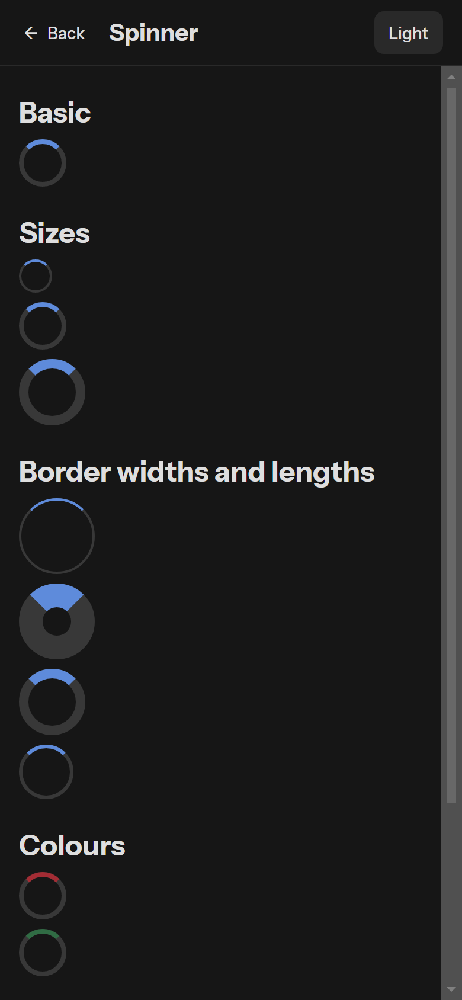

# Spinner

Base Web's `Spinner` (baseui 18.2.0, `spinner/`), as `Metered.Controls.Spinner`, a `TemplatedControl` of one part.

The sample's page, drawn headless by `PreviewGallery`, the rings held still at 0° (below, "The turn").

## Which spinner

Read from `node_modules/baseui/spinner/` (`index.js`, `styled-components.js`, `constants.js`, `types.d.ts`), its
scenario (`src/spinner/__tests__/spinner.scenario.tsx`), and its documentation page, examples and yard config
(`documentation-site/pages/components/spinner.mdx`, `documentation-site/examples/spinner/`,
`documentation-site/components/yard/config/spinner.ts`), at commit `3adb0478c96569dc4e593ab39c24f36dc59e39f5`, the
18.2.0 publish. There is no `spinner-v2`, the page has no deprecation notice, and no prop is marked deprecated.

Base Web's spinner is one styled component, `StyledSpinner`, an `<i>` with `role="progressbar"`,
`aria-label="loading"` and `aria-busy="true"`. Here that element is the part `Spinner`, a `SpinnerRing`, whose theme is
`Spinner.StyledSpinner`.

## API

| Base Web | Metered |
|---|---|
| `$size` (`SIZE.small`, `.medium`, `.large`, a sizing token's name, a number or a length) | `Size`, a `SpinnerLength` (`SpinnerSize.Small`, `.Medium`, `.Large`, `"scale1000"`, `60`, `"60px"`); medium by default |
| `$borderWidth` (the same) | `BorderWidth`, a `SpinnerLength`; unset by default |
| `$color` | `Color`, an `IBrush`; null for `colors.contentAccent` |
| the style function's `boxSize` and `borderSize` for a value that isn't a name | `CustomBoxSize`, `CustomBorderSize` (read-only), which the theme binds to |
| `withStyle(Spinner, {…})`, `$style` | `Overrides`: `Spinner` |
| `$as` | not mapped: the element's type only matters to HTML's flow |
| `role`, `aria-label` | `SpinnerAutomationPeer`: a progress bar, named "loading" unless the app names it (`AutomationProperties.Name`) |

In XAML, `Size` and `BorderWidth` read `Small`, `Medium` or `Large` (in any case) as the size, text that is a number
(`60`, `0`) as that number, as JSX's `{60}`, and anything else as text, as Base Web's string: `scale1000`, `60px`. In
C#, `new SpinnerLength("medium")` is the size, as Base Web's `SIZE.medium` is that string; its lookup is
case-sensitive, so `"Medium"` there is text.

## Behaviour, as Base Web's

From its style function:

- The ring: a round box whose top border is `$color` (`contentAccent`) and whose other three are `backgroundTertiary`,
  the colours meeting on the diagonals.
- The box: `small`, `medium`, `large` are `sizing.scale800`, `scale900`, `scale1000` (24, 32, 40); another value is a
  sizing token's name (`$theme.sizing[$size]`), else `parseInt($size)` pixels (`60`, `"60px"` and `"60.7px"` are 60;
  `"0x10px"` is 16, as `parseInt` reads hexadecimal).
- The border: looked up by `$borderWidth || $size` among the names: `sizing.scale0`, `scale100`, `scale300` (2, 4, 8),
  so an unset border follows a named size; else `$theme.sizing[$borderWidth]`, else `parseInt($borderWidth)` pixels.
  JavaScript's truth decides: a `BorderWidth` of `0` (a number) with a named size takes the size's border, as
  `$borderWidth={0}` does; with a size that isn't a name it is 0.
- No `box-sizing`, so CSS's content box: the border is outside the box. A medium spinner is 40 across (32 + 2 × 4), a
  large one 56, a small one 28.
- A value a browser drops: with no `$borderWidth` and a size that isn't a name, Base Web writes `border-width: NaNpx`,
  which a browser drops for CSS's initial `medium`, 3 px; so does a negative border. Metered draws 3.
- `display: block`: at the start of its line, as wide as the ring; stretched by an app, the ring stays at the start of
  the spinner's box. `cursor: wait` over all of the round box, its hollow middle too.
- The turn: `rotate(0deg)` to `rotate(360deg)`, once each `animation.timing1000` (1 s), linear, without end.

The Spinner reads `$size` and `$borderWidth` into its state pseudoclasses, set on it and on its part:
`:size-small|medium|large` for a name; `:size-custom` for a sizing token the theme has or a length, whose value it
reads into `CustomBoxSize` (the token from the resources it sees, so a theme's own sizing reaches it, as Base Web's
`$theme.sizing` does); `:size-invalid` for none of these; the same for `:border-width-…` and `CustomBorderSize`; and
`:has-color`. The generated theme sets the box and the border for each name, binds the custom ones to the spinner's
and the colour to `Color`, so an override's setters still win over all of them (ADR 0001).

## The turn

A style animation of `RotateTransform.Angle`, 0 to 360, as Button's ring turns; Avalonia puts a group of transforms in
the ring's `RenderTransform` to hold the rotation. It is tested at its end values: the animation's keyframes,
duration, easing and count against Base Web's, and that the angle moves on Avalonia's clock, which in the tests is the
test's own (`TestClock`, #127): the ring stands still however long a test takes, and turns by `Scene.Advance`. A
frame-by-frame comparison with Base Web's is still to come (#13). A test's `Dispatcher.UIThread.RunJobs()` promotes the
dispatcher's due timers (among them the one that asks for the animations' next frame) only after it runs a job, and runs
none when nothing is queued; an app's main loop doesn't wait for a job. So `Scene.Advance` queues an empty job at each
millisecond, and the angle helper one before each frame it reads. Before the test clock, on real time, the angle tests
retried a 150 ms sleep up to five times for a slow runner (#69); now one `Advance(150)` is the same on any machine.

**`:metered-still`.** A turn without end would keep `PreviewGallery` from ever drawing a picture at rest, so it runs
only while the ring isn't `:metered-still`. Only the tests set it: `PreviewGallery` sets it on every element of a
screen before its picture, and the ring then stands at 0°, Base Web's `from`. It is a style inside the part's
`ControlTheme`, not a global rule (the style budget stays 0 of 10). Base Web 18.2.0 reads no
`prefers-reduced-motion` anywhere (`grep` over `node_modules/baseui`), so it has no state of its own that this could
stand for. Headless, a ring whose `:metered-still` is taken off again doesn't turn until something else asks for a
frame; nothing does that but a test.

## Shared with Button's ring

Button's `LoadingSpinner` and the spinner are the same CSS: a round box, its top border one colour, the rest another,
turned. So they share the drawing, `SpinnerRing` (`Foreground`, `Background`, `Thickness`), and `ButtonLoadingSpinner`
is a `SpinnerRing`, its type, properties and theme unchanged. The themes stay apart, as the style functions are:
Button's is `box-sizing: border-box`, coloured by kind, 700 ms; the spinner's is content-box (`BoxSize`, which Button's
leaves unset), coloured by `$color`, 1 s.

## Held by

- `Controls/SpinnerColourTests`: 6 cases (light and dark × no `$color`, the theme's `negative`, its `positive`): the top
  and the rest against Base Web's, and the pixels the ring draws at rest.
- `Controls/SpinnerLayoutTests`: 195 cases (`$size` × `$borderWidth`: unset, the three names, sizing tokens, lengths,
  numbers, 0, negative numbers and lengths, text that is none of these; the scenario's among them): the box, the
  border and the size layout gives the spinner; and its place in a wider parent, stretched or not (196 in all).
- `Controls/SpinnerTests`: the turn's end values, that it turns, that `:metered-still` holds it at 0°, the cursor over
  the whole disc (a ring all border too), the colour following `Color`, the states moving with the lengths, a sizing token the theme holds (one
  Base Web lacks, another value for one it has), the text the lengths are read from, an override over the props, the
  automation peer, and Button's ring keeping its border box: 11 in all.
- `Sample/SpinnerPageTests`: the sample's page, 3.

The part theme is generated (`tools/tokens/spinner.js`): the style function evaluated on Base Web's theme with each
colour replaced by its own name, for each value of each prop, checked to move only its own property. The oracle
(`tools/reference/spinner.js`) evaluates the same function on the real light and dark themes.

## Known differences

1. **One part, restyled by `Overrides`.** Base Web's spinner has no `overrides` prop; `withStyle` and `$style` restyle
   it. An override's setters are in Avalonia's terms: a `BoxSize` of 96 and a `Thickness` of 12 for the documentation's
   `width: 96px` and `borderWidth: 12px`.
2. **The content box is read from the style function, not measured.** Base Web sets no `box-sizing`, and CSS's default
   is `content-box`; an app with a global `border-box` reset would draw it smaller. baseweb.design hasn't been
   measured for it.
3. **A box a browser drops draws nothing.** With `$size` neither a name, a sizing token nor a length (`"abc"`), or a
   negative one, Base Web writes `NaNpx` or a negative width, which a browser drops: the `<i>` is then a block as wide
   as its container and as high as its borders. Metered draws no ring (`BoxSize` NaN).
4. **The names' lengths are numbers.** As every part theme's (ADR 0001, item 8), the boxes and borders of `small`,
   `medium` and `large` are written in the theme, so a theme built with other `scale800` to `scale1000` doesn't reach
   them. A sizing token named by text is read from the theme, so it does; text naming a token the theme doesn't have is
   read by `parseInt`, as Base Web's.
5. **A number in XAML is a number.** XAML has only text; `BorderWidth="0"` is `$borderWidth={0}`, not `"0"`.
6. **The arc ends square**: a CSS border's colour changes on a diagonal mitre, as Button's ring.
7. **Accessibility**: a progress bar named "loading", with no value, as Base Web's has none; `aria-busy` has no Avalonia
   equivalent.
8. **`:metered-still`**, above: a style that exists for the pictures.
9. **The name**: Avalonia has a `Spinner` of its own (`ButtonSpinner`'s base), so C# that uses both namespaces names
   Metered's in full, as with `Button`; XAML's `b:Spinner` is unambiguous.
