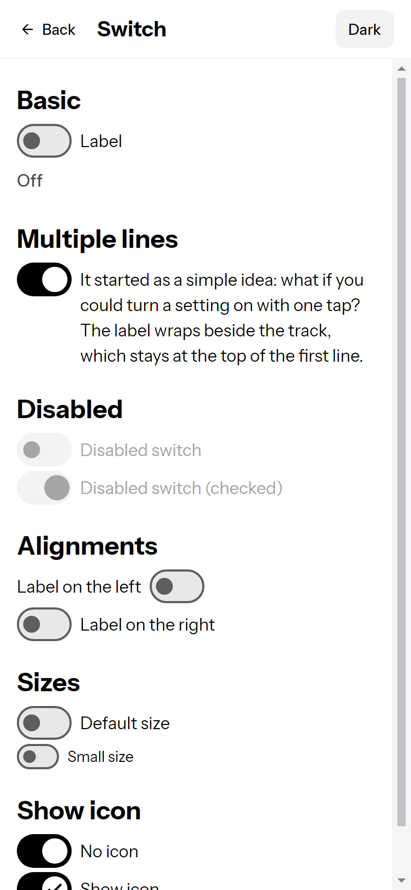
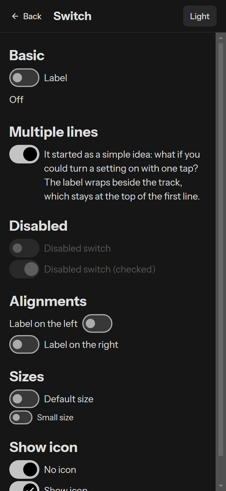

# Switch

Base Web's `Switch` and `StatefulSwitch` (baseui 18.2.0, `switch/`), as `Metered.Controls.Switch`, an Avalonia
`ToggleButton`.

The sample's page, drawn headless by `PreviewGallery` in Instrument Sans, the substitute for Uber Move Text
([ADR 0003](../../decisions/0003-font.md)).

## Which switch

Metered reproduces Base Web's v2 controls (the developer's decision of 2026-11-17). Base Web's v1 `Checkbox` had a
toggle style (`checkmarkType="toggle"`); 18.2.0 has a component of its own for it, `baseui/switch`, which this is.
Read from `node_modules/baseui/switch/` (`switch.js`, `styled-components.js`, `constants.js`, `types.d.ts`), its
scenarios and its browser test (`src/switch/__tests__/`), and its documentation page and examples
(`documentation-site/pages/components/switch.mdx`, `documentation-site/examples/switch/`), at commit
`3adb0478c96569dc4e593ab39c24f36dc59e39f5`, the 18.2.0 publish. Neither the page nor its yard config marks a prop
deprecated.

On Avalonia's `ToggleButton`, not its `ToggleSwitch`: Base Web's switch is a checkbox input with one label, and
Avalonia's `ToggleSwitch` brings on and off content and a knob that drags, which Base Web's doesn't have.

## API

| Base Web | Metered |
|---|---|
| `checked` | `IsChecked`, which a click, Space, or Enter on its release toggles |
| `disabled` | `IsEnabled` |
| `children` | `Content`, the label |
| `size` (`SIZE.default`, `SIZE.small`) | `Size` (`SwitchSize`) |
| `labelPlacement` (`LABEL_PLACEMENT.left`, `.right`) | `LabelPlacement` (`SwitchLabelPlacement`), right by default |
| `showIcon` | `ShowIcon` |
| `overrides` | `Overrides`: `Root`, `ToggleTrack`, `Toggle`, `Label` |
| `onChange`, `onFocus`, `onBlur`, `onMouseEnter`, `onKeyUp`, … | Avalonia's own events (`IsCheckedChanged`, `GotFocus`, …) |
| `initialState`, `stateReducer` (`StatefulSwitch`) | not needed: the switch keeps its own state, which an app can bind |
| `title` | Avalonia's `ToolTip.Tip` |
| `containsInteractiveElement` | not needed: a control in the label takes its own press |
| `autoFocus`, `required`, `name`, `value`, `id`, `inputRef`, `aria-*` | not yet |

## Behaviour, as Base Web's

- The track: 52 × 32 (40 × 24 small), fully rounded, 4 padding. Off, `backgroundTertiary` with a 2 px
  `contentTertiary` border; on, `backgroundInversePrimary` and no border; disabled, `backgroundStateDisabled` with a
  2 px `borderStateDisabled` border, on or off.
- The knob: 16 off, 24 on (12 and 16 small), `contentTertiary` off, `contentInversePrimary` on, `contentStateDisabled`
  disabled; at the start of the track, centred across it (the disabled, checked knob, larger than the track's box,
  overflows it both ways, as CSS's does), and on, moved 20 along (16 small) over 350 ms on
  `cubic-bezier(0.27, 1.06, 0.18, 1.00)`, not on the first appearance. Its size changes at once: CSS transitions
  only the transform.
- `ShowIcon`: on, a checkmark in `contentPrimary`, 16 (12 small), in the middle of the knob; its path is Base Web's
  SVG's.
- On or off: `IsThreeState` is held false, as Base Web's switch has no third state.
- Under the mouse (anywhere over the switch, its label included): the track takes `hoverOverlayAlpha` off and
  `hoverOverlayInverseAlpha` on, the knob the other one, each over its fill (Base Web's `inset 0 0 0 999px` shadow).
- Focused by keyboard: a 2 px `brandBorderAccessible` outline, 2 px out from the track. Not on a click's focus.
- The label: `ParagraphMedium` (`ParagraphSmall` small), `contentPrimary` (`contentStateDisabled` disabled), 8 from
  the track and 4 down (2 small), right of the track or left of it; only when there is content. It wraps beside the
  track, which stays at the top.
- A coarse pointer (a phone or tablet) pads the switch by 8 all round (12 small), making it 48 high; a tap in the
  padding toggles it.
- Enter toggles on its release (Base Web's `onKeyUp`), Space as a checkbox's. `:is-active` (Base Web's `$isActive`)
  is set while any pointer presses the switch or Space or Enter is held, and ends on the release or when the mouse
  leaves; no style of Base Web's reads it, an override may.

## Held by

- `Controls/SwitchColourTests`: 40 cases (on and off × enabled and disabled × the checkmark or not × rest, mouse over,
  finger pressed, keyboard focus; light and dark): the track's fill, border and its width, the overlays, the outline,
  the knob's fill and the checkmark against Base Web's style functions. The states are real input.
- `Controls/SwitchLayoutTests`: 32 cases (size × placement × pointer × on and off × enabled and disabled): the parts'
  lengths and type, and where layout puts the track, the knob and the label; and a long label that wraps (33 in all).
- `Controls/SwitchTests`: toggling by click, Space and Enter (Base Web's browser test), the parts' state, hover and
  press by mouse and finger, keyboard focus, the label only with content, no third state, hover and press ending on
  disabling and on leaving the window, the coarse pointer, the transition, overrides, and the drawn checkmark, outline
  and overlay: 22 in all.
- `Sample/SwitchPageTests`: the sample's page, 3.

The part themes are generated (`tools/tokens/switch.js`): the switch's style functions evaluated on Base Web's theme
with each colour replaced by its own name, for every combination of the states, written by `radio.js`'s theme writer,
which checks its state styles reproduce Base Web's for each combination. The oracle (`tools/reference/switch.js`)
evaluates the same functions on the real light and dark themes.

## Known differences

1. **No `Input` part.** Base Web's hidden `input` is the switch itself.
2. **Hover is a mouse's.** Base Web's `$isHovered` comes from `mouseenter`, which a phone's browser fires on a tap;
   here a finger never hovers (ADR 0001). A press is any pointer's.
3. **A disabled switch draws no hover overlay.** Base Web's overlays don't look at `$disabled`, and its root's
   `onMouseEnter` fires over a disabled switch, so a browser tints one under the mouse. Avalonia doesn't hit-test a
   disabled control (measured for Radio: the hit is the window's presenter), so it never sees the mouse. For the same
   reason the not-allowed cursor isn't shown; the theme still sets it.
4. **`@media (pointer: coarse)` is the platform**: Android and iOS are coarse, desktops fine.
5. **The root is Radio's panel** (`RadioRootPanel`): Base Web orders the label before the track in its markup for the
   left placement; here the panel's `LabelFirst` lays it out first. `verticalAlign: middle` (the inline box's place in
   a line of text) has no equivalent: the switch's alignment is its parent's.
6. **The track and knob are drawn by `RadioMark`** and `SwitchToggle`: the overlay (Base Web's `inset 0 0 0 999px`
   shadow), the outline (CSS's `outline` and `outline-offset`) and the checkmark (a background image in CSS), which a
   `Border` can't take as tokens.
7. **Off, the knob's transform is `translateX(0px)`**, where Base Web sets none, so that Avalonia's transition has two
   ends to move between.
8. **Right to left isn't done.** Base Web negates the knob's move and swaps the label's padding when the theme's
   direction is `rtl`; Metered's themes are generated for left to right, and a `FlowDirection` of `RightToLeft` hasn't
   been tried.
9. **Accessibility is Avalonia's `ToggleButton`'s**: Base Web's `role="switch"` and its `aria-*` props aren't mapped yet.
10. **Fonts**: Base Web's stack starts with Uber Move, which can't ship ([ADR 0003](../../decisions/0003-font.md)).
