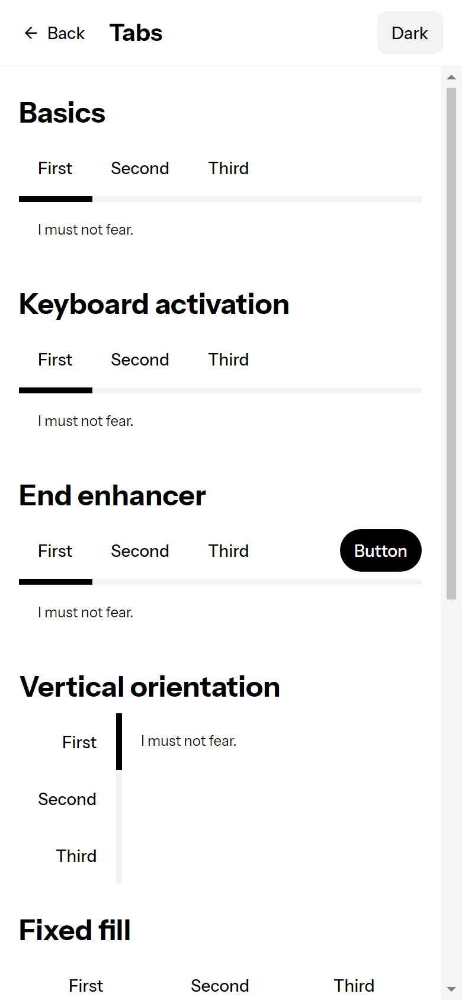
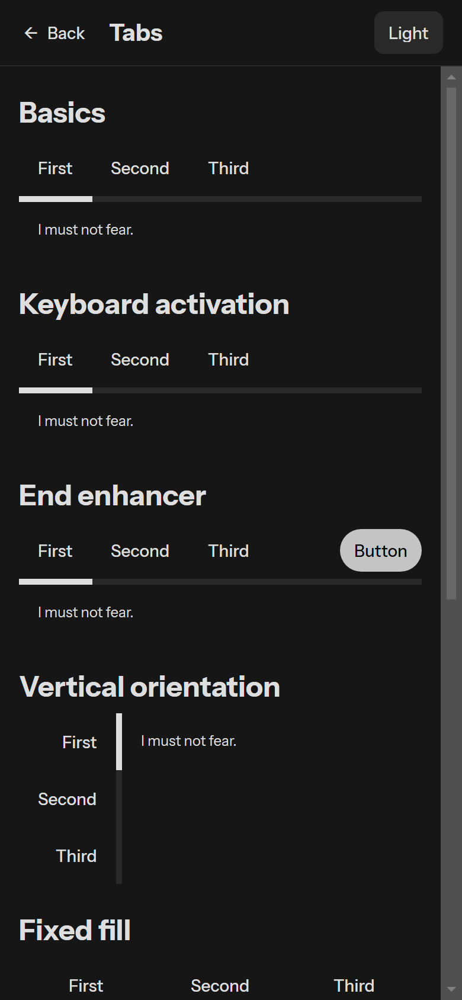

# Tabs

Base Web's `Tabs`, `Tab` and `StatefulTabs` (baseui 18.2.0, `tabs-motion/`), as `Metered.Controls.Tabs` of
`Metered.Controls.Tab` items.

The sample's page, drawn headless by `PreviewGallery` in Instrument Sans, the substitute for Uber Move Text
([ADR 0003](../../decisions/0003-font.md)).

## Which tabs

Base Web ships two: `baseui/tabs` and `baseui/tabs-motion`. Read from `node_modules/baseui/tabs-motion/` (`tabs.js`,
`tab.js`, `stateful-tabs.js`, `styled-components.js`, `utils.js`, `constants.js`, `types.d.ts`), its scenarios and
end-to-end tests (`src/tabs-motion/__tests__/`), and both documentation pages, the examples and the yard config
(`documentation-site/pages/components/tabs.mdx`, `tabs-motion.mdx`, `documentation-site/examples/tabs-motion/`,
`documentation-site/components/yard/config/tabs-motion.ts`), at commit `3adb0478c96569dc4e593ab39c24f36dc59e39f5`, the
18.2.0 publish. **`tabs.mdx` opens with a deprecation notice** ("This component is deprecated and will be removed in our
next major version ... We recommend using our new Tabs (Motion) component"), and `tabs-motion.mdx` says "The newer
design will be considered our default Tabs component going forward". There is no `tabs-v2`. So this is tabs-motion:
its animated highlight and its WAI-ARIA 1.1 keys. No prop of tabs-motion is marked deprecated.

## API

| Base Web | Metered |
|---|---|
| `<Tabs>` children, `<Tab>`s | `Items`, the XAML content: `Tab`s |
| `activeKey` (Tabs), `initialState.activeKey` (StatefulTabs) | `ActiveKey` (a string, two-way): set by a click, a tap and the keys whatever bound it (known difference 1); unset or empty, the first tab's key, StatefulTabs' initial state. Compared with each tab's key as text, as `key == activeKey` |
| `onChange({activeKey})` | the routed event `Change` (`TabsChangeEventArgs.ActiveKey`), after the state has taken the change, as StatefulTabs calls it |
| `stateReducer(state, action)` (StatefulTabs) | `StateReducer`, a `Func<TabsState, TabsAction, TabsState>`; null keeps the change (Base Web's default) |
| `disabled` | `Disabled`: every tab but the active one |
| `fill` (`FILL.intrinsic`, `.fixed`) | `Fill` (`TabsFill`), intrinsic by default |
| `orientation` (`ORIENTATION.horizontal`, `.vertical`) | `Orientation`, Avalonia's, horizontal by default |
| `activateOnFocus` | `ActivateOnFocus`, true by default |
| `renderAll` | `RenderAll` |
| `endEnhancer` | `EndEnhancer`, any content, horizontal only (ignored vertically, as Base Web) |
| `overrides` | `Overrides`: `Root`, `TabBar`, `TabList`, `TabHighlight`, `TabBorder`, `EndEnhancerContainer` |
| `uid` | **none**: there are no element ids; a panel is named by its tab (`aria-labelledby`) to UI Automation |
| Tab's `title` | `Tab.Title`, any content; none (or empty) shows the key, as `title ? title : key` |
| Tab's `key` | `Tab.Key`; unset is its index, as `child.key \|\| String(index)` |
| Tab's `artwork` | `Tab.Artwork`, any content (known difference 6) |
| Tab's `disabled` | `Tab.Disabled` (`bool?`): unset follows `Disabled`; the active tab is never disabled |
| Tab's `overrides` | `Tab.Overrides`: `Tab`, `ArtworkContainer`, `TabPanel` |
| Tab's `children` | `Tab.Content`, any content: the panel's |
| Tab's `tabRef` | **none** (no refs; `Tabs` keeps its buttons internal) |

## Behaviour, as Base Web's

- **Parts.** `Root` holds the bar, the border and the panels; `TabBar` the tab list and the end enhancer; `TabList`
  (`role="tablist"`) the tabs and the highlight. Each tab is a `TabButton` (Base Web's `<button role="tab">`): its
  `ArtworkContainer` and title. Each tab has a `TabPanel`, hidden but the active tab's, holding its content only while
  active, or always with `RenderAll` (e2e: "does not mount non selected tab content", "[renderAll] mounts").
- **A tab**: `LabelSmall`, `contentPrimary` on `backgroundPrimary`, 16 (`scale600`) of padding; under a mouse
  `backgroundSecondary` (its fill's change takes `timing200`, linear, once it is loaded); disabled `contentStateDisabled`
  with a not-allowed cursor (its line shows it: Avalonia hits nothing disabled), and no fill at all hovered
  (`:disabled:hover { background: none }`); focused by the keyboard a 3 px `borderAccent` outline drawn inside it
  (`outline-offset: -3px`). A vertical tab's content sits at its end (`justify-content: flex-end`).
- **The line**: a flex row (a column vertically) that doesn't wrap. Intrinsic tabs are as long as their titles, shrink as
  CSS's flex items do (`flex-shrink: 1`) to no less than their min-content width (their title's longest word, with the
  padding; the title then wraps), and then overflow, scrolled with no bar drawn (`overflow-x: scroll`,
  `scrollbar-width: none`). Fixed tabs share the line equally (`flex-grow: 1; flex-basis: 0`). Across the line every tab
  is as tall as the tallest (a tab with a 20 px artwork is 52 high, so all are).
- **The highlight** (`borderSelected`, 5 px) lies in the tab list's 5 px padding under the tabs (beside them vertically),
  over the border (`borderOpaque`, 5 px), which the list's -5 px margin pulls up to meet it. It is as long as the active
  tab and where it is, by `getLayoutParams`: its `clientWidth` and `offsetLeft` (`clientHeight` and `offsetTop`), whole
  pixels. Placed, not moved, when the tabs are first shown; from the first change on (`$animate`) it moves to the new tab
  over `timing400` on `easeInOutQuinticCurve`. A change of the active tab's size or place moves it too (Base Web's
  ResizeObserver on each tab).
- **Scrolling**: when the tabs are first shown, a list that overflows is scrolled so the active tab's centre is its
  centre (`scrollParentToCentreTarget`, clamped); a new active tab is brought into view (`scrollIntoView` nearest, the
  page round it too).
- **Keys** (`handleKeyDown`): on a focused tab, Left and Right (Up and Down vertically) move the focus to the previous or
  next tab that isn't disabled, wrapping at the ends, and with `ActivateOnFocus` choose it; with only one such tab
  nothing moves. A vertical list takes its arrows, so the page doesn't scroll; a horizontal one doesn't. Enter and Space
  are the button's own click (a browser's activation of a button). **Home and End do nothing**: tabs.js handles only the
  arrows (the issue listed them; Base Web has none). Only the active tab is a tab stop (`tabIndex` 0, the others -1),
  so Tab goes from it into its panel (e2e: "*tab* moves focus to active tab", "to tab content").
- **Pointer and touch**: a click or a tap chooses a tab (e2e: "*click* selects tab"), a disabled one never. Touch first: a
  finger's drag sideways along tabs that overflow scrolls them and chooses none; a drag mostly up or down is the page's;
  a drag that moves past the platform's tap size chooses nothing, as a browser gives no click for a drag. The wheel goes
  on to the page.
- **A changed tab keeps its parts**: a tab's title, artwork, content, key, disabled state or overrides changing, or tabs
  added or removed, update the parts already shown, as React renders the same elements again, so a focused tab stays
  focused.
- **UI Automation**: the list a tab control (`role="tablist"`), each tab a tab item, selected while active
  (`aria-selected`), named by its text (a title that is a control by its own text); selecting one chooses it. Each panel a pane named by its tab
  (`aria-labelledby`). The highlight and the border are hidden from it (`aria-hidden`).

## Motion

The highlight's transition and the tab's fill transition are written from Base Web's style functions into the part
themes. **They are tested at their end values** and once midway (the highlight between the two tabs halfway through
`timing400`, the fill neither colour halfway through `timing200`), as ProgressBar's are: frame by frame against Base Web
needs #13. The highlight's motion only arranges its line again, as a CSS transform moves a box without laying out the
page; its length stretches it along the line.

## Held by

- `Controls/TabsStructureTests`: 19 cases rendered by Base Web itself (tabs.js and stateful-tabs.js with every part
  recorded): the parts in order, each tab's text, key, artwork, selection, tab stop and disabled state, each panel's
  visibility, content and name, the list's role and orientation, the end enhancer, the highlight; and the first key taken
  as StatefulTabs' (20 in all).
- `Controls/TabsKeysTests`: 11 key sequences, Base Web's own `onKeyDown` and `onClick` driven step by step in Node: after
  each real key press, the tab focused, the active key, `onChange`'s keys and whether the key was taken.
- `Controls/TabsColourTests`: 16 cases (eight states, light and dark): a tab's fill, text and focus ring, the highlight and
  the border; and the focus ring drawn inside the tab (18 in all).
- `Controls/TabsLayoutTests`: 4 cases (each orientation and fill): the parts' lengths, padding, type and flex against
  Base Web's, and where layout puts them; fixed vertical tabs sharing a root's height; intrinsic tabs shrinking to their
  longest word; single words overflowing (7 in all).
- `Controls/TabsTests`: click, tap, disabled, a finger's drag sideways and up, the wheel, the highlight's motion and
  resize, centring and bringing into view, the tab stops, a vertical list's arrows, renderAll, content kept, the
  reducer, binding, overrides, UI Automation, tabs that change (the focus kept), hover, the fill's fade midway, a
  disabled tab's cursor, a title that is a control named, a new template's highlight still moving (26).
- `Controls/TabsFrames`: the highlight drawn over the border, light and dark; the gallery (`METERED_FRAMES`).
- `Sample/TabsPageTests`: the sample's page, 4.

The part themes are generated (`tools/tokens/tabs.js`): the style functions evaluated on Base Web's theme with each
colour replaced by its own name, for every combination of the states, written by `radio.js`'s layered writer, which
checks its state styles reproduce Base Web's for each combination. The oracle (`tools/reference/tabs.js`) renders Base
Web's own `Tabs` and `StatefulTabs` with every part overridden by a recorder, and drives the handlers tabs.js gives each
tab with stand-ins for the buttons: nothing of tabs.js is ported to get the expected values.

## Known differences

1. **`Tabs` and `StatefulTabs` are one**, as Menu's and Select's are: a click, a tap or the keys set `ActiveKey` whatever
   bound it, through `StateReducer`. Base Web's controlled `Tabs` changes nothing itself and leaves it to `onChange`.
   As built; the alternative is a separate controlled mode.
2. **A finger never hovers.** Base Web's tab `:hover` isn't inside `@media (hover: hover)`, so a phone's browser keeps a
   tapped tab `backgroundSecondary` until something else is tapped. Here only a mouse hovers (`:is-hovered`), as on
   Metered's other controls (ADR 0001). As built.
3. **A panel's content is the app's control, kept.** Base Web unmounts an inactive panel's children and mounts new ones
   when its tab is chosen again (their state gone); here the same content is taken out of the panel and shown again as it
   was. Avalonia's content is an instance, not a render function.
4. **A new active tab is brought into view at once**: Base Web's `scrollIntoView` is smooth. Not yet.
5. **No `uid`, `tabRef` or element ids**: there is no DOM. A tab's button is internal.
6. **The artwork is content**, not a component Base Web calls with `size: 20` and `color: 'contentPrimary'`: its container
   gives it that colour (`TextElement.Foreground`, which a shape binds to), and the resource `Tabs.ArtworkSize` (20, read
   from Base Web's Tabs rendered) is its size, for an icon's width and height. A disabled tab's artwork stays
   `contentPrimary`, as Base Web's.
7. **`transition: all` on the highlight** is written for what moves: its length, its distance and its colour.
8. **The highlight is drawn over the border by the bar**: Base Web's highlight has `z-index: 1` in the root's stacking
   context (`transform: scale(1)`); here the `TabBar` is drawn over the `TabBorder` (`ZIndex` 1 in the template), and the
   highlight in it.
9. **Layout rounding**: each tab's edges are rounded to whole device pixels, so fixed tabs are within a pixel of an equal
   share and together fill the line; the highlight takes the tab's whole pixels, as `clientWidth` does.
10. **A tab's min-content width is read, not measured**: its title's longest word, broken at spaces only (Avalonia's text
    layout gives no min-content width), as FormControl's end enhancer's is.
11. **Right to left isn't done**: Base Web turns the arrows and the highlight's side for `rtl`; Metered's themes are left
    to right.
12. **Fonts**: Base Web's stack starts with Uber Move, which can't ship ([ADR 0003](../../decisions/0003-font.md)).
13. **Not yet on a phone or in a real window** (#159): built and tested headless only.
