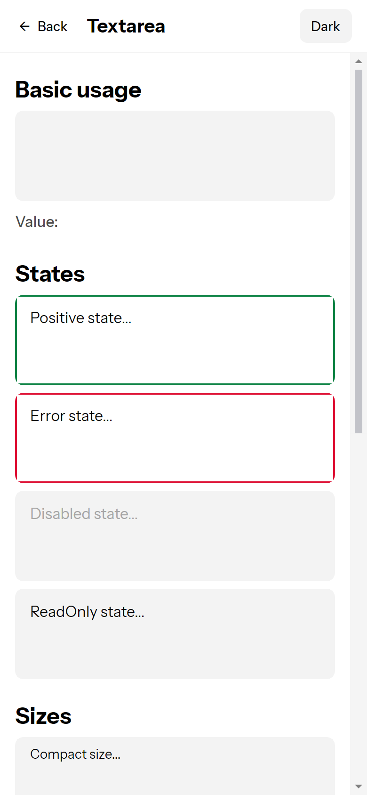
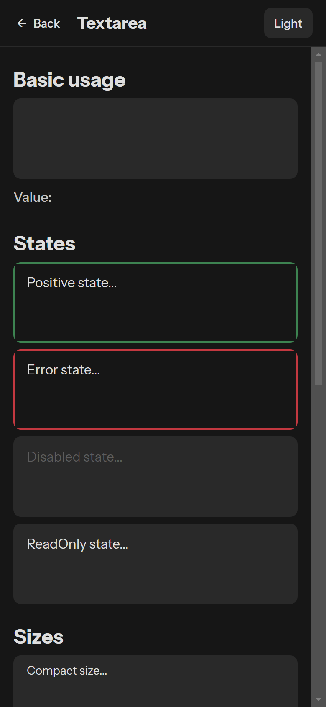
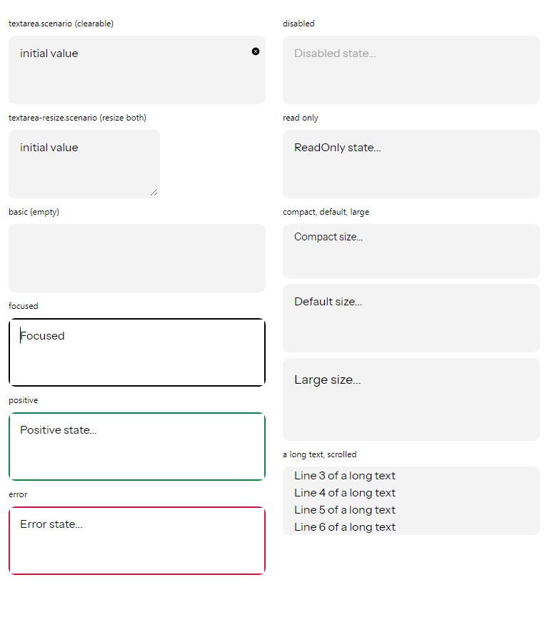
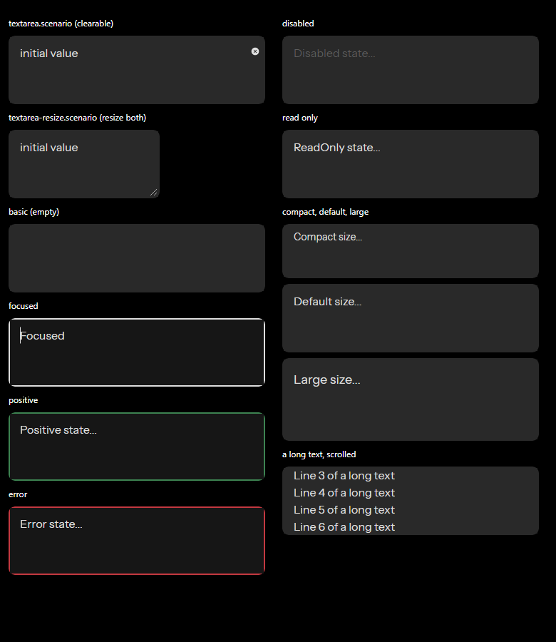

# Textarea

Base Web's `Textarea` (baseui 18.2.0, `textarea/`), as `Metered.Controls.Textarea`, on Input's `BaseInput`
([`docs/controls/Input`](../Input/README.md)), an Avalonia `TextBox` that accepts Enter and wraps its text.

The sample's page, drawn headless by `PreviewGallery` in Instrument Sans, the substitute for Uber Move Text
([ADR 0003](../../decisions/0003-font.md)). The scenarios, from `TextareaFrames`' gallery (headless):
`textarea.scenario` (clearable, with a value), `textarea-resize.scenario` (`resize="both"`, its grip in the corner), the
documentation's basic, states and sizes examples, one focused, and a long text scrolled:

## Which textarea

Read from `node_modules/baseui/textarea/` (`textarea.js`, `styled-components.js`, `types.d.ts`, `constants.js`,
`stateful-container.js`, which is Input's), the Input it renders (`input/base-input.js`, `input/styled-components.js`,
`input/utils.js`), its scenarios and tests (`src/textarea/__tests__/`: `textarea.scenario.tsx`,
`textarea-resize.scenario.tsx`, `textarea.e2e.ts`, `textarea.test.tsx`), and its documentation page, yard config and
examples (`documentation-site/pages/components/textarea.mdx`, `components/yard/config/textarea.ts`,
`examples/textarea/`) at commit `3adb0478c96569dc4e593ab39c24f36dc59e39f5`, the 18.2.0 publish. There is no
`textarea-v2`, the page has no deprecation notice, and no prop is marked deprecated.

`textarea.js` renders `StyledTextAreaRoot` round Input's `BaseInput` with `type="textarea"`, its `Input` and
`InputContainer` overridden by `StyledTextarea` and `StyledTextareaContainer`, which call Input's `getInputStyles` and
`getInputContainerStyles`. So `Textarea` derives from `BaseInput` and reuses `InputField` (as `TextareaField`),
`InputIcon` and `Input.ContextFlyout`; the clear icon, Escape, the states, the parts' guards and the overrides are
BaseInput's, unchanged.

## API

| Base Web | Metered |
|---|---|
| `value`, `onChange`, `placeholder`, `disabled`, `readOnly`, `maxLength` | `Text`, `TextChanged`, `PlaceholderText`, `IsEnabled`, `IsReadOnly`, `MaxLength` (Avalonia's) |
| `rows` (3) | `Rows`, 3; a value that isn't above 0 is HTML's 2 |
| `resize` (CSS's; unset by default) | `Resize`, a `TextareaResize?`: null (Base Web's default), `None`, `Both`, `Horizontal`, `Vertical` |
| `size` (`mini`, `compact`, `default`, `large`) | `Size`, an `InputSize`; `Default` by default |
| `error`, `positive` | `Error`, `Positive`; both draw error |
| `clearable`, `clearOnEscape` | `Clearable`, `ClearOnEscape` (true by default) |
| `overrides` (`Root`, and BaseInput's `InputContainer`, `Input`, `Before`, `After`, `ClearIconContainer`, `ClearIcon`) | `Overrides`, the same seven parts |
| `onFocus`, `onBlur`, `autoFocus`, `inputRef` | `GotFocus`, `LostFocus`, `Focus()`, the control itself |
| `name`, `id`, `required`, `aria-*` | not mapped, as Input's |

The states, set on the textarea and mirrored onto every part, are BaseInput's (`:size-*`, `:is-focused`, `:error`,
`:positive`, `:is-read-only`, `:loaded`; `:disabled` is Avalonia's), and `:resize-none`, `-both`, `-horizontal`,
`-vertical` while `Resize` is set.

## Behaviour, as Base Web's

From its style functions:

- The root: `getRootStyles` with only the root's own props (textarea.js): no `$size`, so no font and the default radius
  (8) at every size, and no `$adjoined` or trailing icon, so no padding; a 2 px border and fill by state, as Input's.
  Its width is `100%`, or the textarea's own (`fit-content`) once `resize` is set to anything, `none` too.
- The container and the textarea: Input's, by size and state; the textarea's CSS `resize` is `$resize || 'none'`.
- The clear icon's container is given `$alignTop` (base-input.js, for a textarea): its icon at the top, 12 px down
  (`sizing.scale500`), at Input's sizes.

From the browser, since Base Web renders a `<textarea>`:

- Its height is `rows` lines of its line height and its padding; its text wraps, and a long text scrolls inside it,
  under its padding (the padding is inside the scroller, as a textarea's): by the caret, the wheel and a finger.
- **A finger's (or a pen's) drag on it scrolls it, not the page round it, unless it is at its end that way when the drag starts**,
  when the drag is the page's. A drag that has moved the textarea stays the textarea's until the finger lifts, even past
  its end: a browser's scroll latching. A textarea whose text fits is the page's to drag. The caret moves by a tap, not
  by a drag (Avalonia's text box would move it by a drag, and keep the page from panning: `BaseInput`'s, Input's too, #94); after a hold,
  a drag extends the hold's selection, as the text box's. A drag is no tap: it focuses nothing, even one that nothing
  scrolls (`BaseInput`'s, #117).
- `resize`: a grip in the textarea's end corner, two strokes as Chrome draws it; a drag on it by any pointer sets the
  textarea's width and height as the way allows, within the Input part's `MinWidth`, `MaxWidth`, `MinHeight` and
  `MaxHeight` (the documentation: set by an override), never smaller than the grip. Right to left, the grip is in the
  bottom-left corner and widens it dragged outward, to the left. A press, a drag or a tap on the grip leaves the focus
  where it was, as Chrome's grip does on a desktop (Chrome on a phone draws none): it doesn't focus the textarea, so a
  finger's drag doesn't open the soft keyboard over it (#111).
- Where nothing stretches it (its root `fit-content`), its width is a browser's for HTML's 20 columns (Base Web gives no
  `cols`): Chrome's 20 times the font's average character width (its `OS/2` table's `xAvgCharWidth`, rounded to a pixel)
  and its padding, with no scroll bar's width, as on a phone.

From its e2e test: the preset value is shown; typing after a click adds to it; the clear icon's click and Escape clear it.

## Held by

- `Controls/TextareaColourTests`: 26: 11 states, light and dark, every part's colours, the caret's, the placeholder's and
  the cursor; and the clear icon's outline with and without keyboard focus (4).
- `Controls/TextareaLayoutTests`: 24: the four sizes × resize unset, `none`, `both`, `horizontal`, `vertical`, and rows 1,
  2, 5 and 0: the root's border, radius, padding and width (and no font), the container's and the textarea's fonts, the
  textarea's padding, resize and height, the text inside the padding, the grip, the clear icon at the top.
- `Controls/TextareaTests`: Base Web's defaults; the parts it renders and their labels (16); typing, Enter, wrapping; a
  long text scrolled by the caret and the wheel, under the padding; rows; a finger's drag in a page that scrolls (it moves
  the textarea, not the page; latched past its end; the page's at its top, when it turns, or when the text fits); a drag
  that nothing scrolls focusing nothing; `ScrollViewer.IsScrollChainingEnabled` reaching its text's scroller; a tap's caret; the clear
  icon and Escape; maxLength; `:resize-*`; the grip by mouse and finger, within its bounds and a narrower space later, leaving the focus where it was,
  right to left, hidden when it doesn't resize; a layout that settles; the shared menu,
  and a long press on another textarea leaving the first with no selection or handles (#109);
  its 20 columns against the font file; overrides; the icon's path; transitions after load; UI Automation.
- `Controls/TextareaFrames`: the drawn border, fill and focus ring, the clear icon at the top, text drawn in the padding
  when scrolled, the grip, and the gallery above.
- `Sample/TextareaPageTests`: the sample's page, 4, a finger's tap and typing, and a drag on its long text.

The part themes are generated (`tools/tokens/textarea.js`): textarea.js's styled components and BaseInput's clear icon,
evaluated on Base Web's theme with each colour replaced by its own name for every combination of size, resize, focus,
disabled, error, positive and keyboard focus, through Input's generator (`tools/tokens/input.js`'s `parts` and `themes`),
written as the fewest layered styles and checked against Base Web's for each combination. The oracle
(`tools/reference/textarea.js`) renders Base Web's own Textarea (react-dom/server) with every part overridden by a
recorder, on the real light and dark themes.

## Known differences

1. **No scroll bar.** A phone's browser draws its scroll bar over the text while it moves; Metered draws none. A desktop
   browser's takes room beside the text; Metered's textarea doesn't.
2. **The grip is Metered's drawing of a browser's**, 16 px, in `colors.contentTertiary`: Base Web has none of its own.
   Chrome on a phone may draw none; Metered draws it wherever `resize` drags.
3. **The grip keeps the textarea within its room.** A browser lets a resized textarea overflow its parent; here the root
   would clip it, grip and all, so it stops at the width the textarea is given, and a width dragged to shrinks with a
   narrower space later (a phone turned upright).
4. **A press anywhere on it focuses it**, as Input's (its known difference 1): the clear icon's container is inside the
   text box's template.
5. **Its 20 columns' width is Chrome's rule**, read from the font's OS/2 table (Instrument Sans here, Uber Move on
   baseweb.design), and only where the root is `fit-content`; with no OS/2 width, the width of `0`.
6. **Tried on a Pixel 8** (Android 17 (API 37), Gboard, Release, 2026-11-21, #90). Enter on the soft keyboard makes a new line;
   a finger's drag in a long text scrolls the text, not the page; the resize grip resizes it under a finger. One problem of its
   own: dragging the grip also focused the textarea and opened the keyboard (#111: fixed since, headless only, by mouse and
   real touch; not tried on the phone again). Not checked there: Input's findings
   (#108 to #110), the latch at a long text's end, a fling, the clear icon under a finger, and a hold and the drag after
   it (holding isn't raised headless, so that drag is untested). The real-window run (2026-11-21) has a check of the latch
   under Windows' injected touch; its first run's drag fell short of the text's end (the script's, fixed), and it hasn't run since.
7. **Transitions start after load**, as on every Metered control.
