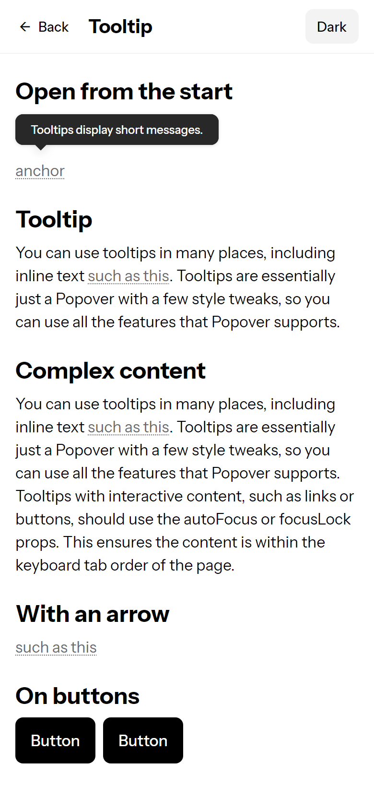
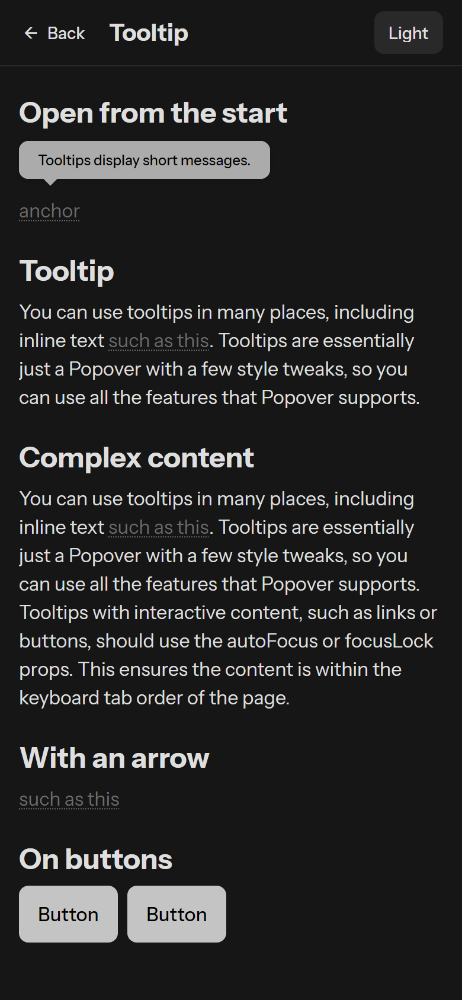
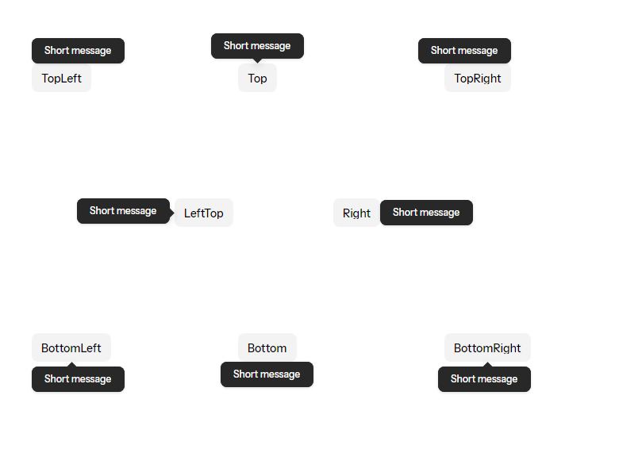
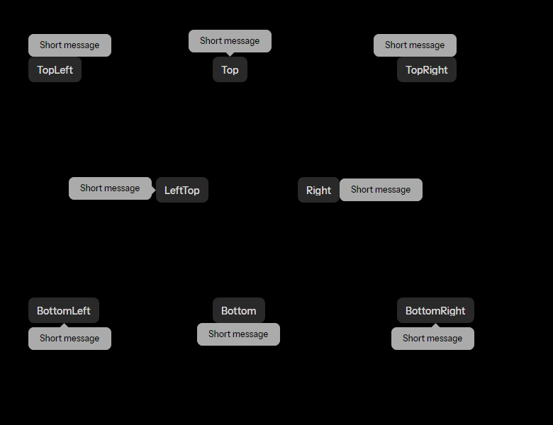

# Tooltip

Base Web's `Tooltip` and `StatefulTooltip` (baseui 18.2.0, `tooltip/`), as one `Metered.Controls.Tooltip`: Base Web's
tooltip is its Popover with its own defaults and its own look, and Metered's is a `Popover`
([docs/controls/Popover](../Popover/README.md)) with the same: everything else, its anchoring, its layers and their
dismissal, the window's safe area, a finger's tap, Back, focus and UI Automation, is the Popover's.

The sample's page, drawn headless by `PreviewGallery` in Instrument Sans, the substitute for Uber Move Text
([ADR 0003](../../decisions/0003-font.md)). Tooltips at the placements, every other one with its arrow, from
`TooltipFrames`' gallery (headless):

## Which tooltip

Read from `node_modules/baseui/tooltip/` (`tooltip.js`, `stateful-tooltip.js`, `stateful-tooltip-container.js`,
`default-props.js`, `styled-components.js`, `constants.js`, `types.d.ts`), the popover they render (`popover/popover.js`,
`popover/stateful-container.js`, `popover/styled-components.js`, `popover/default-props.js`), the tooltip's scenarios and
tests (`src/tooltip/__tests__/`: `tooltip.scenario.tsx`, `tooltip-arrow-margin.scenario.tsx`, `tooltip-complex.scenario.tsx`,
`tooltip-interactive-element.scenario.tsx`, `tooltip.e2e.ts`, `tooltip.test.tsx`, `stateful-tooltip.test.tsx`) and its
documentation page and examples (`documentation-site/pages/components/tooltip.mdx`, `examples/tooltip/`, the yard's
`config/tooltip.ts`) at commit `3adb0478c96569dc4e593ab39c24f36dc59e39f5`, the 18.2.0 publish. There is no `tooltip-v2`,
the page has no deprecation notice, and no prop is marked deprecated. Its types are the popover's (`types.ts`), and its
`PLACEMENT`, `TRIGGER_TYPE` and `ACCESSIBILITY_TYPE` are the popover's: Metered's are `PopoverPlacement`,
`PopoverTriggerType` and `PopoverAccessibilityType`.

## What is the tooltip's own

- **Its defaults** (`default-props.js`, `Tooltip`'s and `StatefulTooltip`'s both): a hover trigger, the accessibility
  type `tooltip`, a `popoverMargin` of 0, no `autoFocus` (`tooltip.js` also renders the Popover with `autoFocus: false`
  under the props), no `returnFocus`; the rest as the popover's (no focus lock, no arrow, `auto`, the 200 ms delays).
  React fills what they leave from StatefulPopover's container (`dismissOnClickOutside` and `dismissOnEsc`, true) and
  from Popover's (`ignoreBoundary`, false). `Tooltip` sets them with `OverrideDefaultValue`; any of them can be set.
- **Its look** (`styled-components.js`, each the popover's style function with the tooltip's values over it):
  - `Body`: `getBodyStyles` in `tooltipBackground`, `radius300`, `shadow400`, `tooltipText`. Its `transitionProperty` is
    `opacity` alone and its `transform` `getEndPosition` in every state, so it fades in and out where it is placed and
    never slides from towards its anchor as a popover's does. Its margin (`getPopoverMarginStyles`: `ARROW_SIZE` with the
    arrow, plus `popoverMargin`) and a hover body's 0.1 s of not taking the pointer are the popover's.
  - `Arrow`: `getArrowStyles` in `tooltipBackground` (its shadow still `shadow600`, its 9 px box, its place the
    popover's).
  - `Inner`: `getInnerStyles` in `tooltipBackground`, `radius300`, `tooltipText`, padding `scale300` by `scale600` (8
    by 16) and `font150` (12 px on 16, medium).
- **Its accessibility**: `role="tooltip"` and `aria-describedby`, the popover's for the type `tooltip`: the body is a
  tooltip to UI Automation, and its text the anchor's help text while it is open (Popover, known difference 5). Neither
  `autoFocus` nor `focusLock` is a tooltip's (`popover.js`), whatever they say.

## Built on the Popover

`Tooltip : Popover` takes a constructor of the Popover's that names its parts' themes, so its `Body`, `Arrow` and
`Inner` take `Tooltip.Styled{Part}` (`Tooltip.Parts.g.axaml`, generated by `tools/tokens/tooltip.js` from the tooltip's
style functions with `popover.js`'s helpers), and an override of a part is merged over the tooltip's theme (ADR 0001).
Its template, `Tooltip.axaml`, is the Popover's structure; its style key is its own, so a style for `b|Popover` isn't a
tooltip's. Its body doesn't slide: the Popover gives it no start (`BodySlides`), and its exit's transition, at an
`AnimateOutTime`, is its opacity's alone.

What it adds to Base Web's look: `Inner`'s text wraps (`TextWrapping`), as CSS's `white-space: normal` wraps it in a
browser, so a long tooltip stays inside the window (known difference 3).

## Behaviour

The Popover's (its README's **Behaviour, as Base Web's**) at the tooltip's defaults: a mouse resting on the anchor opens
it after 200 ms and leaving closes it 200 ms later unless the mouse reaches the body; keyboard focus on the anchor (Tab)
opens it and focus leaving the anchor closes it (`autoFocus` false); Escape closes it; a click on the anchor does
nothing. **Touch first:** a finger never hovers, so a finger's or a pen's tap on the anchor toggles it, and a tap
elsewhere closes one a tap opened (Popover, known difference 2, #123); Avalonia's back request closes it before the
app goes back (Popover, known difference 12).

## Held by

- `Controls/TooltipColourTests`: Body's, Arrow's and Inner's fill, radius, shadow and text colour, Inner's padding and
  font, light and dark (`tooltip.oracle.json`); a string's text in Inner's font and colour; the fade in over 0.1 s on
  `easeOutCurve` of the opacity alone and none before or at the exit (the 16 motion cases, each `opacity` alone); the exit
  at an `animateOutTime`, its opacity alone; a hover body's first 0.1 s.
- `Controls/TooltipLayoutTests`: the body and the arrow drawn where popper.js puts them at a margin of 0 (26 cases of
  `tether.g.json`'s, popper.js itself: the anchors in the middle and in a corner it must flip from, each placement, with
  and without the arrow), Inner's padding round the content; every margin case (72: `getPopoverMarginStyles`) and its
  start its end; the body not moving as it fades in and out (a popover's does); a long text wrapped inside the window.
- `Controls/TooltipTests`: the defaults as StatefulTooltip resolves them, and a Tooltip's; its parts and their themes
  (a style for Popovers not applied); overrides of the three parts; a mouse's hover and the delays; a click not toggling
  it; a tap toggling it and a tap elsewhere closing it; keyboard focus and the blur; Escape and Back; no focus taken nor
  locked, where a popover's takes it; UI Automation.
- `Controls/TooltipFrames`: the body, its text and the arrow's tip drawn in Base Web's colours, light and dark; the
  gallery above.
- `Sample/TooltipPageTests`: the page's place (154, after Menu, before the theme), its examples as set, a tap toggling
  a tooltip and a tap elsewhere closing it, Back closing the open one before the shell goes back.
- What the tooltip shares with the Popover unchanged is held by the Popover's tests.

## Known differences

1. **Controlled and stateful are one**, as the Popover's (its known difference 1): Base Web's controlled `Tooltip` has no
   dismissal unless it is given `onClickOutside` or `onEsc`; Metered's has StatefulTooltip's, `DismissOnClickOutside`
   and `DismissOnEsc` true, which false turns off.
2. **The Popover's differences are the tooltip's**: a tap toggling it (2), the page's scroll (3), focus given back (4),
   the anchor's help text (5), the window's overlay layer (7, 8), what isn't ported (9: `renderAll`, `popperOptions`,
   `stateReducer`, `mountNode`, `id`, `data-baseweb`), the margin placed at once (11) and Back (12).
3. **A long text is as wide as its widest line.** Inner's text wraps at the room it has, as a browser's. But a browser's
   body, a block, takes all the room once its text wraps, where Avalonia's text block is as wide as its longest line: six
   of the documentation's message (`Tooltips display short messages.`) in the 390 px window measure 365 px, where a
   browser's would be 390. Forced: Avalonia measures text by its lines.
4. **The sample's inline anchors** (`stateful.tsx`, `stateful-complex-content.tsx`, a `span` in a line of text): the
   text round them is a `WrapPanel` of its words, so the anchor flows in it as a span does. Avalonia's `InlineUIContainer`
   puts an inline control's foot on the line's baseline, raising the anchor's text by its descent and the line's height;
   `TextBlock.BaselineOffset` on it changed nothing (12.1.4, measured in a headless frame). Forced. The complex content's
   `StyledLink` is an Avalonia `HyperlinkButton` in `linkText`, underlined, in Base Web's dark theme by `ThemeProvider`:
   Metered has no Link yet.
5. **The sample's first example**, open from the start, has `stateful-tooltip.test.tsx`'s props (`initialState` open,
   `topLeft`, `popoverMargin` 8, the arrow) with the documentation's message: the documentation has no open example, and
   the page's pictures would show no tooltip without one.
6. **Not tried in a real window or on a phone**: built and tested headless only (#161).
